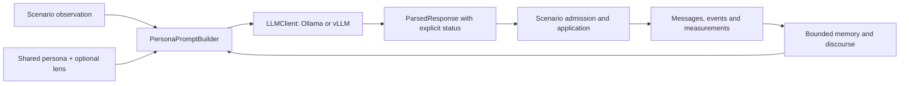

# Agent and team boundaries

Agents propose and explain; deterministic scenario code decides what can execute and what evidence establishes. Do not give an LLM authority to rewrite acceptance requirements or declare a physical pass.

## Shared primitives

[core/agents/base.py](https://github.com/hirototamura/engineering_agents/blob/main/src/core/agents/base.py) defines a `Team` with `run_step(context, observation)` and `apply_outcome(context, outcome)`. Context and outcome types remain scenario-dependent. `Persona`, `DeliberationContext`, and `PersonaAgent` support identity, reasoning style, prompt construction, and parsed responses; they are not a universal multi-agent scheduler.

`core/agents/types.py` supplies messages and scrubber-oriented observations/outcomes. Messages carry roles, type, reasoning, and metadata. A thinking trace is diagnostic evidence about the call; it is not the verifier's verdict. `core/agents/memory.py` bounds shared discourse and per-agent recent memory.

[core/llm/factory.py](https://github.com/hirototamura/engineering_agents/blob/main/src/core/llm/factory.py) constructs Ollama or vLLM clients. `LLM_PROVIDER` overrides the configured provider. Provider-specific URL, model, context, timeout, concurrency, and thinking behavior live in the respective clients. Keep transport errors and parse outcomes observable when changing prompts.

## Message and response flow



[parsing.py](https://github.com/hirototamura/engineering_agents/blob/main/src/core/llm/parsing.py) strips supported thinking tags for JSON extraction and searches for the last balanced object, respecting quoted braces. `ParsedResponse` retains diagnostics; callers decide required fields and substitutions.

| Parse status | Meaning | Regression obligation |
| --- | --- | --- |
| `ok` | Object parsed with the caller's required fields | Still apply the scenario's command/design validation |
| `partial` | A required field is missing or an alias was used | Retain the status and any substituted behavior |
| `fallback` | JSON could not be parsed into the expected object | Do not count substituted actions as successful model decisions |
| `empty_response` | Empty or whitespace response | Preserve provider/parse diagnosis |

`AgentMessage.to_dict()` flattens metadata into the JSONL object. When adding a metadata key, avoid colliding with `step`, roles, `message`, `message_type`, or `reasoning`; the current `update()` permits metadata to overwrite them. A constructed message example is:

```json
{"step": 4, "from_role": "engineer_1", "to_role": "team", "message": "Inspect the recorded margin before acting.", "message_type": "comment", "reasoning": "", "deliberation_phase": "deliberation", "parse_status": "ok"}
```

## Reusable thinking lenses

`load_team()` validates names and `build_personas()` assigns lenses round-robin to agent IDs, prepending a lens to the shared persona. Empty lenses preserve a homogeneous persona. These are reasoning prompts, not fixed engineering roles or pass/fail authorities.

| Lens in `ARCHETYPE_LENSES` | Intended question |
| --- | --- |
| `first_principles` | Can the mechanism be reconstructed from physical facts? |
| `failure_mode` | Which secondary failures and worst cases remain? |
| `improviser` | What smaller intervention uses existing resources? |
| `systems_integrator` | Which subsystem coupling changes the conclusion? |
| `rederive_numbers` | Can each quantity be independently rebuilt? |
| `break_conclusion` | What would falsify this emerging claim? |
| `avoid_local_optima` | Is the team repeating a narrow local adjustment? |
| `design_validity` | Is the proposed machine buildable and operable? |

The exact text and name validation are owned by [persona.py](https://github.com/hirototamura/engineering_agents/blob/main/src/core/agents/persona.py). Scenario-specific application of lenses, representative rotation, and audits belongs below.

## Scenario ownership

- Scrubber's `scenario/agents/scrubber_degradation_team.py` proposes recovery commands, applies them through the simulator, and produces post-run design proposals.
- SSOS separates the runtime `SsosEclssLoopTeam` from `PostRunDesignAgent` and the tool-use designer. `agent_config.py` resolves actor/design modes independently. Candidate evaluation remains in scenario tools and evaluators.
- Cube's `workflow.py` orchestrates specialist, critic, and synthesis work inside its design loop. The adapter compiles and evaluates proposals. It does not use the shared step-team interface.

Fallback semantics also differ: the SSOS tool-use designer can preserve measured candidates and use a labeled deterministic fallback; cube provider failure stops its campaign as inconclusive rather than silently becoming a rule-based LLM result.

Before changing an agent, identify the owner of command admission, evidence, and final selection. Check persona and provider tests in `tests/core`, the relevant team tests in `tests/scenario`, and `test_llm_parallel_deliberation.py` or `test_balancing_cube_workflow.py` when changing concurrency. Add prompt budget coverage when increasing injected context. See [tools and memory](tools-memory.md) for evidence access.
