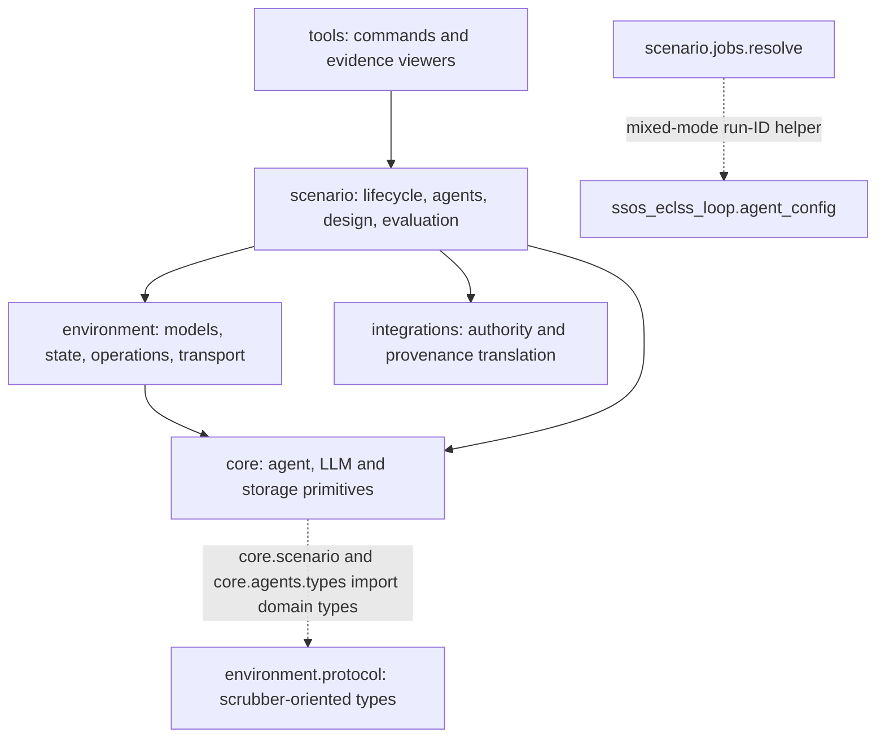

# Architecture and ownership

The framework coordinates engineering work; each scenario owns the meaning of its world and evidence. The intended dependency direction is `tools → scenario → environment → core`; scenarios call `integrations/one_piece` for records and authority. Keep LLM calls, personas, and policy decisions out of simulator implementations.

## Intended layers and current coupling

The solid arrows below express the intended import direction. Dashed arrows identify current exceptions in shared type modules; they are not extension interfaces or permission to add upward imports.

Source checkpoints are [core/scenario.py](https://github.com/hirototamura/engineering_agents/blob/main/src/core/scenario.py), [core/agents/types.py](https://github.com/hirototamura/engineering_agents/blob/main/src/core/agents/types.py), and [scenario/jobs/resolve.py](https://github.com/hirototamura/engineering_agents/blob/main/src/scenario/jobs/resolve.py). Extracting domain-neutral contracts is future work; an architecture diagram must not hide this existing coupling.

## Locate concrete contracts

The environment layout, simulator classes, and agent/evaluation flow are defined under each [scenario implementation](scenarios/index.md). Keep those detailed contracts with their domain rather than expanding a shared comparison matrix. A filename such as `design_proposals.json` does not establish a shared domain schema; neither the abstract `Scenario` nor `Team` currently describes every concrete runner or workflow.

## Where a change belongs

- `tools/cli` translates commands into run or mechanical-job inputs. `tools/analysis`, dashboards, and report builders inspect evidence.
- `scenario/jobs` owns serializable run requests, dispatch, output resolution, and SSOS chain orchestration.
- `scenario/<name>` owns configuration interpretation, lifecycle, design variables, evaluation, and scenario-specific contracts. `scenario/agents` implements the scrubber and SSOS teams.
- `environment` owns model state, physical or mock transitions, backend operations, units, and telemetry boundaries.
- `core/agents`, `core/llm`, `core/event_log.py`, and `core/storage` provide shared agent, provider, and persistence primitives.
- `integrations/one_piece` translates provenance and resolves the cube's authoritative revisioned context.

This is an ownership rule, not a claim that every current type is domain-neutral. For example, `environment/protocol.py` contains scrubber-specific telemetry and commands; `core/scenario.py` and `core/agents/types.py` import environment types. [SSOS](scenarios/ssos_eclss_loop/implementation.md) uses its own backend protocol, and [balancing cube](scenarios/balancing_cube/implementation.md) has a separate design adapter.

## Current coupling

[scenario/runner.py](https://github.com/hirototamura/engineering_agents/blob/main/src/scenario/runner.py) scans directories containing `scenario.yaml` for listings, but execution uses a fixed merge of three registries. [execute_run](https://github.com/hirototamura/engineering_agents/blob/main/src/scenario/jobs/executor.py) and the CLI have explicit SSOS and cube branches. The abstract `Scenario` class does not express every argument those branches use, and the cube runner does not inherit it.

Adding a directory therefore does not complete a new runnable scenario. Follow [add a scenario](guides/add-scenario.md); do not present the current registry as an external plugin system. The [external scenario development plan](development/external-scenarios.md) assigns the work needed to reduce this coupling without imposing one domain's types on another.
