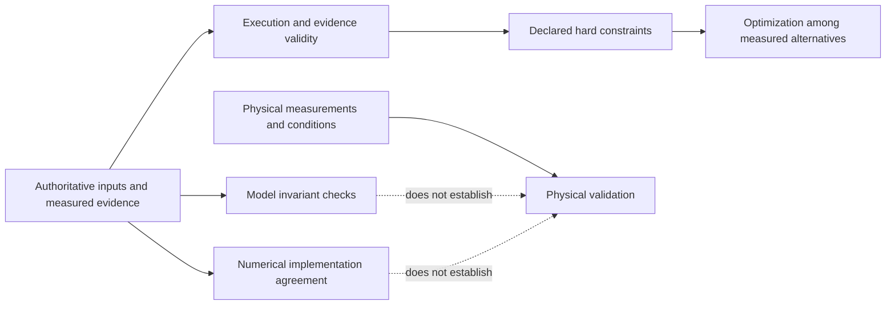

# Evaluation responsibilities

Evaluation has several independent questions. A hard constraint asks whether a design is admissible. An optimization score ranks admissible measured outcomes. Model verification checks the implemented model's invariants. Numerical agreement compares implementations under stated conditions. Physical validation needs evidence from the physical system. Keep these claims separate in code, summaries, and reports.

## Separate the questions before combining results

This is a reasoning map, not one implemented evaluator pipeline. Each scenario defines how these checks interact.

| Question | Typical input | What the result can establish | What remains separate |
| --- | --- | --- | --- |
| Was execution complete? | Summary, trial keys, duration, errors | A specified computation finished | Engineering requirements met |
| Is evidence admissible? | Integrity, required telemetry, provenance | A comparison has the required basis | A high objective value |
| Are requirements met? | Frozen criteria and measured values | The declared checks passed | Model fidelity to hardware |
| Which design is preferable? | Declared objective and comparable outcomes | Ranking under that objective | Reliability outside tested conditions |
| Do implementations agree? | Paired trajectories and tolerances | Numerical agreement in the declared scope | Physical validation |
| Does the model match reality? | Calibrated physical measurements | The tested physical validation claim | Unobserved operating regimes |

## Current owners

[Scrubber evaluation](scenarios/scrubber_degradation/evaluation.md) is recovery telemetry and deterministic health classification in the mock station loop. There is no shared project-wide score or physical validation claim.

[SSOS evaluation](scenarios/ssos_eclss_loop/evaluation.md) consumes persisted configuration, telemetry, events, and summary. `unified_evaluation.finalize_run_evaluation()` runs before post-run design, writes one evaluation and physics gate, and adds compact fields to the summary. Integrity and physics admissibility can invalidate an otherwise high score. Candidate selection and chain final-answer selection are separate consumers of measured evidence.

[Cube evaluation](scenarios/balancing_cube/evaluation.md) screens complete fixed trial matrices against the SSOT contract. Its objective ranks candidates, while CPU/GPU agreement is a separate claim. Missing GPU execution cannot become GPU verification, and numerical agreement cannot become physical validation.

## Changes that preserve reviewability

Trace every check to its input artifacts or authoritative contract. Define missing, non-finite, incomplete, and non-applicable behavior before the pass case. Keep requirements fixed during a comparison. If a supervision decision revises requirements, record a new basis rather than silently improving a historical score.

LLM prose may explain a failed check, propose a design, or suggest a requirement revision. It does not supply a deterministic verdict. Viewers and reports display recorded evaluation; they must not substitute a new untracked scoring rule.

Use [change evaluation](guides/change-evaluation.md) for implementation steps. Test threshold edges, missing evidence, invalid integrity, ranking ties, and preservation of selected-candidate provenance. Existing dated reports describe their recorded conditions; a documentation reorganization does not justify regenerating or rescoring experiments.
