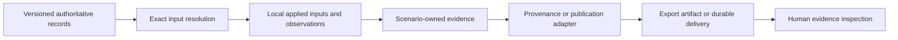

# Records and integrations

Recorded evidence connects requirements, applied design, observations, and decisions. Storage helpers do not by themselves establish authority: that boundary belongs to the scenario and its integration.

## Local evidence

`EventLog` writes named append-only JSONL streams during a run; summaries and named JSON artifacts are separate writes. Effective configuration snapshots are written after overrides and, for SSOS, proposal application. Keep the consumed proposal distinct from a newly emitted one. See [storage contracts](reference/storage.md) for API behavior and [user artifact reference](../users/reference/artifacts.md) for interpretation.

`core/storage` provides artifact access, per-agent sessions, and a claims registry. The claims registry retracts losing recommendations and can detect unqualified references to them in prose. It checks selected phrases; it is not a semantic proof of document consistency. Losing proposals must remain inspectable as rejected evidence without appearing as adopted advice.

## Authority and delivery are different contracts

The arrows show information ownership, not a universal connector implementation. ECLSS provenance export and cube SSOT resolution/delivery are separate mechanisms.

| Boundary | Required identity | Failure question |
| --- | --- | --- |
| Resolve authoritative inputs | Record ID, revision, referenced contract | Did a missing or mismatched revision stop execution? |
| Record a measurement | Applied input and source artifact | Can a reader identify what actually ran? |
| Project agent context | Source revisions plus documented omissions | Can excluded or compacted data still be inspected in full? |
| Deliver evidence | Exact record revision and artifact digest | Can retry preserve the same content and identity? |
| Render a report | Recorded result and stated scope | Is display adding an untracked evaluator? |

Provenance event mappings are documented with their owning [scrubber](scenarios/scrubber_degradation/implementation.md) and [SSOS](scenarios/ssos_eclss_loop/implementation.md) implementations. The exact-record outbox belongs to [cube](scenarios/balancing_cube/implementation.md).

## One Piece boundaries

[integrations/one_piece/client.py](https://github.com/hirototamura/engineering_agents/blob/main/src/integrations/one_piece/client.py) builds local provenance from recorded events, messages, and design states for scrubber and SSOS. Their runners catch export errors, log a warning, and retain the run with a provenance record count. A completed simulation therefore does not imply successful provenance export.

[MechanicalBridge](https://github.com/hirototamura/engineering_agents/blob/main/src/integrations/one_piece/mechanical_bridge.py) resolves cube inputs from exact project, snapshot, and record revisions. The cube must not copy authoritative model or requirements into local defaults. Agent context is a projection of revisioned data, with exclusions and source references retained. A changed snapshot requires a new run.

`MechanicalOutbox` records pending publication and artifact references for retry. Cube synchronization failures stop further design or make final delivery inconclusive, while preserving local retry evidence. The executor does not modify a synchronized mechanical summary just to acknowledge its publication; final delivery status is reported separately.

When changing integration behavior, preserve identity, revisions, digests, source links, and retry idempotence. Use `tests/integrations/test_one_piece_recovery_provenance.py`, `test_balancing_cube_import.py`, and the bridge/synchronization regressions in `tests/scenario/test_balancing_cube.py`. Historical imports and analysis reports remain separate from current authoritative inputs.
