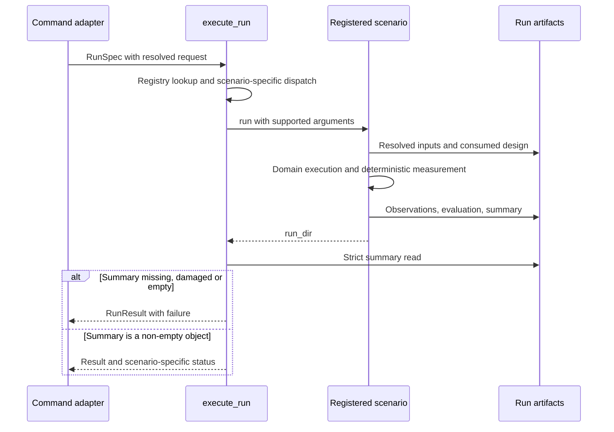

# Execution lifecycle

The lifecycle makes a proposed design, the design actually simulated, and its measured outcome distinguishable. Configuration and command syntax are described in the [user configuration reference](../users/reference/configuration.md); this page explains the implementation sequence.

## From command to evidence

1. `tools/cli/commands/run.py` resolves scenario-specific modes and CLI defaults, merges overrides, performs relevant preflight checks, and creates a `RunSpec`. Cube requests take the mechanical command path.
2. `scenario/jobs/executor.py` resolves the fixed registry and dispatches. SSOS receives proposal adoption, design history, and progress callbacks. Cube receives its SSOT-driven loop and never recreates evidence directories.
3. The scenario resolves inputs before stepping. SSOS applies accepted proposal fields to in-memory configuration, normalizes actor/design settings, validates the design-constraint configuration, and saves effective inputs and integrity classification. Cube loads an exact SSOT snapshot and compiles allowed proposals.
4. The scenario advances the backend, observes telemetry, runs its team or design loop, and writes evidence. Runtime recovery operations and permanent design proposals remain separate.
5. Scenario-owned deterministic evaluation measures the relevant evidence. SSOS evaluates the completed run before post-run design; cube evaluates a frozen trial matrix for each compiled candidate. Scrubber records recovery metrics rather than sharing those scorecards.
6. The executor requires a non-empty JSON object in `summary.json`. A missing or damaged summary is a failed execution, not an empty success.

## Lifecycle handoffs

This sequence shows shared job responsibilities. The scenario box deliberately hides domain operations; their order is defined by the scenario pages, not by a universal loop.

| Handoff | Required invariant | Failure that a change must preserve |
| --- | --- | --- |
| Command → job | Resolved modes and supported input combinations | Unsupported requests fail before expensive execution |
| Job → scenario | Only the branch's supported arguments are passed | An unused `RunSpec` field is not implied support |
| Scenario → storage | Applied inputs remain distinguishable from future proposals | A preview or unexecuted proposal cannot become measured evidence |
| Storage → result | A persisted non-empty summary exists | Missing evidence cannot become `{}` success |
| Result → viewer | Execution and engineering verdict remain separate | Exit code zero cannot be relabeled as physical acceptance |

## Iteration is scenario-specific

`scenario/jobs/iterate.py` supports SSOS only. Run N verifies the proposal applied from the previous run. The final newly generated proposal has not flown. Requirements hashes must stay fixed; paired replays disable design. Final-answer selection considers machines actually simulated, rather than automatically naming the last proposal.

Cube's `loop.py` owns its rounds, candidate and wall budgets, deduplication, factorial mechanical/control comparisons, and fixed-context guards. Scrubber emits a post-run proposal but does not feed that proposal into a next simulation. See the [scenario implementation pages](scenarios/index.md) before changing iteration semantics.

Regression entry points: `test_run_spec.py`, `test_iterate.py`, `test_chain_final_answer.py`, `test_write_effective_configs.py`, and `test_balancing_cube.py` under `tests/scenario`. Failure and exit semantics are detailed in [execution contracts](reference/execution.md).
