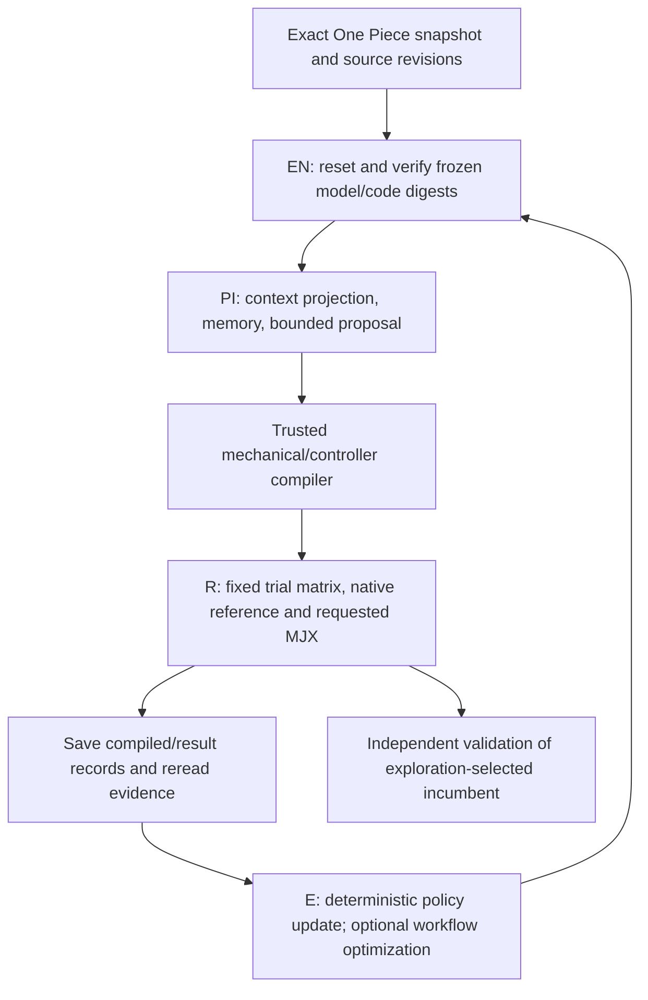
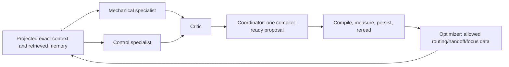
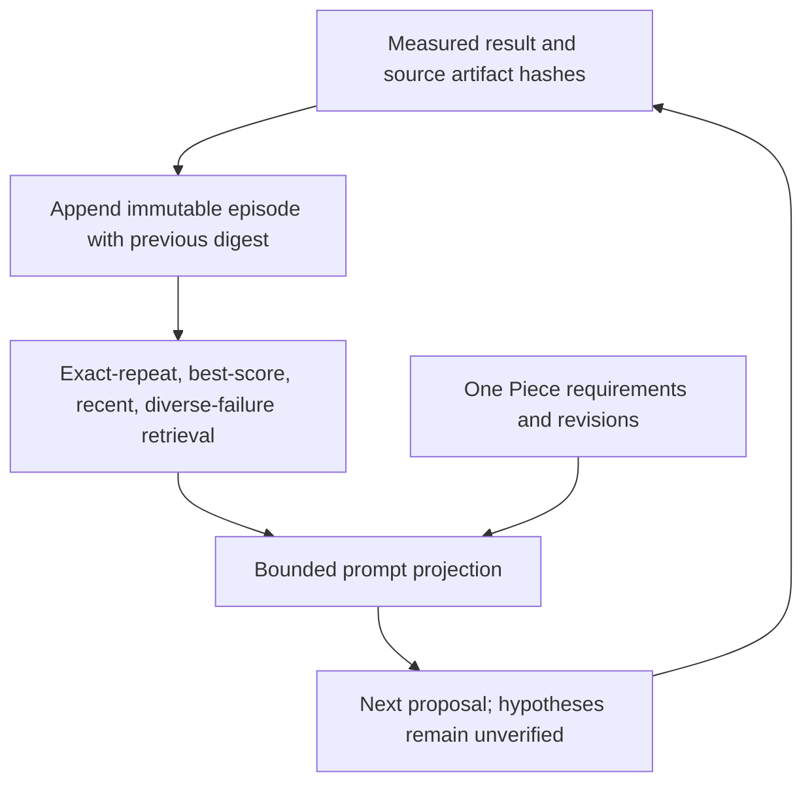
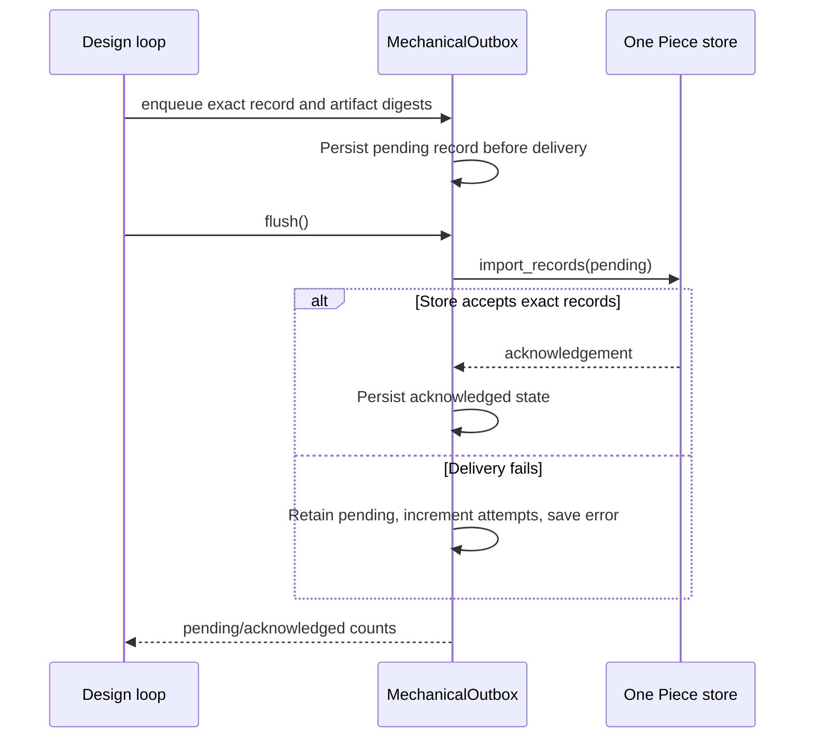

# Cube implementation

The [scenario runner](https://github.com/hirototamura/engineering_agents/blob/main/src/scenario/balancing_cube/scenario_run.py) requires a configured One Piece store and exact snapshot identity. `MechanicalBridge` verifies store integrity, resolves exact requirement/KDP/model references, and retains comparison/controller design-plant provenance. `BalancingCubeAdapter` freezes the resolved data and code digests. A changed context revision requires a new run.

## EN → PI → R → E data flow

The original mechanical walkthrough separates the fast physical controller from the slower engineering loop. These are executable ownership boundaries, not four autonomous agents.



| Stage | Main responsibility | Inspectable output |
| --- | --- | --- |
| EN | Snapshot/code immutability and reset | `frozen-snapshot.json`, `environment.json` |
| PI | Exact context plus allowed-variable proposal | `round-NN/ssot-context.json`, `prompt-data.json`, `proposal.json` |
| R | Compile and measure cases under the frozen contract | `candidates/candidate-NNN/compiled.json`, `result.json` |
| E | Update bounded search policy and optional routing data | Round policy/workflow artifacts and `stage_sequence` |

The feedback controller executes inside each rollout using frozen numerical gains. The LLM proposes a configuration between complete experiments; it does not choose motor torques on each control tick.

## Compiler contract and dependent quantities

A non-reference candidate must have a registered snapshot family, exactly the six mechanical keys below, and a nonempty `id`/`hypothesis`. Optional controller edits are limited to four allowlisted keys. The snapshot can tighten compiler bounds, not expand them.

| Mechanical key | Derived effect |
| --- | --- |
| `side_m` | Body scale, wheel radius, frame inertia |
| `print_mass_ref_kg` | Printed mass scaled from the reference side |
| `wheel_mass_kg` | Annular wheel and rotating inertia |
| `wheel_radius_ratio` | Outer radius relative to side |
| `inner_radius_ratio` | Inner radius relative to outer radius |
| `wheel_thickness_m` | Transverse inertia and geometric thickness |

Using `s` for side, `m` for wheel mass, `r = s × wheel_radius_ratio`, `rᵢ = r × inner_radius_ratio`, and thickness `t`, the implemented relationships include:

```text
printed mass = print_mass_ref_kg × (s / 0.18)³
frame mass   = 3 × (motor total mass − rotor mass) + other fixed mass + printed mass
I_axial      = ½ m (r² + rᵢ²) + rotor axial inertia
I_transverse = ¼ m (r² + rᵢ²) + m t²/12 + rotor transverse inertia
I_frame      = frame mass × s²/6, for each body axis
```

The compiler checks wheel clearance and `2 × I_transverse ≥ I_axial`. Thickness at fixed mass and radii changes the transverse term; it does not enter the axial annulus term. These formulas are model assumptions in [design.py](https://github.com/hirototamura/engineering_agents/blob/main/src/scenario/balancing_cube/design.py), not measured motor or manufactured-part identification.

Controller edits are `tilt_q_scale`, `rate_q_scale`, `momentum_q_scale`, and `yaw_rate_gain_nm_s`. The compiler keeps R fixed and derives K from the declared frozen design plant. Repeating saved settings returns the exact saved controller rather than resolving LQR and changing floating-point bits.

Constructed compiler input, valid only for a snapshot that declares this family and compatible bounds:

```json
{"id":"geometry-test","family":"dc_rs385","parameters":{"side_m":0.18,"print_mass_ref_kg":0.12,"wheel_mass_kg":0.05,"wheel_radius_ratio":0.30,"inner_radius_ratio":0.80,"wheel_thickness_m":0.006},"control":{"tilt_q_scale":1.0,"rate_q_scale":1.0,"momentum_q_scale":1.0,"yaw_rate_gain_nm_s":0.03},"hypothesis":"Test this allowed configuration against the frozen comparison."}
```

`input_digest` hashes compiled configuration, controller, and snapshot digest. `campaign_id` identifies the controller. Labels and persuasive prose cannot substitute a changed compiled input.

## Compile, execute, and retain evidence

`design.py` accepts allowed mechanical/control fields and rejects verifier, reset, sensor, timing, and model-code edits. Compilation recomputes dependent mechanical quantities and control settings under the declared bounds. A retained controller can keep its declared design plant even when simulated mechanics change; that provenance must not be silently rewritten.

`loop.py` first evaluates the frozen numerical reference. Each new compiled input digest is evaluated once. Mechanical and controller changes together require all four factorial cells, with separate controller campaigns; an incomplete required comparison cannot promote its partial best. Candidate, round, stagnation, and wall budgets are explicit. Native execution does not need to import JAX merely to run a CPU case.

`adapter.py` keeps partial rollout evidence for deadline and execution failures in separate incomplete-evaluation records, without inventing an aggregate score. Required GPU unavailability remains inconclusive and can stop before proposal generation. LLM provider failure is recorded as inconclusive rather than silently replaced with a rule policy.

## Workflow, memory, and delivery

`workflow.py` supports budgeted specialist/critic/synthesis handoffs and saves their artifacts. `memory.py` records measured episodes, rejected proposals, configuration digests, and source references; retrieval is bounded and does not establish causal claims. Full revisioned context remains inspectable separately from its compact prompt projection.

Runs refuse nonempty output directories. Inputs and synchronized summaries are immutable evidence. A durable outbox preserves exact records and artifact references for retry; pending synchronization can stop a later design round or make final delivery inconclusive. Keep the physical runner independent of the One Piece package.

## Joint changes require a complete 2 × 2 comparison

| Cell | Mechanics | Controller | Purpose |
| --- | --- | --- | --- |
| `M0C0` | Frozen comparison | Frozen controller | Numerical reference |
| `M1C0` | Proposed | Frozen controller | Isolate mechanics |
| `M0C1` | Frozen comparison | Proposed | Isolate controller |
| `M1C1` | Proposed | Proposed | Joint effect |

The reference is the frozen comparison, not automatically the last proposal. The loop calculates how many unseen cells remain before committing the candidate budget. Required incomplete cells roll back partial-best promotion. A cache hit reuses an exact input digest; it is not another measured configuration.

## Specialist workflow and measured memory



`parallel_blind` specialists do not see one another. `sequential_cross_review` passes earlier drafts to the next specialist. The single-agent experimental arm uses sequential contexts under the same role caps; equal ceilings do not imply equal actual compute.

| Workflow role | Completion cap | Authority |
| --- | --- | --- |
| Mechanical, control | 4096 each | Structured alternative and predicted mechanism |
| Critic | 4096 | Concerns and required checks; not numerical acceptance |
| Coordinator | 4096 | One proposal subject to compiler validation |
| Optimizer | 2048 | Routing, first specialist, focus, handoff order, rationale |

The served prompt-token counter reserves calls against the aggregate prompt cap before inference. `validate_workflow()` requires all four handoff fields exactly once and restricts edits to data; model weights, verifier, requirement revisions, and compiler bounds do not change. Workflow artifacts save final JSON and usage, with `private_reasoning_saved: false`. Intermediate outputs need only parse as objects; final candidate compilation is stricter, so an empty critique is still a present limitation.



`EngineeringMemory` validates sequence, episode identity, record/feedback digests, and previous-record linkage on read. Writes use a file lock, append, flush, and `fsync`; repeated identical episode identities are idempotent and conflicting content is rejected. Retrieval is deterministic rather than embedding-based. Oversized measured episodes are explicitly omitted, not numerically truncated. The complete journal remains available; prompt length is measured in serialized characters, separately from the workflow's token budget.

The current `adapter.feedback()` exposes score, all-pass flag, GPU verification, and failed metric names. Fresh per-case values, margins, and trajectories remain in result artifacts and are not automatically in the next prompt. Rich historical summaries in memory do not remove that interface limitation.

## Durable publication sequence



Outbox identity is `(id, revision)`; retry keeps the saved record rather than generating a new timestamp. Artifact references are relative to the immutable run root and include SHA-256 and size. A conflicting payload for an existing identity is refused. This delivery contract is stronger than the ordinary ECLSS local provenance export and remains owned by the cube integration.

## Regression targets

Use `tests/scenario/test_balancing_cube.py` for compiler bounds, frozen/hash guards, reference failure, incomplete rollout, required GPU, factorial rollback, exact revisions, and synchronization. Use workflow, memory, memory-loop, and context-budget tests for agent changes. Environment MuJoCo/GPU tests need their optional dependencies and hardware. CLI coverage belongs in `tests/tools/test_cli.py`; optional Isaac tooling has its own tests. See [evaluation](evaluation.md) before changing any score or verdict.
