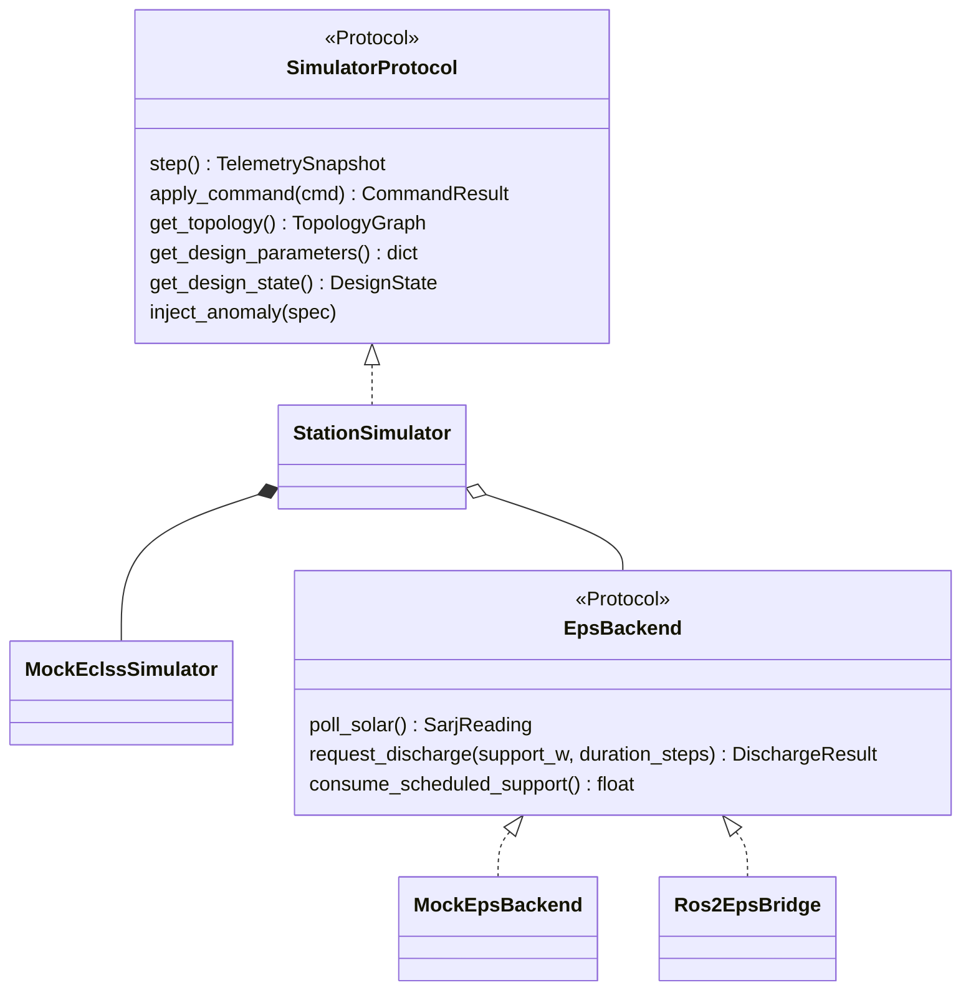
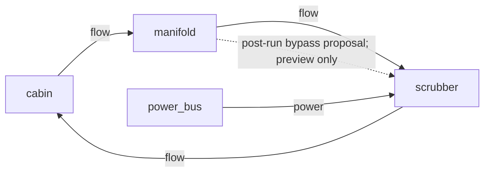
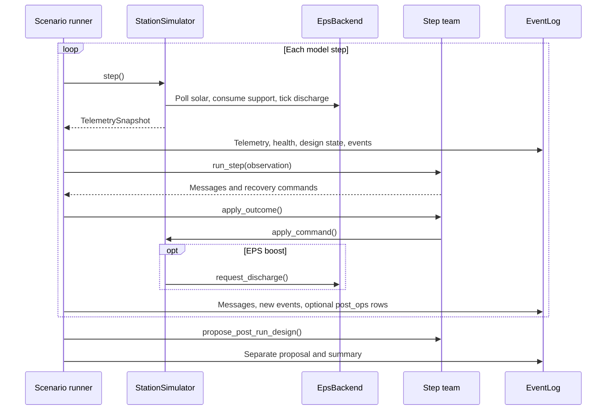

# Scrubber implementation

The [runner](https://github.com/hirototamura/engineering_agents/blob/main/src/scenario/scrubber_degradation/scenario_run.py) loads scenario overrides and agent configuration, resolves the output directory, and writes effective inputs before building the simulator and team. Generic output recreation follows the guarded deletion contract in [storage](../../reference/storage.md).

## Model and operation boundary

`scenario/runner.py::build_simulator()` builds a `StationSimulator` combining `MockEclssSimulator` and an EPS backend. `StationSimulator.step()` polls solar state, consumes scheduled support, steps ECLSS, and ticks battery discharge. An EPS boost command schedules support; its power-margin effect is applied at step timing rather than being invented by an agent.

`environment/scrubber/eclss_ops` owns command validation, anomaly scheduling, telemetry/health conversion, and design state. `SimulatorProtocol` names the basic operations, but the actual runner also consumes `get_events()`. Check real call sites when replacing the simulator; satisfying the protocol declaration alone is insufficient.

## Concrete simulator structure

The original station/class diagram describes a real composition in this checkout; the optional EPS bridge does not turn the ECLSS plant into SSOS.



`get_events()` is an additional consumed method on the concrete station/model. The declared protocol alone does not list every runner dependency.

```text
environment/scrubber/
  station_simulator.py        ECLSS/EPS composition
  mock_eclss.py               ppm model and operation events
  eclss_ops/                 commands, anomalies, health, design state
  eps/backend.py             EPS protocol
  eps/mock/                  SARJ/BCDU stack
 environment/ssos/eps/ros2/   optional EPS bridge
```

## Topology and the two kinds of change

[default_topology()](https://github.com/hirototamura/engineering_agents/blob/main/src/environment/scrubber/eclss_ops/design_state.py) constructs this directed model graph:



The dashed edge is an example of a proposal, not an edge inserted by the runtime loop. `DesignStateManager.apply_dict_change()` supports `add_node`, `add_edge`, and `set_parameter` for preview/tests. The runner does not invoke it to reinject the permanent proposal.

| Runtime `RecoveryCommand.kind` | Operation owner | What changes |
| --- | --- | --- |
| `set_fan_speed` | ECLSS command validation/application | Fan setting |
| `enable_bypass` | ECLSS command validation/application | Temporary bypass state |
| `reduce_load` | ECLSS command validation/application | Temporary load state |
| `request_eps_boost` | Station → `EpsBackend.request_discharge()` | Scheduled discharge support |

Constructed runtime and post-run examples illustrate their different payload contracts:

```json
{"kind":"request_eps_boost","value":120.0,"issued_by":"engineer_2"}
```

```json
{"proposed_by":"engineer_2","decision_source":"rule","changes":[{"change_kind":"add_edge","payload":{"node_a":"manifold","node_b":"scrubber","kind":"bypass"}}]}
```

## Loop and evidence ordering

Each step advances the simulator, computes health, records telemetry/EPS/design state and model events, then lets the team deliberate and apply recovery commands. When commands run, the runner writes same-step `post_ops` rows for updated actuator/EPS fields without advancing physics again. Recovery summaries track observed threshold transitions and applied EPS events.

After the loop, the team can emit a permanent-design proposal. The runner records that proposal separately from commands already executed, writes the summary, exports provenance, and records the export count. Provenance export failure logs a warning; it does not erase simulation evidence.

## Step sequence and provenance



The station's internal model step occurs between support consumption and discharge tick; the grouped EPS message above summarizes three calls, not a second physics advance.

`integrations/one_piece/client.py` exports EPS-boost recovery events by joining the event's issuer and step to its `recovery_command` message. Other recovery commands are not all exported as EPS records.

| Export field | Recorded input |
| --- | --- |
| `record_id`, `run_id` | Run directory identity plus record sequence |
| `actor`, `step` | `command.issued_by` and event step |
| `payload.support_w`, `payload.eps` | Applied EPS event command/metadata |
| `trace.event_kind`, `trace.event_index` | Exact source event and position |
| `trace.message`, `reasoning`, `decision_source`, `parse_status` | Matching recorded message |

The exporter has a runtime design-change branch, but this runner does not apply permanent design changes during operation. It does not read `design_proposals.json`; a proposal cannot acquire runtime-change provenance merely by existing.

## Changing this instance

For new operations, update command validation, model effects, event recording, team admission, and tests together. Preserve the distinction between scheduled support and already-delivered power, and between a proposal and an applied design. For a closed proposal loop, add a deliberate next-run application boundary rather than making the viewer mutate evidence.

Use `tests/environment/test_mock_eclss.py`, `test_station_simulator.py`, `test_mock_eps_backend.py`, and scenario tests `test_scrubber_baseline.py` and `test_scrubber_with_agents.py`. Include rejected commands, support duration, same-step telemetry, event deduplication, and output isolation when those behaviors change. [Evaluation](evaluation.md) defines the health and recovery checks.
