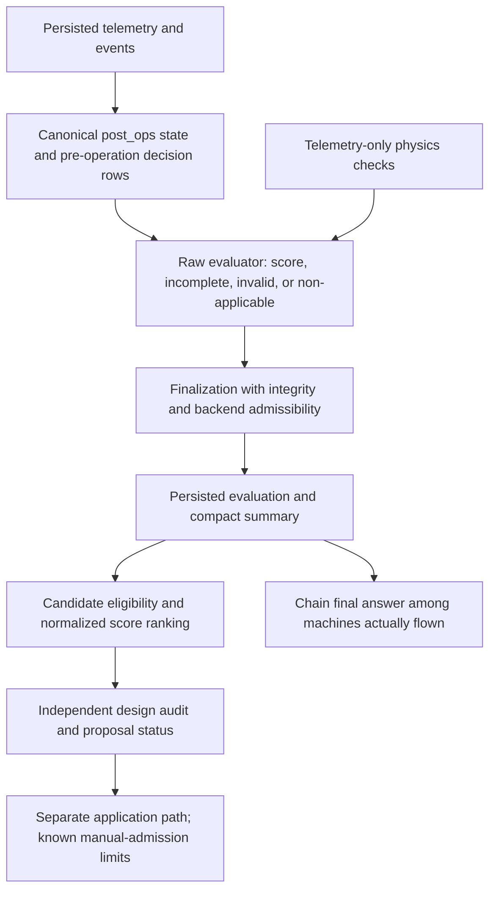
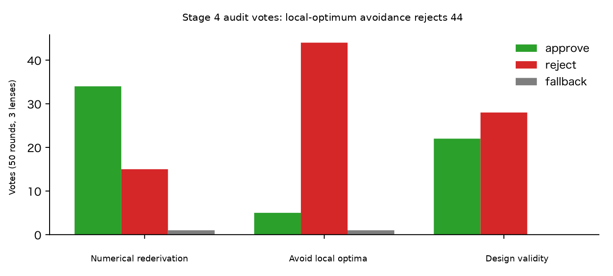

# SSOS evaluation

The evaluator measures persisted evidence before design reasoning. The [user results guide](../../../users/scenarios/ssos_eclss_loop/results.md) explains score interpretation; this page identifies the implementation contract for changing it.

## One recorded measurement

[evaluation.py](https://github.com/hirototamura/engineering_agents/blob/main/src/scenario/ssos_eclss_loop/evaluation.py) reads configuration, telemetry, events, and summary. Its current score schema is `2.1`. Plant simulation with survival enabled is the scorecard's applicable configuration. Raw `evaluate_run()` returns `not_applicable` for other backends, disabled evaluation, or disabled survival. Finalized run status additionally applies the admissibility checks below. Scores cover survival, resource trajectories/recovery, footprint, and applicable actor behavior. Actor-free runs have a different maximum, so ranking uses the percentage of applicable marks rather than comparing raw totals.

Canonical state chooses the last `post_ops` row for a step, otherwise its last row. Actor decisions and event-at-step checks use the first non-post row. Treating every JSONL row as a separate time advance would distort both checks.

`unified_evaluation.finalize_run_evaluation()` makes capacity-aware configuration, reconciles scheduler semantics, writes `evaluation.json`, HTML, and `physics_gate.json`, then enriches the summary. It does not re-evaluate after design and overwrite the measurement the designer read.

## Physics and integrity gates

`physics_gate.py` independently audits readings/finiteness, nonnegative inventories, monotonic totals, carbon/oxygen/water ledgers, stoichiometry, failure quiescence, installed-capacity bounds, and physical operation amounts. Missing required evidence yields skipped checks and an incomplete gate, not a pass. Non-plant runs have no executed plant-physics verdict and use a nullable summary index.

`integrity_guard.py` classifies differences from pristine settings as scoring bar, operating point, actor policy, or other. Changes to thresholds, survival, crew, initial inventories, evaluation, or design constraints affect the scoring bar. Missing integrity is unknown. Finalization invalidates modified/unknown integrity and plant runs whose gate did not pass, regardless of total score.

Current finalization has a non-applicability limitation: disabling evaluation on a plant run makes the raw evaluator return `not_applicable` without an audit, but final admissibility sees a gate without `status: passed` and marks the persisted result `invalid`. Changing the evaluation setting also changes the scoring bar. `physics_gate_index()` receives that final invalid status and reports `False`, rather than null, on plant runs. This value does not establish that the disabled audit executed. Changes to applicability handling need regression checks across the raw evaluator, finalized files, and summary index together.

## Telemetry audit contracts

The ten current `CHECK_NAMES` replace older prose that counted nine. They read telemetry alone, not the agent's explanation or scenario settings.

| Check | Required evidence or invariant |
| --- | --- |
| `readings_present_and_finite` | Storage readings and required plant inventory values |
| `inventories_non_negative` | Finite physical inventory cannot be negative beyond tolerance |
| `totals_monotonic` | Recorded cumulative `total_*` counters do not decrease |
| `carbon_ledger` | Opening cabin/captured CO₂ plus generated CO₂ equals closing stores and recorded outputs |
| `oxygen_ledger` | Opening O₂ plus generated equals closing, consumed, and delivered |
| `water_ledger` | Opening product/urine/grey plus external/regenerated equals closing and loss/use/delivery terms |
| `stoichiometric_residual` | Electrolysis and recorded Sabatier terms match reaction ratios |
| `failure_quiescence` | A failed subsystem processed no work |
| `capacity_bounds` | Per-operation throughput respects installed capacity and operation duration |
| `operational_physical_bounds` | Recorded processed amounts are finite and nonnegative |

For example, the oxygen residual is computed from the first and final measured rows:

```text
r_O₂ = opening_o2 + total_o2_generated
       − final_o2 − total_o2_consumed − total_o2_delivered
pass when |r_O₂| ≤ LEDGER_TOLERANCE
```

The carbon residual includes captured storage, venting, delivered CO₂, and Sabatier use. The water residual includes urine/grey buffers, external grey input, regenerated water, crew loss, brine, electrolysis, and product delivery. Missing any required term skips that ledger; it is not silently zero. Opening inventory comes from the first telemetry row. Current ledger tolerance is `2e-6`; inventory/capacity tolerance is `1e-9` and stoichiometric tolerance is `1e-6`, as defined in [physics_gate.py](https://github.com/hirototamura/engineering_agents/blob/main/src/scenario/ssos_eclss_loop/physics_gate.py). They audit this model, not hardware measurement uncertainty.

## From rows to final answer



A row pair such as `{"step":2,"co2_storage_kg":3.0}` and `{"step":2,"post_ops":true,"co2_storage_kg":2.4}` is one interval, with two observation phases. The canonical resource state is 2.4, while the pre-operation decision check uses 3.0. These abbreviated examples are not a complete physics-auditable telemetry record.

The score percentage used in candidate ranking is `100 × score / applicable_max_score`. Eligibility and survival remain earlier ranking terms. Changing the score cannot repair modified requirements, missing physics evidence, an out-of-bounds machine, or incomplete survival.

## Selection and regression

`design_eval.py` marks eligibility from actual simulation, evidence completeness, survival, constraints, and evaluation/physics state, then ranks eligibility, surviving crew, and score percentage. An ineligible best observed candidate may still be reported as provisional; this label is not a hard application gate. See the [manual adoption limitation](implementation.md#proposal-application-limits).

`chain_selection.py` chooses among machines actually flown. `iterate.py` freezes requirement hashes, retains newly generated final proposals as unverified, and records paired replay evidence separately. Check evaluation, physics-gate, integrity-guard, unified-evaluation, candidate-constraint, chain-memory, and final-answer tests under `tests/scenario`. Gate edges, missing/non-finite rows, scheduler guards, and invalid high-score candidates are essential regressions.

## Historical audit diagnostic

The preserved report 04 four-stage study ran 50 iterations per stage with 50 occupants. Its stage 4 introduced the independent audit panel; this original figure records its votes. It is historical evidence about that recorded setup, not a benchmark of the present code or proof that more auditors improve designs.



The [preserved data](https://raw.githubusercontent.com/hirototamura/engineering_agents/648237d8596462362b5772914242a3881f82ad35/docs/data/report03_emergence.json) records `avoid_local_optima` as 44 rejects, 5 approvals, and 1 fallback. The lesson for a contributor is to measure audit decisions, parse failures, installed-design diversity, and survival separately: the lens's name alone does not prove that it widened exploration. The original [report 04 discussion](https://github.com/hirototamura/engineering_agents/blob/648237d8596462362b5772914242a3881f82ad35/docs/en/eclss_ai_agent_technical_report_04.md) supplies the study context. Current whole-proposal admission and manual-application limitations are defined above and in implementation; historical item-merge prose is not the current API contract. The image and data are reused without regeneration or rescoring.
