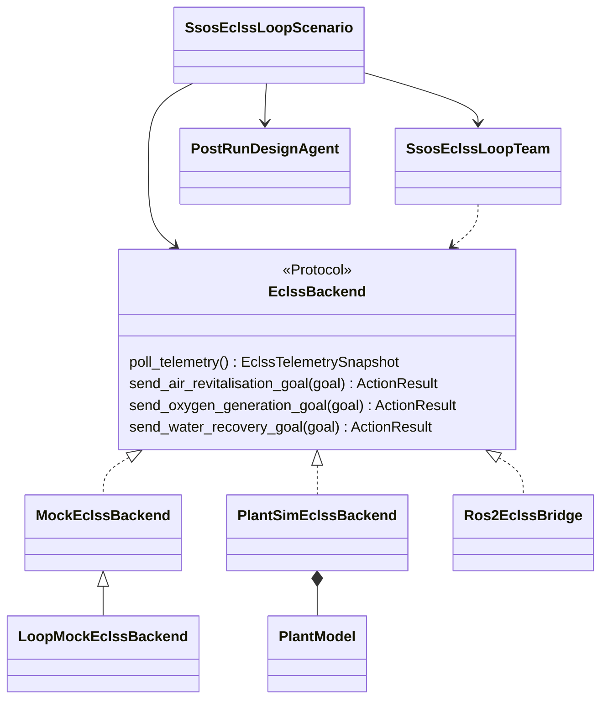
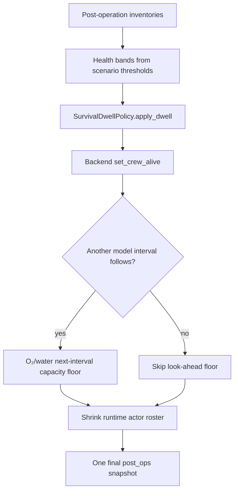
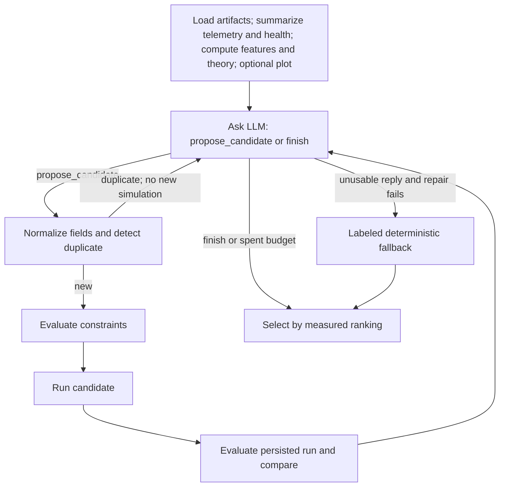
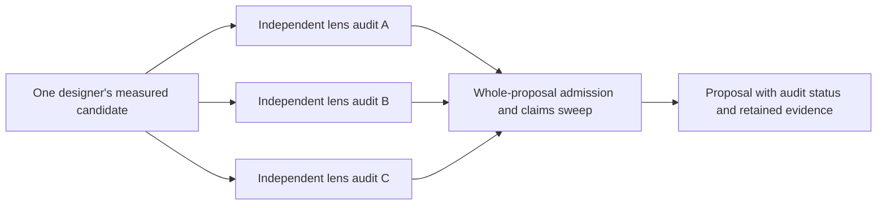

# SSOS implementation

[scenario_run.py](https://github.com/hirototamura/engineering_agents/blob/main/src/scenario/ssos_eclss_loop/scenario_run.py) owns this instance's execution. Before stepping it loads overrides, applies proposal fields to an in-memory configuration, validates the design-constraint configuration, resolves actor/design settings and backend, and writes effective inputs. The consumed proposal is copied into the run; source YAML stays unchanged.

## Environment and backend contract

```text
environment/ssos/eclss/
  backend.py                 EclssBackend protocol
  types.py, units.py         goals, results, storage values, unit conversion
  mock/backend.py            operation-contract stub
  plant_sim/                 model, config, stoichiometry, operation backend
  ros2/                      topics, telemetry, bridge, client graph remap
scenario/ssos_eclss_loop/
  loop_mock_backend.py       runnable loop mock with simple storage dynamics
```

The mock contract stub and runnable loop mock are different classes. In particular, the loop mock's WRS method remains unimplemented; a method in the protocol does not imply that every backend supports it.

| `EclssBackend` method | Result | Boundary meaning |
| --- | --- | --- |
| `poll_telemetry()` | `EclssTelemetrySnapshot` | Latest storage/failure readings; missing values remain optional |
| `send_air_revitalisation_goal(ArsGoal)` | `ActionResult` | ARS operation request |
| `send_oxygen_generation_goal(OgsGoal)` | `ActionResult` | OGS operation request |
| `send_water_recovery_goal(WrsGoal)` | `ActionResult` | WRS operation request, backend support required |
| `request_o2(amount)` | `ServiceResult` | O₂ delivery service |
| `request_co2(amount)` | `ServiceResult` | CO₂ delivery service |
| `request_product_water(liters)` | `ServiceResult` | Product-water delivery service |
| `submit_grey_water(liters)` | `ServiceResult` | Grey-water submission |
| `set_subsystem_failure(name, enabled)` | `None` | Failure-control boundary |

`advance_step()`, installed-capacity changes, and survival hooks are additional concrete-backend capabilities used by the scenario. They are not all methods of `EclssBackend`. See the actual [protocol](https://github.com/hirototamura/engineering_agents/blob/main/src/environment/ssos/eclss/backend.py), [types](https://github.com/hirototamura/engineering_agents/blob/main/src/environment/ssos/eclss/types.py), and runner call sites before replacing a backend.

The class graph includes the plant backend missing from some earlier diagrams. Dashed realization arrows describe structural protocol conformance, not inheritance; the runnable mock inherits the contract stub and overrides operations. Only the scenario coordinates runtime actors and the separate post-run designer.



## Backend and operation lifecycle

`EclssBackend` exposes storage polling, ARS/OGS/WRS actions, storage services, and subsystem failure control. Internal mass is kilograms and product water is liters; ROS2 converts upstream grams at its boundary. Backend construction supports mock, plant simulation, and ROS2. Plant crew/team binding is scenario-owned.

Step 0 observes configured initial state; supported explicit-step backends advance before later observations. The runner applies scheduled failures, logs pre-operation telemetry, invokes the actor, refreshes after commands, then performs survival/capacity effects. Same-step `post_ops` rows retain the final operation/survival state. Failure schedules are cleared in `finally`. ROS2 waits for startup storage telemetry and rejects missing readings.

The runner records integrity against pristine configuration and finalizes deterministic evaluation before post-run design. `PostRunDesignAgent` and `DesignToolkit` then inspect the measured result, simulate candidates with nested design disabled, and persist proposals and traces. Proposal handlers separate action payloads, hardware capacities, policy, services, and graph changes; scoring thresholds are not allowed `set_parameter` targets.

## Post-operation survival ordering

The survival investigation's ordering remains important to a model change:



Dwell still runs on the last step. O₂/water streaks reset after loss and can recur; CO₂'s fractional loss is once per stay in the band. Requested same-step losses are bounded by living occupants, with cause slices rather than attributing the whole total to every resource. The next-interval floor accounts for O₂/water demand; it is not a CO₂ wipe. Designers do not shrink with the runtime actors. See [survival.py](https://github.com/hirototamura/engineering_agents/blob/main/src/scenario/ssos_eclss_loop/survival.py) and `_apply_survival_after_ops()` before changing attribution or timing.

## Nine tools, fixed procedure { #design-toolkit }

The catalog in `DesignToolkit` is implemented, but the current designer does **not** choose tool names. Python gathers the same baseline evidence and runs the candidate pipeline around each model decision.

| Operation | Result and authority |
| --- | --- |
| `load_run_artifacts` | Effective inputs, summary, JSONL head/tail, compact chain note |
| `summarize_timeseries` | Selected-column extrema, final values, bands, trend |
| `compute_eclss_features` | Operations/rejections, failure windows, resource shortfalls |
| `compute_theoretical_capacity` | Demand/cadence/busy-guard sizing calculation |
| `plot_eclss_timeseries` | PNG path and equivalent textual features |
| `propose_capacity_candidate` | Deterministic sizing suggestion; no simulation |
| `evaluate_design_constraints` | Buildability and footprint labels; no simulation |
| `run_design_candidate` | New run with candidate capacities and nested design disabled |
| `compare_design_runs` | Deterministic ranking and selection rationale |



Baseline gathering calls both telemetry and health summaries. A model `finish` before any candidate also triggers fallback. A duplicate costs a decision but not a second simulation. Budget exhaustion with candidates retains the measured ranking; the model's requested winner is not the selection authority. The fixed `_traced_tool_call()` invokes handlers with error conversion and evidence credit; the public toolkit `call()` is a separate dispatch path with similar error semantics.

The decision protocol is plain JSON, for example this constructed partial profile:

```json
{"decision":"propose_candidate","fields":{"plant_sim.ars.capacity_kg_day":22.0},"rationale":"Test a distinct ARS nameplate while retaining the installed context."}
```

The three design keys are `plant_sim.ars.capacity_kg_day` (kg/day), `plant_sim.ogs.max_o2_kg_day` (kg/day), and `plant_sim.wrs.max_feed_l_per_operation` (L/operation). `design_variables.py` validates finite positive known fields; `DesignConstraints` separately evaluates buildability and budgets. Raising hardware without raising usable operating payload can be ineffective. OGS synchronization computes:

```text
required water kg/action = O₂ nameplate kg/day × operation seconds / 86400 × WATER_PER_O2
```

`sync_action_payloads()` raises OGS water and WRS urine requests when needed; it does not lower them. Efficiencies, chemistry, metabolism, and verification thresholds are not these sizing variables.

## Runtime operation records

`EclssOperationalCommand` stores `kind`, a payload mapping, and `issued_by`; `StepEclssOutcome` separates messages from commands. This constructed event shows an admitted ARS request, not a physical-validation verdict:

```json
{"step":2,"kind":"/eclss/events/operational_applied","command":{"kind":"air_revitalisation","payload":{"initial_co2_mass":1.8},"issued_by":"eclss_actor_1"},"result":{"success":true},"message":"ARS request accepted"}
```

`operational_rejected` is a separate event. `client.py` exports **both** applied and rejected operational events; `trace.result_success` uses the result when present and otherwise derives success from the event kind. It joins message metadata by step, issuer, and command kind. Rejection provenance is therefore retained, not silently converted into an accepted operation. The exporter does not consume post-run proposal files.

## Trace and independent audit

| Artifact | Internal contract |
| --- | --- |
| `tool_trace.jsonl` | `start`, `tool_call`, `llm_turn`, decision/candidate events, `done` |
| `candidate_rankings.json` | Baseline, ranked measured candidates, selection |
| `design_review_report.json` | Evidence completeness, constraints, thinking-turn diagnostics, candidate errors and selected status |
| `design_storage/sessions/<agent_id>.jsonl` | Per-agent session events |
| `design_storage/claims.json` | Standing selected claim and retracted alternatives |

A constructed, abbreviated trace row is:

```json
{"event":"tool_call","source":"pipeline","iteration":1,"decision":1,"tool":"evaluate_design_constraints","arguments":{"fields":{"plant_sim.ars.capacity_kg_day":22.0}},"result":{"error":"illustrative failure"},"result_excerpt":"...","tool_elapsed_s":0.01,"evidence":{"missing":[]}}
```

`source` identifies Python's fixed stage (`evidence`, `pipeline`, or fallback), not a tool chosen by the model. Actual rows retain the result plus excerpt and evidence state; a failed call does not gain its evidence credit.



Auditors see the same slim brief, not each other's replies. They can approve or reject named proposed capacity keys, for example `{"decision":"reject","rejected_fields":["plant_sim.wrs.max_feed_l_per_operation"]}`. Unknown fields are ignored and unusable replies abstain. **Any recognized veto rejects the whole proposal**; current `integrate_audit_panel()` does not stitch an unmeasured hybrid from vetoed and installed fields. Claims sweep retracts losing recommendations; it is still a phrase-based check. This corrects contradictory partial-pinning prose in the historical audit investigation.

## Chain memory and complete handoff

`compact_chain_memory.json` is a bounded note, not the trace history and not an application service. Its current schema retains theoretical sizing separately from optional measured probe brackets.

| Field | Why it is retained |
| --- | --- |
| `best_full_survival` | A measured reference to the best retained full-survival design |
| `last_effective_design` | The actual installed sizing, not a proposed next machine |
| `theoretical_floor` / `measured_limits` | Calculated sizing versus optional measured brackets |
| `known_bad_patterns` | Bounded repeated-failure evidence |
| `stagnation` / `exploration_directive` | Bounded same-survival-tier progress diagnosis |

`chain_memory.py` caps serialized memory at 4096 bytes and bad patterns at five; `_fit()` drops structured entries rather than chopping JSON. `iterate_apply_document()` and complete-capacity helpers preserve omitted keys from the flown machine when applying onto fresh YAML. The note itself does not prevent reset or apply any change. Test memory budgeting, tier changes, partial proposals, and repeated-chain invocation independently.

## Proposal adoption limitation { #proposal-application-limits }

Candidate eligibility and application are separate code paths. `design_eval.py` can mark a candidate out of bounds or otherwise ineligible, then label the best observed candidate `provisional_final`. In manual application, `apply_design_proposals()` checks supervisor/status reasons only when `approve_provisional` is false. Enabling it can also bypass a `rejected_final` status check. Handlers validate proposal fields, but the application path does not enforce the hardware bounds from `DesignConstraints`; constructing that object validates its configuration, not the applied capacities against those bounds.

Automatic chains separately filter rejected proposals in `iterate.py`; that behavior is not a guarantee for manual application. A corrective change should make status admission and capacity-bound checks explicit at application, preserve consumed-input evidence, and test rejected/provisional/out-of-bounds documents through both manual and chain paths without weakening requirement integrity.

## Regression targets

Use scenario tests for agent configuration, command gates, proposals, design constraints/tools, capacity profiles, health/survival, effective configuration, iteration, and final answers. Use environment unit, busy-guard, mass-balance, audit-telemetry, and ROS2 adapter tests for backend changes. The [evaluation guide](evaluation.md) describes admissibility and ranking; [user running](../../../users/scenarios/ssos_eclss_loop/running.md) owns the public commands.
