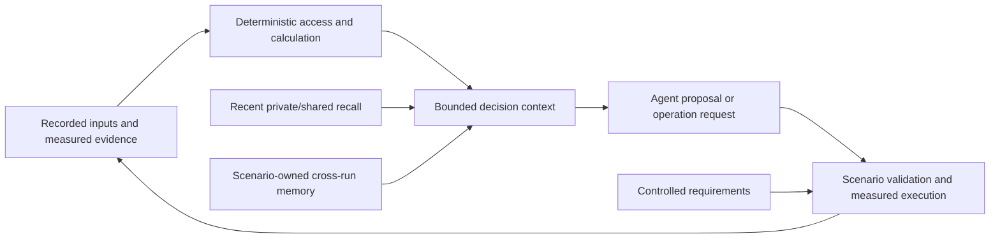

# Tools and memory

Tools turn an agent's questions into inspectable evidence. Memory carries selected prior evidence into a later decision. Neither changes the authority of requirements or turns a hypothesis into a measurement.

## Tool ownership

An exposed operation needs an argument contract, deterministic implementation, bounded result, side-effect policy, and an error/evidence path. The catalog alone does not decide when it runs. Current scenario orchestration can schedule handlers directly through a traced wrapper; keep that path and any public dispatcher consistent when adding a tool.

The [SSOS toolkit](scenarios/ssos_eclss_loop/implementation.md#design-toolkit) documents its nine operations and fixed procedure. The [cube adapter/workflow](scenarios/balancing_cube/implementation.md) owns a different compile/rollout/feedback boundary. Analysis utilities under `tools/` are not automatically available to scenario agents. Use [add a tool](guides/add-tool.md) to scope a change.

## Evidence, recall, and authority

| Memory boundary | Stores | Does not authorize |
| --- | --- | --- |
| `AgentMemory` | Bounded own summaries and issued commands | Requirement changes or peer-session access |
| `DiscourseBuffer` | Bounded team messages | Treating every message as measured fact |
| `SessionStore` | Persisted per-agent records | Filesystem access control or semantic truth |
| Scenario cross-run memory | Selected prior measurements with source references | Unilateral adoption or rewriting verification |

Keep three distinctions from the original agent-design explanation: a trace is the history for inspection, a memory projection is selected context for the next decision, and an authoritative requirement has a separate owner. Retaining a claim in memory does not increase its evidential strength.

## Memory scopes

- `core/agents/memory.py` keeps bounded recent discourse and private agent summaries for a team. It is in-memory history, not a persistent cross-run knowledge base.
- `core/storage/session.py` saves per-agent JSONL sessions. Its API reads one agent's session; peer isolation is a caller discipline rather than a filesystem security boundary.
- SSOS `chain_memory.py` maintains a compact, measured chain history and exploration guidance. `iterate.py` clears leftover chain memory for a new invocation, even when keeping the directory.
- Cube `memory.py` stores episodes with source references and configuration digests, retrieves bounded context, and projects deterministic measured associations. Association does not establish causality; retained hypotheses remain hypotheses.

When changing retrieval, preserve provenance, version identifiers, exclusion of inappropriate evidence, and bounded context. Check `test_memory.py` and `test_design_storage.py` in `tests/core`, and SSOS chain-memory, cube memory-loop, independent-design, and context-budget tests in `tests/scenario`. Storage recovery behavior is in [storage contracts](reference/storage.md).
