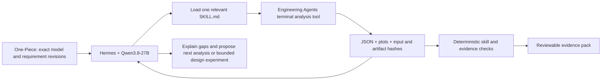

# Hermes engineering skill harness

Hermes plans tasks, discovers a skill, calls its tools, reads results and proposes
next work. Engineering Agents owns versioned skills and deterministic analysis.
One-Piece owns requirements, model revisions, evidence and human decisions.
The existing production cube design loop remains available; this change does not
replace its bounded compiler or automatically apply analytical gains.



The first four skills are deliberately bounded:

- **GNC — `cube-gnc-loop-analysis`:** derive a local tilt-axis transfer function,
  plot Bode response, place poles, check sampled stability and compare linear
  response with torque-limited nonlinear dynamics. This is not three-axis
  synthesis or measured-data system identification.
- **Mechanical — `cube-mechanical-mass-uncertainty`:** mass, CoM, inertia tensor,
  principal moments, frame transforms and bounded mass/placement uncertainty.
  Missing component masses keep full-system properties unresolved.
- **Electrical — `cube-electrical-wheel-power`:** wheel-drive current, voltage
  headroom, operating-mode energy, braking and winding temperature. BLDC
  phase/line constants require a documented effective-DC conversion first.
- **Systems — `cube-systems-evidence-assessment`:** compare exact-revision
  requirements with eligible, hashed evidence; retain stale, missing, failed,
  wrong-domain and unresolved-condition results. Human approval is not a test pass.

The commands are tool interfaces, not prose-only skills:

```bash
python -m pip install -e '.[dev,analysis,onepiece]'
python -m tools.engineering_skills run gnc \
  --input skills/engineering/cube-gnc-loop-analysis/examples/input.json \
  --output experiments/balancing_cube/engineering_analysis/my-run/gnc
```

Each output contains `input.json`, `result.json`, `receipt.json` and applicable
plots/CSV. Existing output directories are refused. A failure retains an input
and a failure receipt. The receipt records source revision, data basis, software
runtime, input/result/artifact hashes and duration. Assumed and synthetic inputs
are labelled; numerical calculations are not physical qualification.

For systems assessment, use full records, not an LLM-rewritten requirement:

```bash
python -m tools.engineering_skills run systems --input review-input.json \
  --store ../one-piece/projects/balancing-cube/store \
  --artifact-root /absolute/path/to/evidence \
  --output experiments/balancing_cube/engineering_analysis/my-review
```

Non-synthetic assessments verify One-Piece store integrity and exact canonical
record equality. Preserve native requirement units; unit conversion shall be
explicit before assessment. Artifact paths are confined to the explicit root.
Read-only assessment does not publish records, approve a baseline or edit CORE.md.
A numerical criterion without enough condition/domain coverage stays inconclusive.
The supplied systems example is deliberately synthetic and demonstrates that six
simulation seconds cannot establish a thirty-second hardware requirement.

## Remote execution

The existing pinned profile runs Hermes v0.22.4 and Qwen3.8-27B Q4_K_M through
the CUDA llama.cpp endpoint `127.0.0.1:8016/v1` on the reserved A5000. The model
and inference service are not restarted by skill installation. The default Hermes
wrapper now installs the four repository skills into its profile on startup;
existing changed skills cause a visible conflict rather than being overwritten.
Source and calculator hashes are recorded in `engineering-skills-install.json`.

```bash
cd '/home/one-piece/hiroto/Engineering Agents'
bash engineering_agents/deploy/eng-agents-008/hermes-engineering.sh
# Or a bounded, explicit engineering task:
bash engineering_agents/deploy/eng-agents-008/hermes-engineering.sh chat --oneshot \
  --max-turns 8 --run-budget 240 \
  -q 'Use cube-gnc-loop-analysis to analyze the example. Write a new run and explain its limitations.'
```

`EA_ENGINEERING_REPO` supports a separate Git worktree without switching ongoing
remote development. Set `EA_WORKSPACE` to the parent workspace containing the
runtime/venv/One-Piece checkouts. The wrapper provides `ea-engineering` on the terminal PATH. It uses the project
Python only for calculation subprocesses, keeping Hermes and Engineering Agents
packages with the same `tools` name isolated. The wrapper keeps approval prompts and local-host
execution semantics. Skills do not add OpenShell, hardware actuation or new
network services. CUDA hosts the model; these small SciPy/NumPy analyses run on
CPU because they are not accelerated by configuring a visible GPU.

## Validation

1. **Skill packaging:** validate names, YAML frontmatter, referenced files and
   install conflict/idempotency behavior. This is discovery validation only.
2. **Independent numerical checks:** analytical roots/gains, known transfer
   values, sampling effects, primitive mass moments, parallel-axis cross terms,
   rotation invariance, power conservation and thermal step solutions.
3. **Failure cases:** missing masses, invalid tensors/units, voltage/current
   limits, regeneration policy, stale references, failed runs and hash errors.
4. **Live harness acceptance:** each task asks Hermes/Qwen to load a skill and
   execute its example. Inspect tool-call transcripts and trusted output hashes;
   a fluent answer without execution is not accepted.

```bash
python -m pytest -q tests/engineering_skills
python -m tools.engineering_skills.live_acceptance \
  --repo "$EA_ENGINEERING_REPO" --workspace "$EA_WORKSPACE" \
  --output /absolute/new/acceptance-directory
```

The skill-specific validation documents describe their oracles. Repeat affected
checks when skill code, dependencies, quantization or serving templates change.
These tests qualify implemented calculations and the harness connection. They do
not establish physical accuracy, optimal designs or project-success improvement.
Real measurements, calibration, excitation/identifiability checks and comparison
with independently measured behavior are still needed. Future skills can add
system identification, robust control, actuator characterization, load/strength
analysis and circuit/filter analysis without expanding these first tools' claims.

Use ISO/IEC/IEEE 29148:2018 first, applicable NASA guidance second, ASD-STE100
where compatible, and `shall` for normative requirements. Shared authoritative
policy lives in One-Piece, not duplicated requirements in a skill.

Sources: [Hermes skill format](https://hermes-agent.nousresearch.com/docs/developer-guide/creating-skills),
[Hermes skill discovery](https://hermes-agent.nousresearch.com/docs/user-guide/features/skills),
[Qwen model card](https://huggingface.co/Qwen/Qwen3.8-27B).
