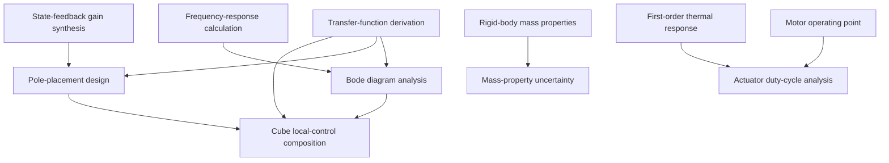

# Engineering analysis skills

Engineering analysis skills are project-independent capabilities used during design
and verification. Hermes is the task harness; Engineering Agents owns the skills
and deterministic tools. One-Piece supplies exact requirement/model revisions and
retains human authority over requirements and adopted baselines.

Each skill has **one primary output**, a typed `result.json`. Plots, CSV and
`summary.json` are supporting views of that result. `receipt.json` is execution
provenance, not another engineering deliverable. `contract.json` declares the
output type/version, atomic or composite kind, dependencies and project scope.
The executable catalog is checked against those contracts in CI.

A generic skill is portable within its stated model scope. For example, the first
transfer-function skill accepts continuous-time SISO state-space models; it does
not claim to identify arbitrary nonlinear systems from scarce measurements.
Project assumptions belong in supplied models or project adapters.

## Initial catalog

Atomic skills do not invoke another analysis skill:

- `transfer-function-derivation` → **transfer_function_model**: derive
  `G(s) = C(sI−A)⁻¹B + D`, preserving the original state basis, units and scope.
- `frequency-response-calculation` → **frequency_response**: complex frequency
  response, dB magnitude and phase under an explicit phase convention.
- `state-feedback-gain-synthesis` → **state_feedback_gain**: full-state SISO gain,
  gain units, achieved poles and zero-order-held sampled stability.
- `rigid-body-mass-properties` → **rigid_body_mass_properties**: assembly mass,
  center of mass and inertia tensor, with missing masses left unresolved.
- `motor-operating-point` → **motor_operating_point**: one effective-DC
  motor/driver power and current/voltage feasibility assessment.
- `first-order-thermal-response` → **thermal_interval_response**: one exact
  constant-load lumped thermal interval, including peak-temperature checks.
- `requirement-evidence-assessment` → **requirement_evidence_assessment**:
  exact-revision evidence eligibility and deterministic threshold outcomes.

Composed skills consume lower-level skills:

- `bode-diagram-analysis` → **frequency_response_assessment**: consumes the
  transfer-function and frequency-response skills, generates a Bode plot and
  evaluates explicit magnitude/phase criteria. A plot without criteria is
  **unassessed**, not a design pass. Point checks do not certify an entire band;
  a Bode plot does not establish feedback stability or gain/phase margins.
- `pole-placement-design` → **pole_placement_design**: consumes the transfer
  model and gain synthesis. The exact original realization reaches synthesis;
  a transfer-equivalent canonical basis would give different gain coordinates.
- `mass-property-uncertainty` → **mass_property_uncertainty_assessment**: consumes
  nominal rigid properties and reuses the qualified rigid-body calculator for
  bounded Monte Carlo draws. Central 95% ranges are empirical ranges under
  independent uniform inputs, not confidence intervals or worst-case bounds.
- `actuator-duty-cycle-analysis` → **actuator_duty_cycle_assessment**: consumes
  motor points and successive thermal intervals, carries temperature between
  modes and accumulates energy. Infeasible operating points stay visible.

The project-specific `cube-gnc-loop-analysis` is a composition that produces a
**cube_local_control_assessment**. It supplies the upright fixed-pivot tilt-axis
model to transfer-function, Bode and pole-placement skills, then adds a
project-specific torque-limited nonlinear comparison. Positive body torque is
opposite ideal wheel motor torque. This remains a local diagnostic: three-axis
contact, wheel momentum/speed, yaw, estimator errors and structural flexibility
require other models. No production K, evaluation condition or baseline changes.



## Execution and composition

```bash
python -m pip install -e '.[dev,analysis,onepiece]'
ea-engineering catalog
ea-engineering run bode-diagram-analysis \
  --input skills/engineering/bode-diagram-analysis/examples/input.json \
  --output /absolute/path/to/NEW_BODE_RUN
```

`python -m tools.engineering_skills` exposes the same interface. The old short
commands `gnc`, `mechanical`, `electrical` and `systems` remain aliases. Three old
`cube-*` skill folders were renamed to generic capabilities; the cube GNC skill
remains an explicitly labelled project composition. Historical evidence refers
to the source revision at which it was generated and is preserved.

Hermes selects/loads a skill, invokes its trusted tool, reads the result and
explains findings or proposes another analysis. The deterministic executor runs
the declared dependency graph. Each child keeps its own input, typed result and
receipt under `dependencies/<role>/`. The parent records child input/result/
receipt hashes and a recursive artifact inventory. Repeated thermal intervals
have distinct roles. Failure stops the composition and retains completed and
failed child evidence; a missing dependency cannot become a successful parent.
Graphs with cycles or undeclared dependencies are rejected.

The mass-uncertainty skill retains the nominal child and records the sampled
inputs' bounds, seed and sample count. Its repeated draw calculations reuse the
same qualified rigid-body implementation in process, rather than creating a file
pack for every Monte Carlo draw.

Use fresh output directories. Receipts record calculator/shared-source hashes,
Git revision, runtime versions, data basis and duration. Source-linked measured,
assumed, derived and synthetic data remain distinct. Read `summary.json` and
`receipt.json` with `cat`; inspect plots when applicable. Read each skill's
`references/input_contract.md` and `references/validation.md` as needed.

For non-synthetic systems assessment, supply full canonical One-Piece records
from one project; `project_id` is explicit or taken from those records:

```bash
ea-engineering run requirement-evidence-assessment --input review-input.json \
  --store /absolute/path/to/one-piece-store \
  --artifact-root /absolute/path/to/evidence \
  --output /absolute/path/to/NEW_EVIDENCE_REVIEW
```

The tool verifies store integrity, exact record identity and artifact hashes.
Native requirement units are retained; conversions shall be explicit. A six-second
simulation cannot verify a thirty-second hardware requirement. Human approval of
requirement wording is distinct from verification status. Assessment does not
publish records, approve a baseline or edit CORE.md.

## Validation hierarchy

**Atomic qualification** uses independent mathematical examples, invariants,
limiting cases and rejected inputs. Tests cover closed-form transfer/gain
solutions, a matrix-resolvent cross-check, very small feedthrough coefficients,
RC frequency response, zero-order-held instability, primitive inertias and
parallel-axis cross terms, energy identities in all motor quadrants, thermal
step/cooling solutions and exact-revision evidence cases. An LLM's confidence is
not a numerical oracle.

**Composite qualification assumes qualified lower-level skills.** It checks
exact input/output contracts, units, state basis, dependency routing, chronological
temperature/energy flow, criterion evaluation, failure propagation and lineage.
It does not requalify lower equations with duplicate tests. Any newly introduced
mathematics, such as a project nonlinear model or uncertainty propagation, gets
its own relevant checks in addition to composition tests.

```bash
python -m pytest -q tests/engineering_skills
python -m tools.engineering_skills.live_acceptance \
  --repo "$EA_ENGINEERING_REPO" --workspace "$EA_WORKSPACE" \
  --output /absolute/path/to/NEW_LIVE_ACCEPTANCE
```

CI makes the analytical and composition tests mandatory on Python 3.11/3.12.
Live acceptance checks successful Hermes skill/tool events, expected results,
complete batches and recursively hash-matched dependency outputs. Fluent final
prose without actual execution fails acceptance. Repeat affected checks after
calculator, skill, contract, dependency, quantization or serving-template changes.
Software qualification does not establish physical accuracy, optimal design or
improved project-success rates. Calibration and measured model comparisons remain
separate work.

## Hermes deployment

The remote profile uses pinned Hermes v0.22.4 and CUDA-hosted Qwen3.8-27B Q4_K_M
on the reserved RTX A5000. The wrapper installs the repository catalog and exposes
`ea-engineering` to terminal tools. Analysis subprocesses use the project Python;
Hermes's own `tools` package is isolated from the project's namespace. These small
NumPy/SciPy calculations execute on CPU. The model service, approval settings,
other GPUs and OpenShell decision remain unchanged.

```bash
ssh gpu-sv-008
~/.local/bin/engineering-hermes chat
```

`EA_ENGINEERING_REPO` and `EA_WORKSPACE` support a dedicated versioned checkout.
The installer updates unchanged owned skills and removes unchanged obsolete
copies after a rename. It refuses to overwrite or delete human edits. Stable
launchers can be repointed after merge without switching another working tree:

```bash
PYTHONPATH="$EA_ENGINEERING_REPO/src" "$EA_WORKSPACE/.venv/bin/python" \
  -m tools.engineering_skills.launchers --repo "$EA_ENGINEERING_REPO" \
  --workspace "$EA_WORKSPACE" --bin-dir "$HOME/.local/bin"
```

The pinned gateway does not accept `--run-budget`; live tasks use a bounded turn
count and an external timeout while preserving the profile budget.

Use ISO/IEC/IEEE 29148:2018 first, applicable NASA guidance second, ASD-STE100
where compatible, and `shall` for normative requirements. Shared authoritative
requirements policy remains in One-Piece.

Sources: [Hermes skill format](https://hermes-agent.nousresearch.com/docs/developer-guide/creating-skills),
[Hermes skill discovery](https://hermes-agent.nousresearch.com/docs/user-guide/features/skills),
[Qwen model card](https://huggingface.co/Qwen/Qwen3.8-27B).

The [2026-10-25 qualification receipt](https://github.com/hirototamura/engineering_agents/blob/5c7aee6dcc74cf2d89548ab710d0ab7b02fc65e6/deploy/eng-agents-008/engineering-skills-validation-20261025.json)
records the original four bundled skills. It is historical evidence, not a claim
that this refactored catalog was tested at that earlier revision.
