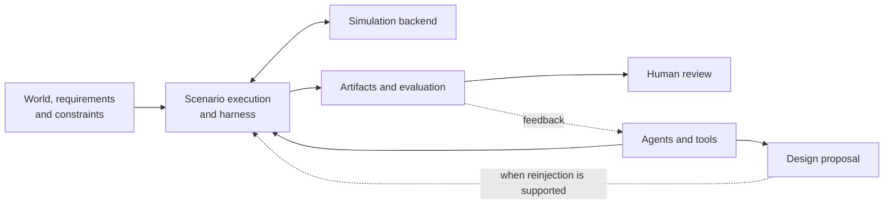

# Engineering Agents

Engineering Agents develops teams of engineering agents that design and verify systems across domains. Accumulated knowledge, memory, tools, evaluation, and evidence inform the next engineering decision.

## How the pieces connect

The diagram shows responsibilities, not one universal runtime API. Each scenario owns its physical model, evaluation contract, and whether a proposal can be applied to a subsequent run. Human viewers consume the saved evidence.

| Your task | Start here | What you should obtain |
| --- | --- | --- |
| Configure an existing experiment and judge the result | [User guide](users/index.md) | Resolved inputs, recorded outputs, and an interpretation of the evidence |
| Change how the repository works | [Developer guide](developers/index.md) | An implementation boundary, extension procedure, and regression checks |

## Run design and verification

The [user guide](users/index.md) serves engineers using existing capabilities. Start with a local run in the [quickstart](users/quickstart.md), set conditions with the [task guides](users/guides/configure-run.md), and [inspect the results](users/guides/inspect-results.md).

## Add or change capabilities

The [developer guide](developers/index.md) serves contributors changing the repository. Follow [environment setup](developers/setup.md), [architecture](developers/architecture.md), [extension guidance](developers/guides/add-scenario.md), and [development priorities](developers/development/index.md) to connect implementation with verification.

## Bundled scenarios

- [scrubber_degradation](users/scenarios/scrubber_degradation/index.md): scrubber degradation, power-assisted recovery, and design proposals.
- [ssos_eclss_loop](users/scenarios/ssos_eclss_loop/index.md): life-support operations and capacity design iterations.
- [balancing_cube](users/scenarios/balancing_cube/index.md): mechanical and control design against One-Piece requirements.

These are equal-status bundled instances. The current implementation registers and runs scenarios inside the repository. Connecting external scenarios is a [development goal](developers/development/external-scenarios.md).

The repository's core connects worlds and constraints, agent inputs and outputs, tools, harnesses, evaluation, and artifacts. Dashboards and reports help humans inspect the recorded evidence.
