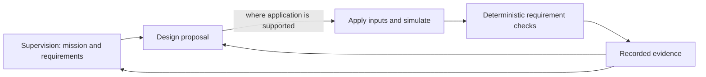

# Understand the design–verification loop

The project develops engineering teams across domains. A scenario gives a team a concrete system, observations, available tools, design variables, constraints, and an evaluation procedure. The three bundled scenarios are examples with different capabilities, not successive maturity levels of one simulator.

## Roles and authority

**Supervision** supplies the mission, design requirements, and verification requirements. The mission remains the top requirement. Humans retain final authority over requirement revisions.

**Design** proposes a permanent change for a future build or run. **Operations** acts on the currently simulated system. Starting an oxygen generator during a run and increasing its installed capacity for the next run are different actions.

**Verification** measures a candidate under declared conditions and checks requirements deterministically. Agents may explain observations or propose a requirement change; their explanations do not establish pass/fail. A request to revise a requirement is a supervision decision, not permission to move the scoring threshold during a comparison.

## What evidence establishes

A constraint defines an allowed region or a required behavior. An optimization metric ranks outcomes within a declared objective. A high score alone does not establish constraint satisfaction. An execution exit code shows whether a procedure completed, not whether its engineering result is acceptable.

Model verification tests the implemented simulation and its invariants. Numerical agreement compares implementations under matching conditions. Physical validation requires observations of the real system; none of the bundled scenarios establishes that through a simulated pass.

A proposal is not an applied design. A viewer preview is not a second simulation. Look for the consumed inputs, the applied configuration, new observations, and the scenario's evaluation record before claiming an improvement.

## Choose the evidence contract

[Scrubber](scenarios/scrubber_degradation/index.md) studies recovery operations and post-run recommendations. [ECLSS](scenarios/ssos_eclss_loop/index.md) supports proposal application and chained capacity design. [Balancing cube](scenarios/balancing_cube/index.md) uses frozen requirements and mechanical simulation with separate screening and validation. Follow the selected scenario's results page when interpreting outcomes.

## How a claim becomes reviewable

This is a conceptual verification path. Proposal application follows the selected scenario: scrubber does not implement reinjection. The feedback arrow to supervision is a request to review requirements, not an automatic rewrite. The feedback arrow to design carries measured outcomes, not a declaration that a narrative is true.

| Evidence level | Question it can answer | What it does not establish |
| --- | --- | --- |
| Proposal/schema validation | Is this input allowed and well formed? | That it works |
| Model verification | Do implemented rules and invariants hold? | That the model matches hardware |
| Numerical comparison | Do declared implementations agree under matching conditions? | Real-world accuracy |
| Physical validation | Does observed hardware satisfy declared requirements? | An outcome available from these simulation runs alone |
