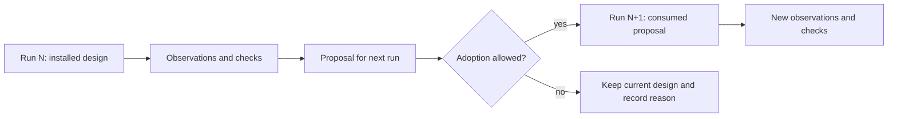

# Iterate a design and verify the handoff

Choose an iteration procedure supported by your scenario. [ECLSS](../scenarios/ssos_eclss_loop/running.md) applies post-run proposals before a later run and supports a chain. [Cube](../scenarios/balancing_cube/running.md) runs a bounded design search against a frozen SSOT plan. Scrubber emits recommendations but does not feed them into the next simulation.

## Run an ECLSS chain

With the model service configured as described in [LLM setup](llm.md):

```bash
PYTHONPATH=src python -m tools.cli run ssos_eclss_loop \
  --backend plant_sim --actor-mode labeled_rule_base --design-mode llm \
  --iterate 3 --steps 50 --run-id capacity-review-01 --dry-run --json
```

Review the plan, then remove the dry-run flags. A chain uses numbered child directories and, by default, `baseline-replay` and `final-replay`. It adopts permitted design changes between simulations, preserving earlier changes that a later partial proposal omits. Verification thresholds are not automatically applied as design changes.

Provisional designs that need supervisor approval are withheld unless `--approve-provisional` is enabled. Read feasibility, eligibility, and approval reasons first. Automatic chains discard `rejected_final` documents. Manual `--apply-proposals` with `--approve-provisional` bypasses status blocking, including `rejected_final`; it does not enforce every engineering bound or guarantee safety/constraint compliance. `--no-approve-provisional` restores the status gate. `--apply-proposals` and an automatic chain cannot be combined; use the [two-run procedure](../quickstart.md) for a specific external handoff.

## Review the result

Read `chain_summary.json` and `chain_final_answer.json`, then inspect the chosen candidate's simulation evidence. The latest proposal may still be unverified; a selected answer need not be the final numbered run.

The chain's `IMPROVED` verdict requires successful paired replays and compares survival in the selected measured numbered-run design against the first numbered run. The replay survival counts are recorded separately and do not enter this verdict. An equal-survival design with a better score can be useful while the verdict remains `NOT_IMPROVED`. Disabling paired replay gives `INCONCLUSIVE`. Mock chains exercise handoffs but cannot establish a plant capacity improvement.

For cube, use the scenario's separate selection, GPU comparison, and promotion rules. Do not generalize ECLSS's chain verdict or approval flags to mechanical workflows.

## Follow the installed design, not the last idea



| Record | Question to ask |
| --- | --- |
| Proposal | What is being suggested, and why? |
| Consumed proposal / compiled input | What was actually installed? |
| New run evaluation | What happened after application? |
| Chain selection | Which measured design was selected, under which requirements? |
| Unverified last proposal | What still needs another measured run? |

The [historical ECLSS example](../scenarios/ssos_eclss_loop/results.md#historical-four-chain-record) shows why this matters: early partial proposals could lose an already successful design. Those recorded failures predate the current completion of omitted capacity fields.
