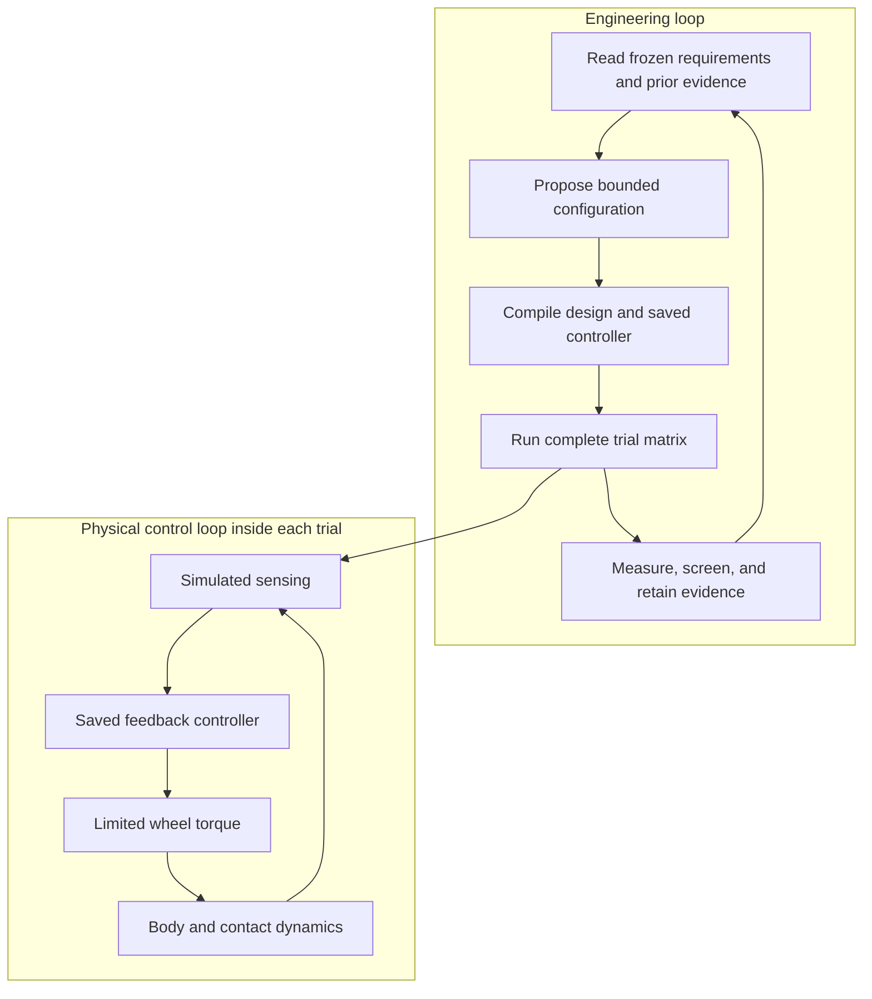

# Balancing cube

Use this scenario to investigate bounded mechanical design changes for a balancing cube. Requirements, reference design, controller, trial matrices, seeds, and verification criteria come from a frozen One Piece single source of truth (SSOT) snapshot. A model-generated proposal cannot rewrite those requirements or the verifier.

A normal run screens the reference and candidates using native MuJoCo. It selects an exploration candidate, evaluates a separate frozen validation matrix, and can compare MJX GPU results. An optional Isaac workflow exports the same frozen model for separate contact simulation campaigns. These forms of evidence have different limits.

Start with [configuration](configuration.md) to prepare a store and optional dependencies. Follow [running](running.md) to evaluate a reference, search designs, or use Isaac. Read [results](results.md) before interpreting a completed run or selected design: CPU screening, numerical confirmation, and physical validation are distinct.

This scenario does not infer electrical energy, motor temperature, or real-hardware compliance from a simulated balancing result. To modify its implementation or frozen contracts, see the [developer scenario documentation](../../../developers/scenarios/balancing_cube/implementation.md).

## Two loops, two timescales

The LLM participates in the outer engineering loop. It does not issue motor commands at each controller tick. A saved controller and frozen sensing/actuation assumptions define the inner loop.

The original walkthrough distinguishes the eight-corner hardware mission from a declared numerical trial, and the runnable snapshot from an older experiment. A viewer displaying a newer requirement model does not retroactively change a saved campaign.
