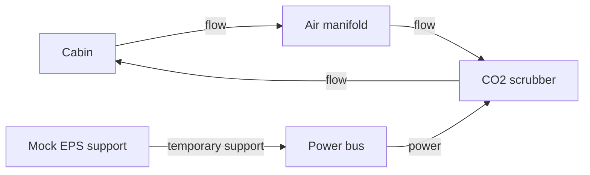

# Scrubber degradation

Use this scenario to study how an engineering team responds when CO₂ scrubbing degrades while power margin falls. It couples a simple ECLSS model to a mock electrical-power support model. This is a deterministic station abstraction, not a validated spacecraft model.

An anomaly starts at step 20 in the bundled configuration. Runtime agents can adjust fan speed, enable bypass, reduce load, and request temporary EPS support. Post-run designers can recommend permanent changes, but this scenario does not apply those recommendations to the next simulation. A dashboard Before/After view is a preview.

Follow [configuration](configuration.md) to select conditions and modes, [running](running.md) to compare them, and [results](results.md) to interpret recovery indicators. The default scenario is a no-agent baseline; choose an agent mode explicitly for team behavior.

Use [ECLSS](../ssos_eclss_loop/index.md) when your task requires a supported proposal→next simulation loop. For changes to this scenario, see its [developer implementation](../../../developers/scenarios/scrubber_degradation/implementation.md).

## The modeled station

The original scenario separates airflow from electrical support:

`cabin`, `manifold`, `scrubber`, and `power_bus` are the initial topology nodes. Temporary bypass operation changes an operating flag; a proposed bypass edge is a permanent design recommendation. Keeping those separate lets you examine recovery without pretending that runtime commands rebuilt the station.
