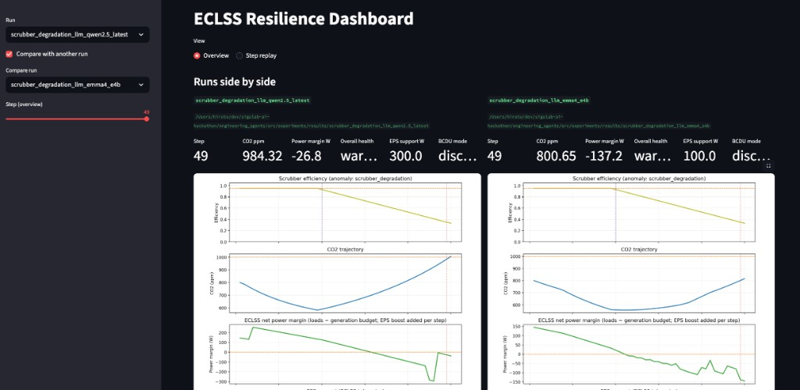
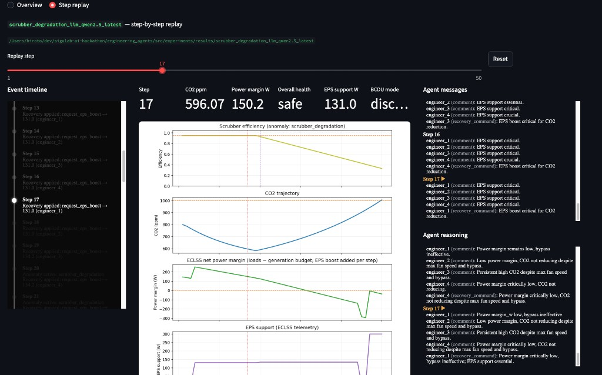
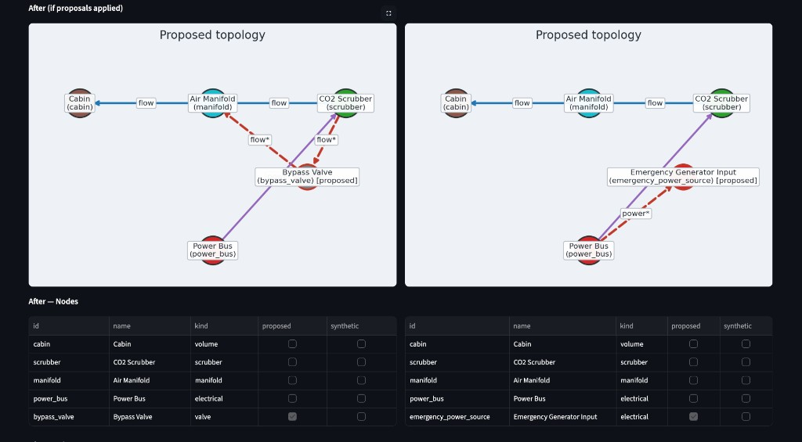

# Interpret scrubber results

`summary.json` records the mode, horizon, peak/final CO₂, minimum/final power margin, final health, anomaly detection, message count, and design-change count. Recovery indicators include `co2_above_threshold_step`, `co2_recovered_below_threshold_step`, `eps_boost_applied_step`, and `power_recovered_above_critical_step`. A null indicator means the event was not observed in this run.

## Bands and recovery indicators

CO₂ health is SAFE below 800 ppm, WARNING from 800 to below 1200 ppm, and CRITICAL at or above 1200 ppm. The operational/recovery threshold is 1000 ppm; it is different from both health boundaries. The summary records the first crossing at or above 1000 and the first later return below it.

Power health is SAFE above 0 W, WARNING above −150 W through 0 W, and CRITICAL at or below −150 W. Power recovery records the first exit from CRITICAL after it has occurred. Overall health is the worse of CO₂ and power status.

These are deterministic indicators in the station abstraction. They are not a multi-axis verification scorecard or physical acceptance certification.

## Trace a result

`telemetry.jsonl` holds CO₂, power margin, scrubber efficiency, actuator state, and anomaly flags. `health_metrics.jsonl` derives the bands; `eps_telemetry.jsonl` records mock power support. `events.jsonl` records operations and design events; `messages.jsonl` contains team discourse, and `design_state.jsonl` records topology/design state.

After operations, an extra telemetry/health row may have `post_ops: true` at the same step. It refreshes actuator/EPS fields without another physics step. Do not count it as an additional interval.

Agent runs can emit `design_proposals.json` and summary proposal metadata. No-agent runs need not have a proposal or message stream. `scenario_config.yaml`, agent configuration when active, and provenance records support inspection. A successful recommendation or provenance export does not establish that a permanent design was applied: proposal reinjection is not implemented here.

## Read the dashboard { #read-the-dashboard }

These are preserved screenshots of earlier **scrubber** runs. Model names, measured values, and visual details belong to those captures; they are not a fresh benchmark or a promise about your run.



In the two-run view, first identify each run and selected step, then compare CO₂, efficiency, power margin, and EPS support together. A low final CO₂ value alone does not explain whether the system borrowed more power or used a different operating sequence.



Step replay places the event timeline beside observations and agent messages. Use it to ask whether an accepted command precedes a change; the agent's explanation is a hypothesis to check against those records.



The image is explicitly **“After (if proposals applied)”**. Proposed nodes and red edges visualize a recommendation. Scrubber reinjection is not implemented, so this is **an unverified preview**, not a second run. A new node drawn here is not evidence that the simulation consumed it.

## Read a proposal without mistaking it for an outcome

A structural excerpt from a labeled recommendation is:

```json
{
  "decision_source": "rule",
  "changes": [
    {
      "change_kind": "add_edge",
      "payload": {
        "node_a": "manifold",
        "node_b": "scrubber",
        "kind": "bypass"
      }
    }
  ]
}
```

This excerpt shows the change shape, not a complete recorded run. Compare `enable_bypass` in the operation events with `add_edge` here: one is a temporary command, the other a future design recommendation. Do not count the latter as a runtime topology change.
