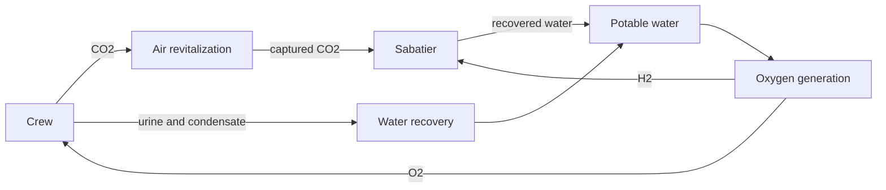

# ECLSS loop

Use this scenario to study resource operations and post-run sizing of air revitalization (ARS), oxygen generation (OGS), and water recovery (WRS). Runtime actors operate the current system; post-run designers propose the next build. Their modes are independent.

Choose `mock` for a lightweight handoff exercise, `plant_sim` for the local resource and survival model, or `ros2` to operate SSOS through its container bridge. The same command name does not make their physics or evaluation scope equivalent.

This scenario can consume `design_proposals.json` before a later run and can chain design→verification rounds. Capacity proposals apply to `plant_sim`; graph/service changes have backend-specific limits. Verification thresholds remain separate from the allowed design variables.

Start with [configuration](configuration.md), follow [running](running.md), and use [results](results.md) to judge survival, constraints, score, and comparison evidence. The [quickstart](../../quickstart.md) is a deliberately small mock handoff. To change the implementation, read the [developer scenario guide](../../../developers/scenarios/ssos_eclss_loop/implementation.md).

## Follow the coupled resources

This is a resource-flow explanation, not a ROS topic graph. The local plant tracks coupled inventories, throughput limits, action timing, and survival. Broader habitat functions such as temperature, humidity, and pressure control are outside this plant's implemented scope.

| Role | During a simulation | After a simulation |
| --- | --- | --- |
| Actor | Observe inventory/health and request permitted operations | Its events become decision evidence |
| Designer | Does not resize the installed plant mid-run | Proposes a next design; LLM tool-use can measure candidates |
| Deterministic evaluator | Collect observations/events | Check applicability, integrity, physics, and score |
