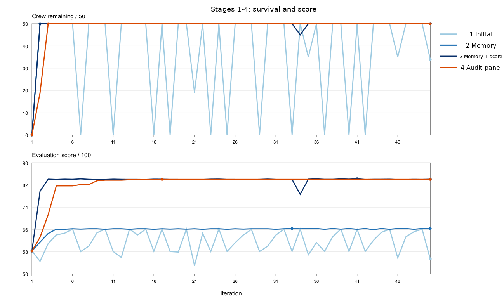
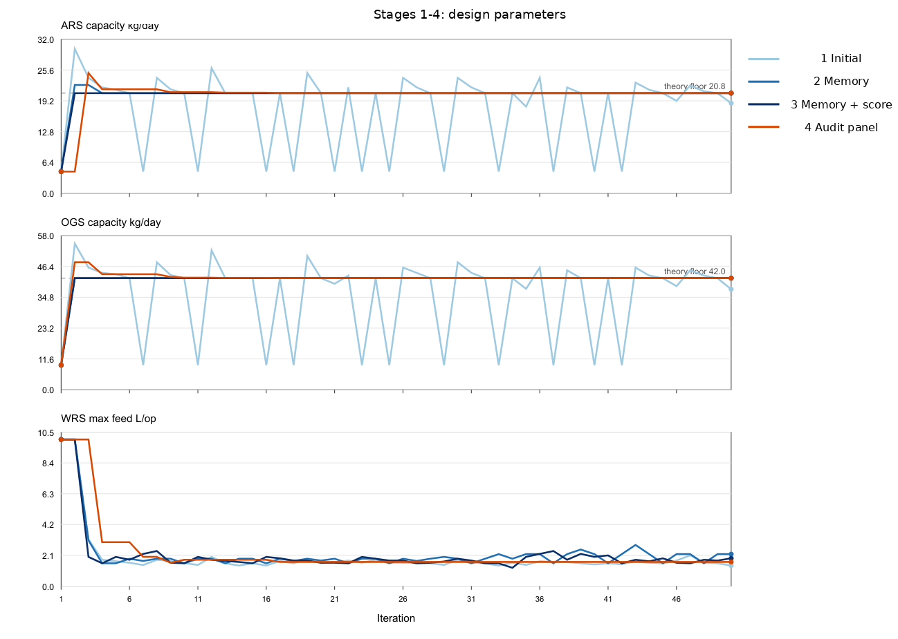
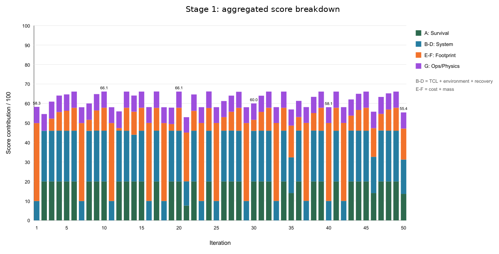
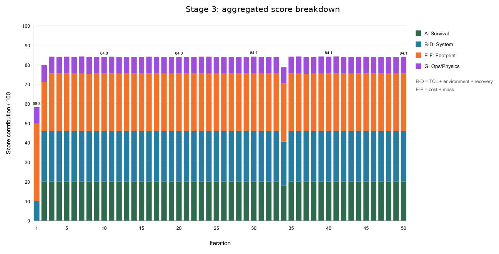

# Interpret ECLSS evidence

Use `summary.json` to identify backend, actor/design modes, steps, fault injection, resource extrema/final state, operations, and proposal/evaluation paths. Plant runs also record crew initial/remaining/lost and causes. The saved effective configuration states the experiment actually run.

## Health and canonical observations

Default storage bands are CO₂ HIGH at 2 kg and CRITICAL at 8 kg; O₂ LOW at 6 kg and CRITICAL at 1 kg; potable water LOW at 50 L and CRITICAL at 25 L. These are scenario requirements, not a conversion from scrubber ppm bands. Plant survival uses configured dwell policies plus physical resource limits.

`telemetry.jsonl` may contain both pre-operation and `post_ops` rows at one step. The evaluator uses the `post_ops` row when present, otherwise the final row for that step. Actor-decision checks use the first non-post row at the event step. `events.jsonl` records accepted/rejected operations, busy guards, faults, and losses; `messages.jsonl` records agent discussion.

## Evaluation contract

`evaluation.json` is the canonical deterministic scorecard, currently schema **2.1**. `evaluation.html` and `evaluation_browser.html` are views. Full scoring requires `plant_sim` with survival enabled. Mock/ROS2 and disabled evaluation are not fully scored; inspect the applicability reason. Invalid physics or evidence-integrity results invalidate the record. `physics_gate.json` and `run_integrity.json` retain supporting checks.

The current maximum is 100 with actors:

| Axis | Maximum | Read it as |
| --- | ---: | --- |
| Actor survival | 20 | Retained crew, not an independent physical certification |
| Time to crew loss (TCL) | 10 | Observed survival against the declared horizon |
| Environment trajectory | 10 | Resource-band severity through the run |
| Resource recovery | 10 | Terminal state and recovery from the worst state |
| Cost | 20 | Configured exploration cost model |
| Mass | 20 | Configured installed-mass model |
| Actor decision | 5 | Response timing and command validity |
| Physical response | 5 | Observed response to valid operations |

No-actor runs omit the last two axes and have maximum 90. An unobserved axis can leave the score incomplete; inspect `status`, `scores.complete`, axis statuses, and `scores.applicable_max` before comparing totals. Scores from earlier schema versions need not be comparable.

TCL uses observed data against the configured 16-hour reference; it does not extrapolate future survival. Cost/mass scores use the configured exploration sizing model. Constraints and the full-survival design objective are separate from a total score. LLM reasoning never supplies deterministic pass/fail, and passing this plant model does not establish physical validation.

## Design and chain records

`design_proposals.json` proposes the next design; `consumed_proposals.json` records a proposal actually applied before this run. `design_history.json`, design candidate records when present, and provenance support the handoff. A proposal may carry `provisional_final` or `requires_supervisor_approval`; read those reasons before adoption.

A chain adds numbered child runs, `chain_summary.json`, `chain_final_answer.json`, and optional baseline/final replays. Successful paired replays are required for `IMPROVED`, but its comparison uses the selected measured numbered-run design's crew survival versus the first numbered run, not the replay survival counts. Equal survival is `NOT_IMPROVED`, even when another metric improves; missing comparison evidence gives `INCONCLUSIVE`. Read `unverified_proposals` and the selected candidate's evidence: the last emitted proposal is not automatically the verified answer. See [design iterations](../../guides/design-iterations.md).

## Historical four-chain record — 2026-08-30 { #historical-four-chain-record }

This worked example reuses the original experiment record and figures. The four archived chain summaries are dated **2026-08-30 UTC**. They contain **one recorded chain per stage**, each with 50 design rounds and 50 simulation steps per round. This is evidence about those runs, not a current benchmark, controlled causal proof, or universal agent-improvement result.

| Recorded condition | Value in the saved runs |
| --- | --- |
| Plant and crew | `plant_sim`, 50 crew, survival enabled |
| Observation interval / horizon | 1200 s / 50 steps per simulation |
| Initial CO₂ / O₂ / water | 1.3 kg / 8 kg / 80 L |
| Operations | `labeled_rule_base`; no injected subsystem faults |
| Designer | vLLM `qwen3.8-27b-uncensored`; generation temperature 0.45 |
| Recorded seed | null; not an independently sampled multi-seed study |
| Evaluation schema | **2.0**, with a footprint configuration change before stage 3 |

The original headline values are preserved below. “Final replay” means the recorded final replay, **not** the selected candidate's survival. The record contains distinct selected-design, last-numbered-run, and replay outcomes.

| Recorded measure | 1: Initial | 2: + memory | 3: + score re-anchoring | 4: + audit panel |
| --- | ---: | ---: | ---: | ---: |
| Completed rounds | 50 | 50 | 50 | 50 |
| Baseline replay survivors | 0/50 | 0/50 | 0/50 | 0/50 |
| **Final replay survivors** | **34/50** | **50/50** | **50/50** | **50/50** |
| Rounds with all 50 alive | 34 | 49 | 48 | 48 |
| Rounds with 0 alive | 12 | 1 | 1 | 1 |
| Complete design proposals | 38/50 | 50/50 | 50/50 | 50/50 |
| Unique designs | 39 | 11 | 17 | 9 |
| Best score | 66.18 | 66.36 | 84.23 | 84.03 |
| Mean score | 61.71 | 65.94 | 83.34 | 82.59 |
| Final score | 55.41 | 66.36 | 84.08 | 84.03 |

!!! warning "Historical scoring basis changed"
    Stages 1–2 and stages 3–4 have different cost/mass scoring anchors even though the saved schema field is 2.0 throughout. The rise from about 66 to 84 is not an equivalent 18-point hardware improvement. Stages 3 and 4 share a scoring basis. Do not compare any of these totals directly with current schema 2.1 results without checking the full evaluator and configuration.



Read the upper survival panel separately from the lower score panel. The records show that memory coincided with fewer collapses, and the audit stage explored fewer unique designs. One chain per stage and several pipeline changes do not isolate a causal effect of memory or audit.

### Distinguish proposed and installed fields

The original report's phase-1 example is a state-inheritance failure:

```text
round 24: ARS=20.8  OGS=42.0  WRS=1.8  → 50/50 alive, 66.18
partial WRS-only proposal
next run: ARS=4.5  OGS=9.25           → 0/50
```

The current handoff completes omitted capacity fields from the installed design. This historical failure is not a description of today's merge behavior. In the CSV, `config_ars` / `config_ogs` / `config_wrs` describe the machine that ran; `proposal_ars` / `proposal_ogs` / `proposal_wrs` describe what was handed on. A blank proposal field is not a measurement of zero capacity.



The original archive used a calculated floor to guide the search, and stage 4 used an item-veto audit panel. Those recorded mechanisms differ from later measured-floor and audit changes. Do not use the old floor or audit behavior as a current contract.

### See the scoring change in its components

Stages 1–2 gave full footprint marks at the non-surviving baseline; stages 3–4 moved those anchors. The following original charts retain their historical grouped labels and values:





| Footprint setting | Stages 1–2 | Stages 3–4 |
| --- | --- | --- |
| Cost full-score anchor | Baseline | 500 MUSD |
| Cost zero-score anchor | 750 MUSD | 900 MUSD |
| Mass full-score anchor | Baseline | 3400 kg |
| Mass zero-score anchor | 5000 kg | 6000 kg |

A score can change because the design changes, because the evaluator changes, or both. Here the component charts show why you must retain physical quantities and survival alongside the scalar score.

### Trace the retained evidence

Read the [original experiment report](https://github.com/hirototamura/engineering_agents/blob/648237d8596462362b5772914242a3881f82ad35/docs/en/results.md) for the complete narrative. The [four-stage summary JSON](https://raw.githubusercontent.com/hirototamura/engineering_agents/648237d8596462362b5772914242a3881f82ad35/docs/data/ssos_three_way_comparison_summary.json) and the [raw per-round data](https://github.com/hirototamura/engineering_agents/tree/648237d8596462362b5772914242a3881f82ad35/docs/data/) retain all recorded values; each `phaseN_iteration_metrics.csv` has 50 rows and 54 columns. The [original run archives](https://github.com/hirototamura/engineering_agents/tree/648237d8596462362b5772914242a3881f82ad35/experiments/eclss/runs/) retain complete inputs and per-round evaluations. These links pin the source revision used here; no experiment or figure was regenerated for this documentation.
