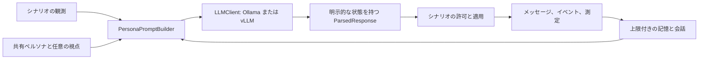

# エージェントとチームの境界

エージェントは提案と説明を行います。実行できる操作と、証拠が示す結果はシナリオの決定論的なコードが判断します。LLM に受入要件の書き換えや物理的な合格宣言の権限を与えないでください。

## 共通の基本部品

[core/agents/base.py](https://github.com/hirototamura/engineering_agents/blob/main/src/core/agents/base.py) の `Team` は `run_step(context, observation)` と `apply_outcome(context, outcome)` を定義します。コンテキストと結果の型はシナリオに依存します。`Persona`、`DeliberationContext`、`PersonaAgent` は識別、思考の視点、プロンプト構築、応答の解析を支援します。汎用の複数エージェントスケジューラではありません。

`core/agents/types.py` はメッセージとスクラバー向けの観測・結果を定義します。メッセージは役割、種別、理由、メタデータを持ちます。思考のトレースは呼び出しの診断情報であり、検証器の判定ではありません。`core/agents/memory.py` は共有の会話と個別エージェントの最近の記憶に上限を設けます。

[core/llm/factory.py](https://github.com/hirototamura/engineering_agents/blob/main/src/core/llm/factory.py) は Ollama または vLLM のクライアントを作ります。`LLM_PROVIDER` は設定したプロバイダより優先します。URL、モデル、コンテキスト長、タイムアウト、同時実行、思考出力の動作は各クライアントが担当します。プロンプト変更時も通信エラーと解析結果を追跡可能にしてください。

## メッセージと応答の流れ



[parsing.py](https://github.com/hirototamura/engineering_agents/blob/main/src/core/llm/parsing.py) は対応する思考タグを JSON 抽出用に除き、引用内の波括弧を考慮して最後の均衡したオブジェクトを探します。`ParsedResponse` は診断を保持し、呼び出し側が必須項目と代替処理を決めます。

| 解析状態 | 意味 | 回帰確認の責務 |
| --- | --- | --- |
| `ok` | 呼び出し側の必須項目を持つオブジェクト | シナリオの操作・設計検査は引き続き必要 |
| `partial` | 必須項目の欠落や別名の使用 | 状態と代入した動作を追跡可能にする |
| `fallback` | 期待するオブジェクトを解析できない | 代替操作をモデル判断の成功に数えない |
| `empty_response` | 空または空白だけの応答 | プロバイダ・解析の診断を残す |

`AgentMessage.to_dict()` はメタデータを JSONL オブジェクトの直下へ展開します。項目追加時は `step`、役割、`message`、`message_type`、`reasoning` と衝突させないでください。現在の `update()` はこれらを上書きできます。次は構造を示す例です。

```json
{"step": 4, "from_role": "engineer_1", "to_role": "team", "message": "操作前に記録した余裕を確認する。", "message_type": "comment", "reasoning": "", "deliberation_phase": "deliberation", "parse_status": "ok"}
```

## 再利用する思考の視点

`load_team()` は名前を検査し、`build_personas()` は ID に順番に視点を割り当て、共有ペルソナの先頭へ加えます。空なら同一のペルソナを使います。これらは思考のプロンプトであり、固定した技術役割や合否の権限ではありません。

| `ARCHETYPE_LENSES` の名前 | 問う内容 |
| --- | --- |
| `first_principles` | 物理的な事実から仕組みを組み立て直せるか |
| `failure_mode` | 二次故障と最悪条件に何が残るか |
| `improviser` | 既存資源でどんな小さな介入が可能か |
| `systems_integrator` | サブシステムの結合が結論をどう変えるか |
| `rederive_numbers` | 各数値を独立に再計算できるか |
| `break_conclusion` | 生まれつつある主張を何が反証するか |
| `avoid_local_optima` | 狭い局所的な調整を繰り返していないか |
| `design_validity` | 機械全体を製造・運用できるか |

文面と名前の検査は [persona.py](https://github.com/hirototamura/engineering_agents/blob/main/src/core/agents/persona.py) が担当します。シナリオ別の視点、代表の交代、監査の適用は各シナリオに置きます。

## シナリオごとの責務

- スクラバーの `scenario/agents/scrubber_degradation_team.py` は復旧操作を提案し、シミュレータを通じて適用し、実行後の設計提案を作ります。
- SSOS は実行中の `SsosEclssLoopTeam` と、`PostRunDesignAgent`・ツール利用設計器を分離します。`agent_config.py` は操作と設計のモードを個別に解決します。候補の評価はシナリオのツールと評価器に残します。
- キューブの `workflow.py` は設計ループ内で専門家、批評、統合の作業を調整します。アダプタが提案をコンパイル・評価し、共通のステップチーム契約は使いません。

代替処理も異なります。SSOS のツール利用設計器は測定済み候補を保持し、決定論的な代替処理を明示できます。キューブはプロバイダ失敗時に不確定として停止し、規則処理を LLM の結果と見せません。

変更前に、操作の許可、証拠、最終選択を誰が持つかを確認します。`tests/core` のペルソナ・プロバイダのテストと、`tests/scenario` の対象チームのテストを確認してください。同時実行を変える場合は `test_llm_parallel_deliberation.py` または `test_balancing_cube_workflow.py`、投入する情報を増やす場合はプロンプト上限も確認します。証拠へのアクセスは[ツールと記憶](tools-memory.md)を参照してください。
