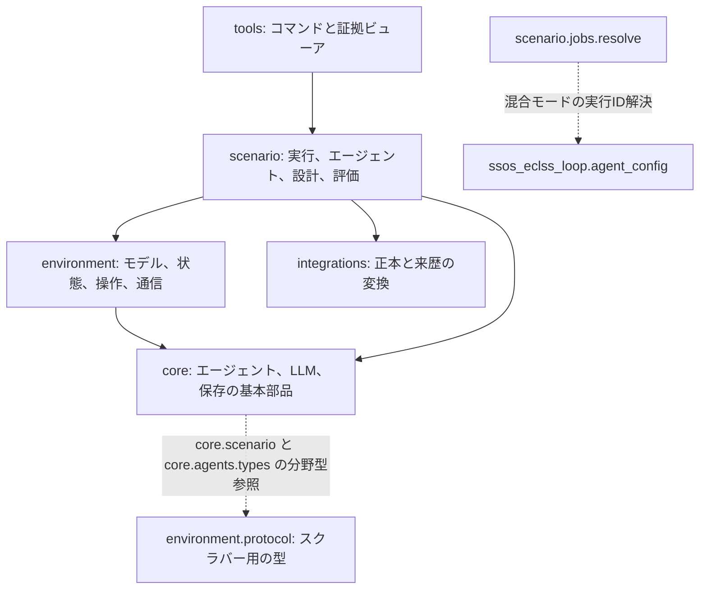

# アーキテクチャと責務

基盤はエンジニアリング作業を調整し、各シナリオが世界と証拠の意味を持ちます。依存の設計方針は `tools → scenario → environment → core` です。シナリオは記録と権限のために `integrations/one_piece` を呼び出します。シミュレータの実装に LLM 呼び出し、ペルソナ、方針判断を入れないでください。

## 目標のレイヤーと現在の結合

実線は目標とする依存方向です。破線は現在の共有型モジュールなどにある例外を示し、拡張用のインターフェースや上位への依存を追加する許可ではありません。

確認先は [core/scenario.py](https://github.com/hirototamura/engineering_agents/blob/main/src/core/scenario.py)、[core/agents/types.py](https://github.com/hirototamura/engineering_agents/blob/main/src/core/agents/types.py)、[scenario/jobs/resolve.py](https://github.com/hirototamura/engineering_agents/blob/main/src/scenario/jobs/resolve.py) です。分野非依存の契約の抽出は今後の作業であり、図で現在の結合を隠してはいけません。

## 具体的な契約の場所

環境の構成、シミュレータのクラス、エージェント・評価の流れは各[シナリオ実装](scenarios/index.md)で定義します。詳細な契約は分野の配下に置き、共有ページの比較表へ広げません。`design_proposals.json` のような同名ファイルでも分野のスキーマを共有するとは限らず、抽象 `Scenario` と `Team` も現在の全ランナーやワークフローを表しません。

## 変更先の選び方

- `tools/cli` はコマンドを通常実行または機械系ジョブの入力に変換します。`tools/analysis`、ダッシュボード、レポート生成は証拠を閲覧します。
- `scenario/jobs` は直列化可能な実行要求、振り分け、出力先、SSOS の連鎖実行を担当します。
- `scenario/<name>` は設定の解釈、ライフサイクル、設計変数、評価、固有の契約を持ちます。`scenario/agents` はスクラバーと SSOS のチームを実装します。
- `environment` はモデルの状態、物理モデルやモックの遷移、バックエンド操作、単位、テレメトリの境界を持ちます。
- `core/agents`、`core/llm`、`core/event_log.py`、`core/storage` は共有のエージェント、プロバイダ、保存の基本部品です。
- `integrations/one_piece` は来歴を変換し、キューブの版を固定した正本コンテキストを解決します。

これは責務の方針であり、現行の型がすべて分野非依存という意味ではありません。例えば `environment/protocol.py` のテレメトリとコマンドはスクラバー固有で、`core/scenario.py` と `core/agents/types.py` は環境の型を読み込みます。[SSOS](scenarios/ssos_eclss_loop/implementation.md) は専用のバックエンド契約を、[バランシングキューブ](scenarios/balancing_cube/implementation.md)は別の設計アダプタを使います。

## 現在の結合箇所

[scenario/runner.py](https://github.com/hirototamura/engineering_agents/blob/main/src/scenario/runner.py) は `scenario.yaml` のあるディレクトリを一覧にしますが、実行には 3 つの固定レジストリを結合して使います。[execute_run](https://github.com/hirototamura/engineering_agents/blob/main/src/scenario/jobs/executor.py) と CLI には SSOS とキューブ専用の分岐があります。抽象 `Scenario` クラスは分岐が使うすべての引数を表しておらず、キューブのランナーは継承していません。

ディレクトリの追加だけでは新しいシナリオを実行できません。[シナリオ追加](guides/add-scenario.md)に従い、固定レジストリを外部プラグイン機構として説明しないでください。[外部シナリオ化の開発計画](development/external-scenarios.md)は、ある分野の型を別の分野へ押し付けずに結合を減らす作業を整理しています。
