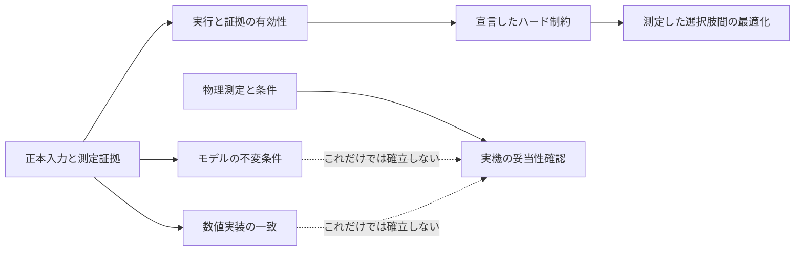

# 評価の責務

評価には独立した問いがあります。ハード制約は設計を受け入れられるかを問い、最適化スコアは受入可能な測定結果を順位付けします。モデルの検証は実装したモデルの不変条件を調べ、数値的一致は条件を明示して実装間を比較します。実機の妥当性確認には実際の物理系の証拠が必要です。コード、要約、レポートでこれらを分けてください。

## 結果を結合する前に問いを分ける

これは考え方の図であり、単一の実装済み評価器ではありません。検査の結び付きは各シナリオが定めます。

| 問い | 主な入力 | 結果が示せること | 別に残ること |
| --- | --- | --- | --- |
| 実行は完了したか | 要約、試行キー、期間、エラー | 指定した計算の完了 | 技術要件の充足 |
| 証拠を受け入れられるか | 完全性、必要な測定、来歴 | 比較の根拠が揃っている | 高い目的値 |
| 要件を満たすか | 固定基準と測定値 | 宣言した検査の合格 | ハードウェアへの忠実度 |
| どの設計を選ぶか | 宣言した目的と比較可能な結果 | その目的の下での順位 | 未試験条件の信頼性 |
| 実装同士は一致するか | 対の軌跡と許容差 | 宣言範囲の数値的一致 | 実機の妥当性確認 |
| モデルは現実に合うか | 校正した物理測定 | 試験した範囲の妥当性 | 未観測の運転範囲 |

## 現在の担当箇所

[スクラバーの評価](scenarios/scrubber_degradation/evaluation.md)はモックのステーションループの復旧テレメトリと決定論的な健全性分類です。プロジェクト共通のスコアや実機検証の主張はありません。

[SSOS の評価](scenarios/ssos_eclss_loop/evaluation.md)は保存済みの設定、テレメトリ、イベント、要約を使います。`unified_evaluation.finalize_run_evaluation()` は実行後の設計より先に動き、評価と物理ゲートを一度書き、要約にコンパクトな結果を加えます。完全性と物理的な受入条件によって、高得点でも無効になります。候補の選択と連鎖の最終回答の選択は測定証拠を使う別の処理です。

[キューブの評価](scenarios/balancing_cube/evaluation.md)は完全な固定試行行列を SSOT 契約で検査します。目的関数による順位と CPU/GPU の一致は別の主張です。GPU の未実行を GPU 検証へ、数値的一致を実機の妥当性確認へ読み替えません。

## レビュー可能性を保つ変更

各検査の入力成果物や正本の契約を追跡可能にします。合格時の処理より先に、欠落、非有限値、不完全、非適用の扱いを定めてください。比較中の要件は固定します。監督が要件を改訂した場合は新しい根拠を記録し、過去の得点を黙って改善しません。

LLM の説明は失敗理由の解釈、設計の提案、要件変更の提案に使えますが、決定論的な判定を供給しません。ビューアとレポートは記録した評価を示し、追跡できない新しい採点規則で置き換えないでください。

実装の手順は[評価変更](guides/change-evaluation.md)を参照します。しきい値の境界、証拠欠落、完全性の無効化、順位の同点、採用候補の来歴を確認してください。日付付きの既存レポートは記録した条件を説明します。文書整理のために実験を再生成・再採点しません。
