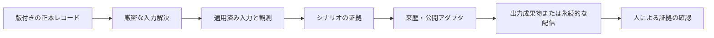

# 記録と外部連携

証拠の記録は要件、適用した設計、観測、判断を結びます。保存用の部品だけで正本や権限が決まるわけではありません。その境界はシナリオと連携機能が持ちます。

## ローカルの証拠

`EventLog` は実行中に名前付きの JSONL ストリームへ追記します。要約と名前付き JSON 成果物は別に書きます。実効設定は上書き後、SSOS では提案適用後に保存します。消費した提案と新しく出した提案を区別してください。API の動作は[保存契約](reference/storage.md)、成果物の読み方は[利用者向けリファレンス](../users/reference/artifacts.md)を参照します。

`core/storage` は成果物の読み書き、エージェント別セッション、主張の台帳を提供します。主張の台帳は不採用の推奨を撤回し、文書に留保なしで残る参照を検出できます。検査は指定した語句に基づき、文書の意味的一貫性を証明する機能ではありません。不採用案は拒否した証拠として確認できるように残しつつ、採用済みの助言として表示しないでください。

## 正本と配信は異なる契約

情報の責務を示す図であり、共通コネクタの実装ではありません。ECLSS の来歴出力と、キューブの SSOT 解決・配信は別の仕組みです。

| 境界 | 必要な識別 | 失敗時に問うこと |
| --- | --- | --- |
| 正本入力の解決 | レコード ID、版、参照契約 | 欠落や版の不一致で実行を止めたか |
| 測定の記録 | 適用入力と出典成果物 | 実際に何を動かしたか特定できるか |
| エージェント向け投影 | 出典の版と省略の記録 | 除外・圧縮した情報の全体を確認できるか |
| 証拠の配信 | 厳密なレコード版と成果物ダイジェスト | 再送で内容と識別を維持できるか |
| レポート表示 | 記録済み結果と範囲 | 未追跡の評価器を表示側で加えていないか |

来歴のイベント対応は担当する[スクラバー](scenarios/scrubber_degradation/implementation.md)と [SSOS](scenarios/ssos_eclss_loop/implementation.md) の実装で説明します。厳密なレコードの送信箱は[キューブ](scenarios/balancing_cube/implementation.md)が持ちます。

## One Piece との境界

[integrations/one_piece/client.py](https://github.com/hirototamura/engineering_agents/blob/main/src/integrations/one_piece/client.py) はスクラバーと SSOS のイベント、メッセージ、設計状態からローカルの来歴を作ります。ランナーは出力エラーを捕捉して警告し、来歴件数とともに実行結果を保持します。シミュレーション完了は来歴出力の成功を意味しません。

[MechanicalBridge](https://github.com/hirototamura/engineering_agents/blob/main/src/integrations/one_piece/mechanical_bridge.py) はプロジェクト、スナップショット、レコードの版を指定してキューブの入力を解決します。正本のモデルと要件をローカルの既定値へ複写してはいけません。エージェント向けコンテキストは版付きデータの投影であり、除外規則と出典を保持します。スナップショット変更には新しい実行が必要です。

`MechanicalOutbox` は再送のために未送信の記録と成果物参照を保存します。キューブの同期失敗は次の設計を止めるか最終配信を不確定にし、ローカルの再送証拠を残します。実行器は送信の了承を記すために同期済みの機械系要約を書き換えず、最終配信状態を別に報告します。

変更時は識別子、版、ダイジェスト、出典、再送の冪等性を保ちます。`tests/integrations/test_one_piece_recovery_provenance.py`、`test_balancing_cube_import.py`、`tests/scenario/test_balancing_cube.py` のブリッジ・同期の回帰テストを使います。過去データの取り込みや分析レポートは、現在の正本入力と分離してください。
