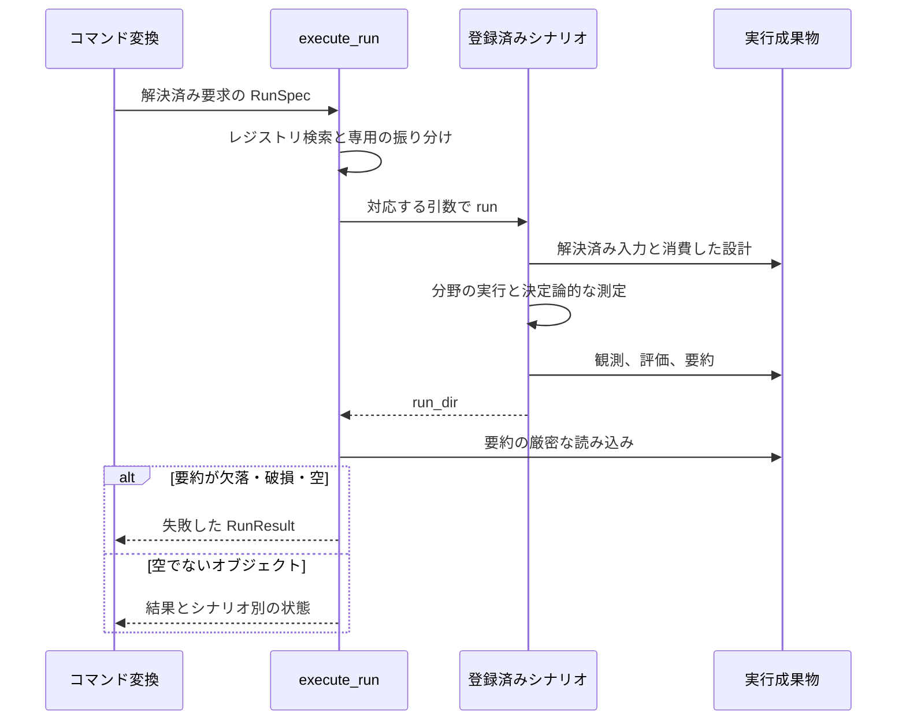

# 実行ライフサイクル

提案した設計、実際にシミュレーションへ投入した設計、測定結果を区別することがライフサイクルの目的です。設定とコマンドの構文は[利用者向け設定リファレンス](../users/reference/configuration.md)を参照してください。このページは実装の処理順を説明します。

## コマンドから証拠まで

1. `tools/cli/commands/run.py` がシナリオ別のモードと CLI の既定値を解決し、上書き設定を統合して必要な事前確認を行い、`RunSpec` を作ります。キューブは機械系コマンドの経路に進みます。
2. `scenario/jobs/executor.py` が固定レジストリから実行先を選びます。SSOS には提案の採用、設計履歴、進捗通知を渡します。キューブは SSOT に基づくループを実行し、証拠ディレクトリを作り直しません。
3. シナリオは最初のステップ前に入力を確定します。SSOS は採用可能な提案をメモリ上の設定へ反映し、操作・設計の設定を正規化して、設計制約を確認し、実効入力と完全性の分類を保存します。キューブは版を指定した SSOT スナップショットを読み、許可された提案をコンパイルします。
4. バックエンドを進め、テレメトリを観測し、チームまたは設計ループを動かして証拠を書きます。実行中の復旧操作と恒久的な設計提案は分離します。
5. シナリオ固有の決定論的評価で証拠を測定します。SSOS は実行後の設計前に評価します。キューブはコンパイルした候補ごとに固定した試行行列を評価します。スクラバーはこれらのスコア表を使わず復旧指標を記録します。
6. 実行器は `summary.json` が空でない JSON オブジェクトであることを要求します。欠落・破損した要約は正常な空結果ではなく実行失敗です。

## ライフサイクルの受け渡し

共有ジョブの責務を示します。シナリオ内部の分野操作は省略しています。その順序は汎用ループでなく、各シナリオのページで定義します。

| 受け渡し | 守る条件 | 変更後も保持する失敗の扱い |
| --- | --- | --- |
| コマンド → ジョブ | モードと対応入力の解決 | 未対応要求は高コストの実行前に拒否 |
| ジョブ → シナリオ | 分岐が対応する引数だけを渡す | 未使用の `RunSpec` 項目を対応済みとみなさない |
| シナリオ → 保存 | 適用入力と次の提案を区別 | プレビューと未実行提案を測定証拠にしない |
| 保存 → 結果 | 空でない要約が保存済み | 証拠欠落を `{}` の成功にしない |
| 結果 → ビューア | 実行成否と設計判定を区別 | 終了コードゼロを実機の受入にしない |

## 反復はシナリオごとに異なる

`scenario/jobs/iterate.py` は SSOS 専用です。実行 N は前回から適用した提案を検証します。最終実行で新しく生成した提案は未実行です。要件ハッシュは固定し、対の再実行では設計を無効にします。最終回答は実際にシミュレーションした機械から選び、最後の提案を自動採用しません。

キューブの `loop.py` は反復数、候補数・時間の上限、重複排除、機械・制御の要因比較、固定コンテキストの保護を担当します。スクラバーは実行後に提案を出しますが、次回のシミュレーションへ投入しません。反復の意味を変える前に[シナリオ別の実装](scenarios/index.md)を確認してください。

回帰確認の入口は `tests/scenario` の `test_run_spec.py`、`test_iterate.py`、`test_chain_final_answer.py`、`test_write_effective_configs.py`、`test_balancing_cube.py` です。失敗と終了の意味は[実行契約](reference/execution.md)で説明します。
