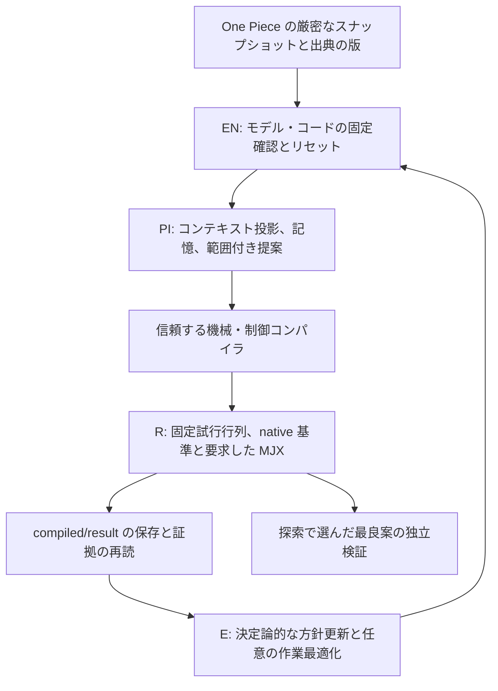
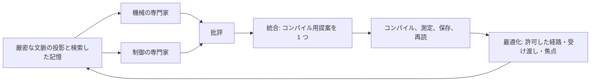
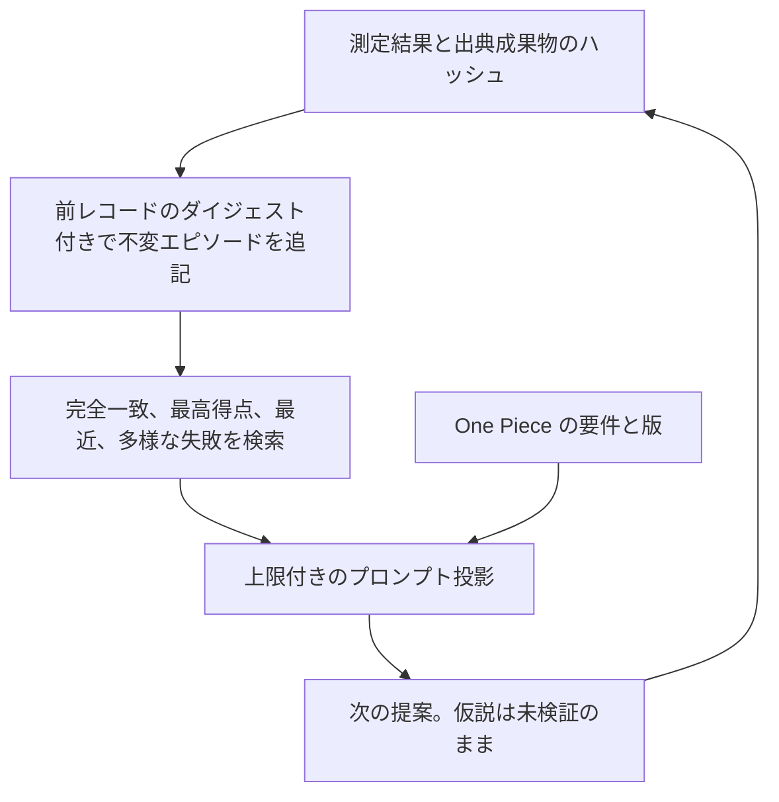
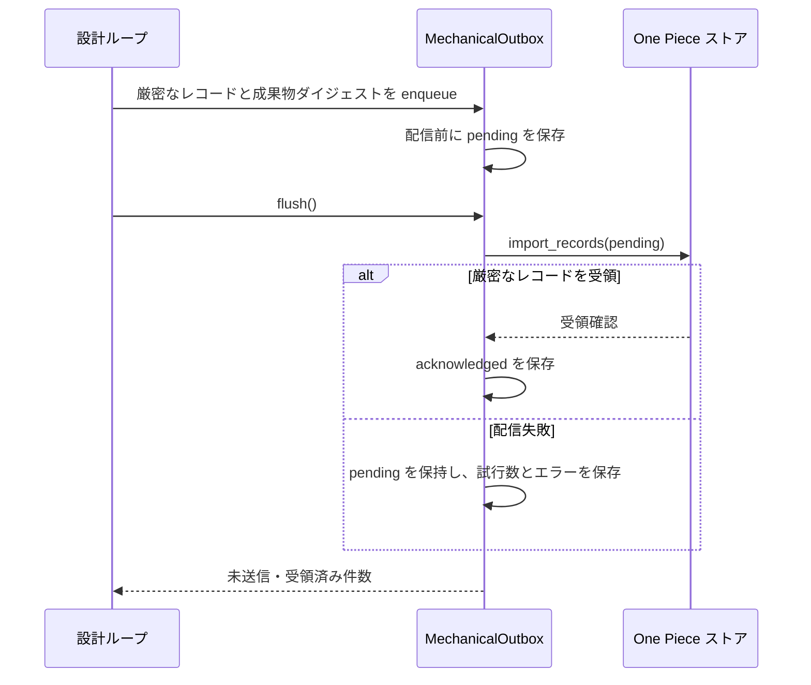

# キューブの実装

[シナリオランナー](https://github.com/hirototamura/engineering_agents/blob/main/src/scenario/balancing_cube/scenario_run.py) は設定した One Piece ストアと厳密なスナップショット識別を要求します。`MechanicalBridge` はストアの完全性を検査し、要件・KDP・モデルの版を解決し、比較設計と制御器の設計用プラントの来歴を保持します。`BalancingCubeAdapter` は解決済みデータとコードのダイジェストを固定します。コンテキストの版変更には新しい実行が必要です。

## EN → PI → R → E のデータフロー

元の機械系ウォークスルーは高速の物理制御と遅い設計ループを分けます。これは実行の責務境界であり、4 人の自律エージェントではありません。



| 段階 | 主な責務 | 確認できる出力 |
| --- | --- | --- |
| EN | スナップショット・コードの固定とリセット | `frozen-snapshot.json`、`environment.json` |
| PI | 厳密な文脈と許可変数の提案 | `round-NN/ssot-context.json`、`prompt-data.json`、`proposal.json` |
| R | 固定契約下でコンパイル・測定 | `candidates/candidate-NNN/compiled.json`、`result.json` |
| E | 上限付きの探索方針と任意の経路データの更新 | 各回の方針・作業成果物と `stage_sequence` |

各実行内のフィードバック制御は固定した数値ゲインを使います。LLM は完了した実験の間に構成を提案し、各制御周期のモータトルクを決めません。

## コンパイラの契約と従属量

基準以外の候補は、スナップショットに登録したファミリ、次の 6 機械項目すべて、空でない `id` と `hypothesis` を必要とします。任意の制御変更は 4 項目だけです。スナップショットはコンパイラ範囲を狭められますが広げられません。

| 機械のキー | 派生する効果 |
| --- | --- |
| `side_m` | 本体寸法、ホイール半径、フレーム慣性 |
| `print_mass_ref_kg` | 基準辺長から拡大縮小した造形質量 |
| `wheel_mass_kg` | 環状ホイールと回転慣性 |
| `wheel_radius_ratio` | 辺長に対する外半径 |
| `inner_radius_ratio` | 外半径に対する内半径 |
| `wheel_thickness_m` | 横慣性と形状の厚さ |

辺長を `s`、ホイール質量を `m`、`r = s × wheel_radius_ratio`、`rᵢ = r × inner_radius_ratio`、厚さを `t` とすると、実装は次を含みます。

```text
造形質量 = print_mass_ref_kg × (s / 0.18)³
フレーム質量 = 3 × (モータ全質量 − 回転子質量) + その他の固定質量 + 造形質量
I_axial = ½ m (r² + rᵢ²) + 回転子の軸慣性
I_transverse = ¼ m (r² + rᵢ²) + m t²/12 + 回転子の横慣性
各軸の I_frame = フレーム質量 × s²/6
```

クリアランスと `2 × I_transverse ≥ I_axial` を検査します。質量・半径を固定して厚さを変えると横慣性は変わりますが、環状部の軸慣性には入りません。[design.py](https://github.com/hirototamura/engineering_agents/blob/main/src/scenario/balancing_cube/design.py) のモデル仮定であり、モータや製造部品の実測同定ではありません。

制御変更は `tilt_q_scale`、`rate_q_scale`、`momentum_q_scale`、`yaw_rate_gain_nm_s` です。R は固定し、宣言した固定設計プラントから K を導きます。保存設定を繰り返す場合は LQR の再計算で末尾ビットを変えず、保存した制御器をそのまま返します。

次はこのファミリと範囲を宣言するスナップショットだけで有効な構造例です。

```json
{"id":"geometry-test","family":"dc_rs385","parameters":{"side_m":0.18,"print_mass_ref_kg":0.12,"wheel_mass_kg":0.05,"wheel_radius_ratio":0.30,"inner_radius_ratio":0.80,"wheel_thickness_m":0.006},"control":{"tilt_q_scale":1.0,"rate_q_scale":1.0,"momentum_q_scale":1.0,"yaw_rate_gain_nm_s":0.03},"hypothesis":"固定した比較基準に対して、この許可構成を試す。"}
```

`input_digest` はコンパイル済み構成、制御器、スナップショットのダイジェストをハッシュ化します。`campaign_id` は制御器を識別します。名前と説得力のある説明だけで新しいコンパイル入力にはなりません。

## コンパイル、実行、証拠保持

`design.py` は許可した機械・制御項目を受け付け、検証器、リセット、センサ、時間設定、モデルコードの編集を拒否します。宣言した範囲で従属する機械量と制御設定を再計算します。保持する制御器はシミュレーションする機械が変わっても宣言済みの設計プラントを使えるため、来歴を黙って書き換えないでください。

`loop.py` はまず固定した数値基準を評価します。新しいコンパイル入力のダイジェストは一度だけ評価します。機械と制御を同時に変えると、制御器ごとの独立したキャンペーンで 4 つの要因比較を必要とし、不完全な比較の部分的な最良値を採用しません。候補数、反復数、停滞、経過時間の上限は明示します。CPU 実行のためだけに JAX を読み込む必要はありません。

`adapter.py` は期限・実行失敗時の部分証拠を不完全な評価として分離し、集計得点を作りません。必須 GPU が利用不能なら不確定となり、提案前に停止する場合があります。LLM プロバイダ失敗は規則方針へ黙って置き換えず、不確定と記録します。

## 作業、記憶、配信

`workflow.py` は上限付きで専門家・批評・統合を受け渡し、成果物を保存します。`memory.py` は測定エピソード、拒否提案、設定ダイジェスト、出典を保存します。検索は量を制限し、因果を確立しません。版付きの全コンテキストは小さなプロンプト投影とは別に確認できます。

空でない出力先は拒否します。入力と同期済み要約は不変の証拠です。永続的な送信箱は厳密なレコードと成果物参照を再送用に保持します。未同期は後続の設計を止めるか、最終配信を不確定にします。物理ランナーは One Piece パッケージから独立させます。

## 同時変更には完全な 2 × 2 比較が必要

| セル | 機械 | 制御器 | 目的 |
| --- | --- | --- | --- |
| `M0C0` | 固定した比較設計 | 固定制御器 | 数値基準 |
| `M1C0` | 提案 | 固定制御器 | 機械の効果を分離 |
| `M0C1` | 固定した比較設計 | 提案 | 制御の効果を分離 |
| `M1C1` | 提案 | 提案 | 同時効果 |

基準は固定した比較設計であり、直前の提案とは限りません。ループは候補数を消費する前に未測定セル数を計算します。必須セルが不完全なら部分的な最良案の昇格を戻します。キャッシュは厳密な入力ダイジェストを再利用し、新たな測定構成とは数えません。

## 専門家作業と測定記憶



`parallel_blind` では専門家同士の回答を見せず、`sequential_cross_review` では先行案を渡します。単一エージェントの比較群も同じ役割上限で順次文脈を使います。上限の一致は実際の計算量の一致ではありません。

| 作業の役割 | 出力トークン上限 | 権限 |
| --- | --- | --- |
| 機械・制御 | 各 4096 | 構造化した代案と予測した仕組み |
| 批評 | 4096 | 懸念と必要検査。数値受入を判断しない |
| 統合 | 4096 | コンパイラの検査を受ける 1 提案 |
| 最適化 | 2048 | 経路、先行専門家、焦点、受け渡し順、理由 |

実プロバイダのトークンカウンタで、推論前に合計入力上限から予約します。`validate_workflow()` は 4 つの受け渡し項目を一度ずつ要求し、変更をデータに制限します。モデル重み、検証器、要件の版、コンパイラ範囲は変えません。作業成果物は最終 JSON と使用量を保存し、`private_reasoning_saved: false` です。中間応答はオブジェクトとして読めればよく、最終コンパイルより弱い検査のため、空の批評を受け入れる制限は残ります。



`EngineeringMemory` は読み込み時に順序、識別、レコード・測定のダイジェスト、前レコードとの連鎖を検査します。書き込みはファイルロック、追記、flush、`fsync` を使い、同一内容・同一識別の再送は冪等、不一致は拒否します。検索は決定論的で、埋め込みを使いません。大きすぎる測定エピソードは省略を明示し、数値を途中で切りません。全履歴は残り、文字数の上限はワークフローのトークン上限と別に測ります。

現行 `adapter.feedback()` は得点、全合格、GPU 検証、失敗指標名を返します。新しい試行別の値、余裕、軌跡は結果成果物にあり、次のプロンプトへ自動では入りません。豊富な過去の要約を記憶に持っても、この境界の制限は残ります。

## 永続的な公開の順序



識別は `(id, revision)` で、再送は新しい時刻を作らず保存済みレコードを使います。成果物参照は不変の実行ルートからの相対パスと SHA-256、サイズを持ちます。同じ識別に異なる内容は拒否します。通常の ECLSS のローカル来歴出力より強い配信契約であり、キューブの連携が担当します。

## 回帰確認の対象

`tests/scenario/test_balancing_cube.py` でコンパイラの範囲、固定・ハッシュ保護、基準失敗、不完全実行、必須 GPU、要因比較の巻き戻し、版、同期を確認します。エージェント変更にはワークフロー、記憶、記憶ループ、コンテキスト上限のテストを使います。MuJoCo/GPU の環境テストには追加依存とハードウェアが必要です。CLI は `tests/tools/test_cli.py`、Isaac は専用テストで確認します。得点や判定の変更前に[評価](evaluation.md)を読んでください。
