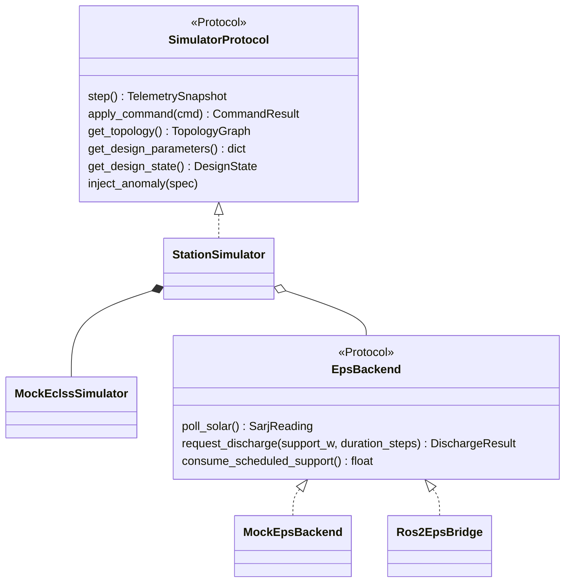
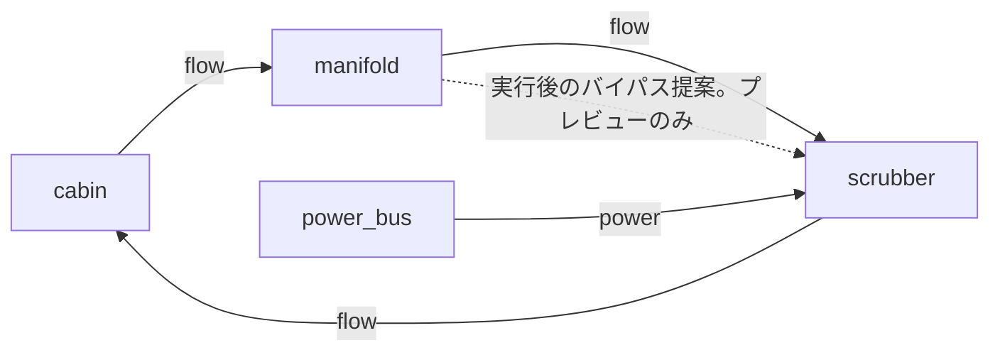
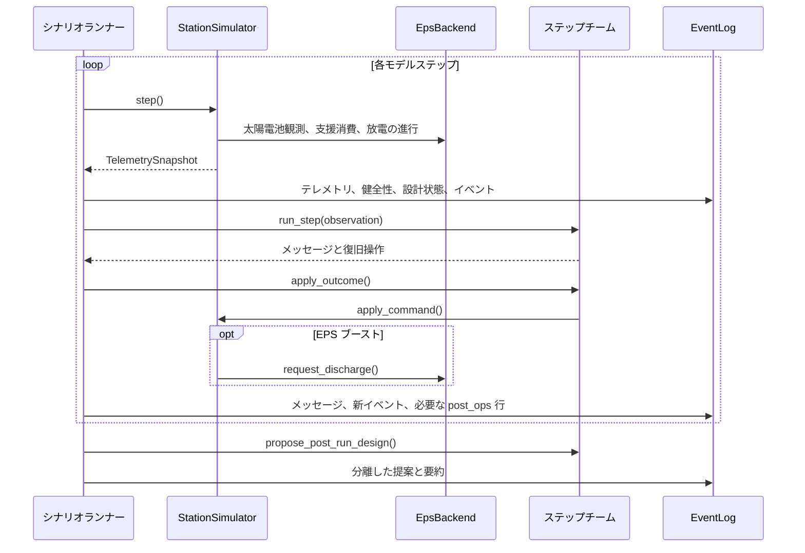

# スクラバーの実装

[ランナー](https://github.com/hirototamura/engineering_agents/blob/main/src/scenario/scrubber_degradation/scenario_run.py)は設定の上書きとエージェント設定を読み、出力先を解決し、実効入力を保存してからシミュレータとチームを作ります。通常の出力再作成は[保存契約](../../reference/storage.md)の削除保護に従います。

## モデルと操作の境界

`scenario/runner.py::build_simulator()` は `MockEclssSimulator` と EPS バックエンドを結合した `StationSimulator` を作ります。`StationSimulator.step()` は太陽電池の状態を読み、予約した支援を消費し、ECLSS を進め、バッテリ放電を進めます。EPS ブーストは支援を予約するコマンドで、電力余裕への効果はステップの処理順に従って適用します。エージェントが効果を作り出すことはありません。

`environment/scrubber/eclss_ops` がコマンド検査、異常の予定、テレメトリと健全性の変換、設計状態を持ちます。`SimulatorProtocol` は基本操作を定義しますが、実ランナーは `get_events()` も使います。交換時は呼び出し箇所を調べてください。宣言されたプロトコルを満たすだけでは不十分です。

## シミュレータの具体的な構造

元のステーション・クラス図は現在も実装された構成を説明します。任意の EPS ブリッジを使っても ECLSS が SSOS に変わるわけではありません。



具象のステーションとモデルは、ランナーが使う追加メソッド `get_events()` も持ちます。宣言したプロトコルだけでは全依存を表しません。

```text
environment/scrubber/
  station_simulator.py        ECLSS/EPS の結合
  mock_eclss.py               ppm モデルと操作イベント
  eclss_ops/                 操作、異常、健全性、設計状態
  eps/backend.py             EPS 契約
  eps/mock/                  SARJ/BCDU スタック
 environment/ssos/eps/ros2/   任意の EPS ブリッジ
```

## 構造と 2 種類の変更

[default_topology()](https://github.com/hirototamura/engineering_agents/blob/main/src/environment/scrubber/eclss_ops/design_state.py) は次の有向モデルを作ります。



破線は提案例であり、実行ループで挿入した接続ではありません。`DesignStateManager.apply_dict_change()` はプレビュー・テスト用に `add_node`、`add_edge`、`set_parameter` を扱います。ランナーは恒久提案の再投入に呼び出しません。

| 実行中の `RecoveryCommand.kind` | 操作の担当 | 変更するもの |
| --- | --- | --- |
| `set_fan_speed` | ECLSS の検査・適用 | ファン設定 |
| `enable_bypass` | ECLSS の検査・適用 | 一時的なバイパス状態 |
| `reduce_load` | ECLSS の検査・適用 | 一時的な負荷状態 |
| `request_eps_boost` | ステーション → `EpsBackend.request_discharge()` | 予約した放電支援 |

次は実行中と実行後の異なるペイロードを示す構造例です。

```json
{"kind":"request_eps_boost","value":120.0,"issued_by":"engineer_2"}
```

```json
{"proposed_by":"engineer_2","decision_source":"rule","changes":[{"change_kind":"add_edge","payload":{"node_a":"manifold","node_b":"scrubber","kind":"bypass"}}]}
```

## ループと証拠の順序

各ステップでシミュレータを進め、健全性を計算し、テレメトリ・EPS・設計状態・モデルイベントを記録した後、チームが議論して復旧操作を適用します。操作がある場合、追加の物理時間を進めず、更新されたアクチュエータと EPS の値を同じステップの `post_ops` 行に記録します。復旧の要約は観測したしきい値遷移と、適用済み EPS イベントを追います。

ループ後にチームは恒久設計を提案できます。実行済みコマンドと分けて保存し、要約、来歴、来歴件数を記録します。来歴出力の失敗は警告し、シミュレーションの証拠は保持します。

## ステップの順序と来歴



内部のモデル進行は支援消費と放電の進行の間です。上の EPS の 1 行は 3 呼び出しの要約で、追加の物理時間進行ではありません。

`integrations/one_piece/client.py` は EPS ブーストの復旧イベントを、発行者とステップが一致する `recovery_command` メッセージと結合して出力します。他の全復旧コマンドを EPS レコードにするわけではありません。

| 出力項目 | 記録済みの入力 |
| --- | --- |
| `record_id`、`run_id` | 実行ディレクトリの識別とレコード順序 |
| `actor`、`step` | `command.issued_by` とイベントのステップ |
| `payload.support_w`、`payload.eps` | 適用した EPS イベントの操作・メタデータ |
| `trace.event_kind`、`trace.event_index` | 元イベントと位置 |
| `trace.message`、`reasoning`、`decision_source`、`parse_status` | 対応する記録メッセージ |

出力器には実行中の設計変更の経路もありますが、このランナーは操作中に恒久設計を適用しません。`design_proposals.json` は読まないため、提案ファイルがあるだけでは実行中の変更の来歴になりません。

## この事例を変更する

操作を追加する場合、コマンド検査、モデルの効果、イベント、チームの許可、テストをまとめて更新します。支援の予約と供給済み電力、提案と適用済み設計を区別してください。提案ループを閉じる場合は次回実行の適用境界を追加し、ビューアに証拠を変更させません。

`tests/environment/test_mock_eclss.py`、`test_station_simulator.py`、`test_mock_eps_backend.py`、シナリオの `test_scrubber_baseline.py`、`test_scrubber_with_agents.py` を確認します。該当する変更には拒否操作、支援期間、同一ステップのテレメトリ、イベントの重複排除、出力分離も含めます。健全性と復旧の検査は[評価](evaluation.md)で定義します。
