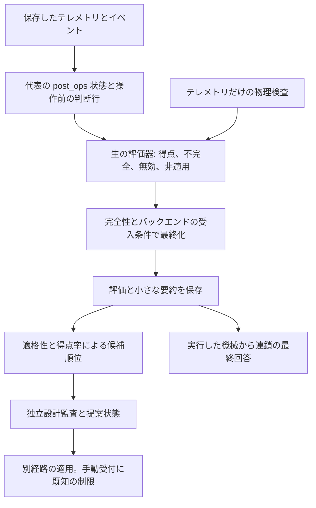
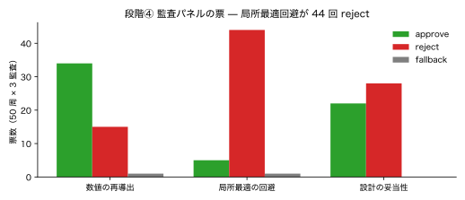

# SSOS の評価

評価器は設計の推論より先に保存済み証拠を測定します。得点の読み方は[利用者向け結果ガイド](../../../users/scenarios/ssos_eclss_loop/results.md)、このページは変更時に必要な内部契約を説明します。

## 測定を一度記録する

[evaluation.py](https://github.com/hirototamura/engineering_agents/blob/main/src/scenario/ssos_eclss_loop/evaluation.py) は設定、テレメトリ、イベント、要約を読みます。現行の得点スキーマは `2.1` です。生存モデルを有効にしたプラントがスコアの適用対象です。生の `evaluate_run()` は他のバックエンド、評価無効、生存モデル無効で `not_applicable` を返します。実行の最終状態には以下の受入検査も適用します。生存、資源の推移・復旧、機器規模、適用可能な操作の振る舞いを採点します。操作担当なしでは満点が異なるため、順位には素点ではなく適用可能な満点に対する百分率を使います。

代表状態はステップ内の最後の `post_ops` 行、なければ最後の行です。操作判断とイベント時点の検査は最初の操作前の行を使います。JSONL の各行を別の時間進行と扱うと、両方を誤ります。

`unified_evaluation.finalize_run_evaluation()` は容量に応じた評価設定、スケジューラの解釈調整、`evaluation.json`・HTML・`physics_gate.json` の保存、要約への反映を行います。設計後に再採点して、設計器が読んだ測定を上書きしません。

## 物理と完全性のゲート

`physics_gate.py` は読み値の存在・有限性、非負在庫、単調な累計、炭素・酸素・水の収支、化学量論、故障時の停止、設置容量、物理的な処理量を独立監査します。必要な証拠の欠落は検査をスキップし、不完全にします。合格にはしません。プラント以外ではプラント物理判定を実行せず、要約の指標は空値になります。

`integrity_guard.py` は元の設定との差を、採点基準、動作点、操作方針、その他に分類します。しきい値、生存条件、乗員、初期在庫、評価、設計制約は採点基準に影響します。完全性が未測定なら不明です。最終化は、基準変更・完全性不明と、プラントの物理ゲート不合格を、得点にかかわらず無効にします。

現在の最終化には非適用の扱いに制限があります。プラントで評価を無効にすると、生の評価器は監査せず `not_applicable` を返しますが、最終受入処理はゲートに `status: passed` がないため、保存結果を `invalid` にします。評価設定の変更自体も採点基準の変更です。`physics_gate_index()` は最終的な無効状態を受け、プラントでは空値でなく `False` を返します。この値から無効化した監査を実行したとは判断できません。適用範囲の処理を変える場合は、生の評価器、確定ファイル、要約の指標をまとめて回帰確認する必要があります。

## テレメトリ監査の契約

現在の `CHECK_NAMES` は 10 個です。以前の 9 個という説明を置き換えます。エージェントの説明や設定でなく、テレメトリだけを読みます。

| 検査 | 必要な証拠・不変条件 |
| --- | --- |
| `readings_present_and_finite` | 貯蔵値と必要なプラント在庫値 |
| `inventories_non_negative` | 許容値を超える負の物理在庫がない |
| `totals_monotonic` | 記録した `total_*` 累計が減らない |
| `carbon_ledger` | 初期の室内・捕集 CO₂ と生成が、最終在庫と記録出力に一致 |
| `oxygen_ledger` | 初期 O₂ と生成が、最終・消費・供給に一致 |
| `water_ledger` | 初期の製品水・尿・雑排水と外部・再生が、最終・損失・使用・供給に一致 |
| `stoichiometric_residual` | 電気分解と記録した Sabatier の反応比 |
| `failure_quiescence` | 故障した系が仕事を処理していない |
| `capacity_bounds` | 1 操作の処理量が設置容量・時間の範囲内 |
| `operational_physical_bounds` | 記録処理量が有限・非負 |

例えば酸素残差は最初と最後の測定行から計算します。

```text
r_O₂ = 初期 O₂ + 累計生成 O₂
       − 最終 O₂ − 累計消費 O₂ − 累計供給 O₂
|r_O₂| ≤ LEDGER_TOLERANCE で合格
```

炭素残差は捕集貯蔵、排気、CO₂ 供給、Sabatier 使用を含みます。水は尿・雑排水、外部投入、再生、乗員による損失、濃縮廃液、電気分解、製品水供給を含みます。必須項目が欠ければ検査をスキップし、ゼロで補いません。初期在庫は最初の観測行です。[physics_gate.py](https://github.com/hirototamura/engineering_agents/blob/main/src/scenario/ssos_eclss_loop/physics_gate.py) の現行許容値は収支 `2e-6`、在庫・容量 `1e-9`、化学量論 `1e-6` です。モデルの監査であり、実測の不確かさではありません。

## 行から最終回答まで



例えば `{"step":2,"co2_storage_kg":3.0}` と `{"step":2,"post_ops":true,"co2_storage_kg":2.4}` は 1 区間の異なる観測段階です。代表の資源状態は 2.4、操作前の判断検査は 3.0 を使います。この省略例は完全な物理監査用レコードではありません。

候補順位に使う得点率は `100 × score / applicable_max_score` です。適格性と生存を先に比較します。得点変更で、要件の改変、物理証拠欠落、製造範囲外、生存の不足を解消することはできません。

## 選択と回帰確認

`design_eval.py` は実行、証拠の充足、生存、制約、評価・物理の状態から適格性を付け、適格性、残存乗員、得点率で順位を付けます。不適格な観測上の最良案も暫定と報告することがあり、このラベルは適用の強制ゲートではありません。[手動適用の制限](implementation.md#proposal-application-limits)を参照してください。

`chain_selection.py` は実行済みの機械から選びます。`iterate.py` は要件ハッシュを固定し、最終回の新提案を未検証として残し、対の再実行を別の証拠として記録します。`tests/scenario` の評価、物理、完全性、統一評価、候補制約、連鎖記憶、最終回答を確認します。境界、欠落・非有限行、スケジューラ保護、高得点の無効候補が重要な回帰対象です。

## 過去の監査の診断例

保存した report 04 の 4 段階の研究は、乗員 50 人で各段階を 50 回反復しました。段階④で独立監査を加え、この原図はその票を示します。当時の記録条件の証拠であり、現行コードのベンチマークや監査人数の有効性の証明ではありません。



[保存データ](https://raw.githubusercontent.com/hirototamura/engineering_agents/648237d8596462362b5772914242a3881f82ad35/docs/data/report03_emergence.json)の `avoid_local_optima` は拒否 44、承認 5、代替応答 1 です。開発者は、監査票、解析失敗、設置設計の多様性、生存を別々に測定する必要があります。視点の名前だけで探索を広げたとは判断できません。元の [report 04 の分析](https://github.com/hirototamura/engineering_agents/blob/648237d8596462362b5772914242a3881f82ad35/docs/ja/eclss_ai_agent_technical_report_04.md)に研究条件があります。現在の提案全体の受付と手動適用の制限は、このページと実装の契約を参照します。過去の項目マージの説明を現行 API にしません。図とデータは再生成・再採点せず再利用しています。
