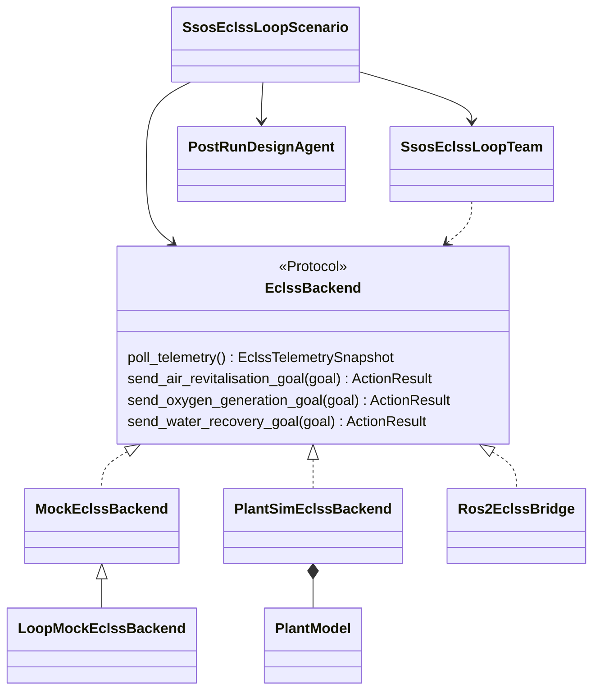
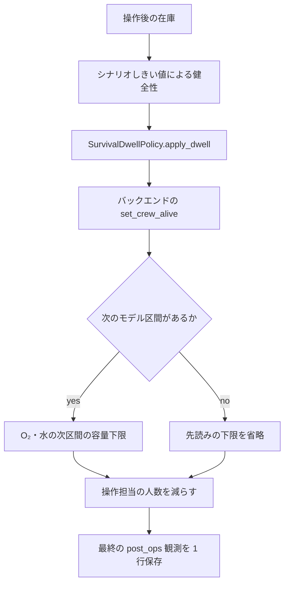
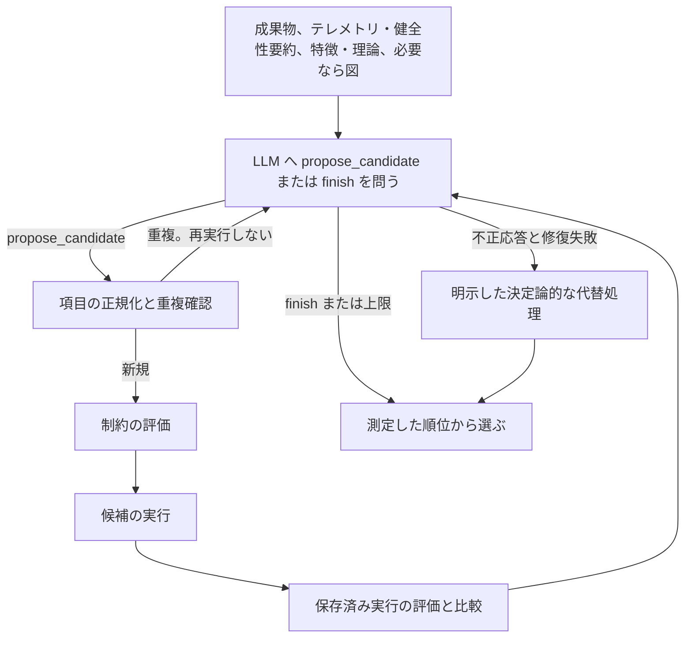
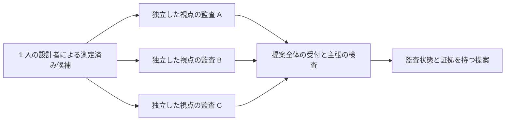

# SSOS の実装

[scenario_run.py](https://github.com/hirototamura/engineering_agents/blob/main/src/scenario/ssos_eclss_loop/scenario_run.py) が実行を担当します。最初のステップ前に上書き設定を読み、提案をメモリ上の設定へ適用し、設計制約の設定自体を検査し、操作・設計とバックエンドを解決して、実効入力を保存します。消費した提案は実行内へ複写し、元の YAML は変えません。

## 環境構成とバックエンドの契約

```text
environment/ssos/eclss/
  backend.py                 EclssBackend 契約
  types.py, units.py         目標、結果、貯蔵量、単位変換
  mock/backend.py            操作契約のスタブ
  plant_sim/                 モデル、設定、化学量論、操作バックエンド
  ros2/                      トピック、観測、ブリッジ、クライアント再接続
scenario/ssos_eclss_loop/
  loop_mock_backend.py       単純な貯蔵動態を持つ実行用モック
```

契約用のスタブとループ用モックは異なるクラスです。特にループ用モックの WRS は未実装です。契約にメソッドがあることは、全バックエンドの対応を意味しません。

| `EclssBackend` メソッド | 結果 | 境界での意味 |
| --- | --- | --- |
| `poll_telemetry()` | `EclssTelemetrySnapshot` | 最新の貯蔵・故障値。欠落は任意値として保持 |
| `send_air_revitalisation_goal(ArsGoal)` | `ActionResult` | ARS 操作要求 |
| `send_oxygen_generation_goal(OgsGoal)` | `ActionResult` | OGS 操作要求 |
| `send_water_recovery_goal(WrsGoal)` | `ActionResult` | WRS 操作要求。バックエンドの対応が必要 |
| `request_o2(amount)` | `ServiceResult` | O₂ 供給サービス |
| `request_co2(amount)` | `ServiceResult` | CO₂ 供給サービス |
| `request_product_water(liters)` | `ServiceResult` | 製品水の供給 |
| `submit_grey_water(liters)` | `ServiceResult` | 雑排水の投入 |
| `set_subsystem_failure(name, enabled)` | `None` | 故障制御の境界 |

`advance_step()`、設置容量の変更、生存処理は、シナリオが使う具象バックエンドの追加能力です。すべてが `EclssBackend` に宣言されているわけではありません。交換前に実際の[契約](https://github.com/hirototamura/engineering_agents/blob/main/src/environment/ssos/eclss/backend.py)、[型](https://github.com/hirototamura/engineering_agents/blob/main/src/environment/ssos/eclss/types.py)、ランナーの呼び出し箇所を確認してください。

以前の一部の図で欠けていたプラントを含めたクラス図です。破線の実現は構造的な契約の対応で、継承ではありません。実行用モックはスタブを継承して操作を上書きします。操作チームと別の実行後設計器を調整するのはシナリオです。



## バックエンドと操作の順序

`EclssBackend` は貯蔵量観測、ARS/OGS/WRS アクション、貯蔵サービス、故障制御を公開します。内部の質量は kg、製品水は L で、ROS2 の境界で上流の g を変換します。モック、プラント、ROS2 を構築でき、プラントの乗員・チームの結び付けはシナリオが行います。

ステップ 0 は設定した初期状態を観測し、対応するバックエンドでは以降の観測前に時間を進めます。故障を適用し、操作前のテレメトリを記録し、操作担当を呼び、操作後に更新してから、生存・容量への影響を処理します。同一ステップの `post_ops` 行が操作・生存処理後の状態を残します。故障予定は `finally` で解除します。ROS2 は開始時の貯蔵テレメトリを待ち、読み値欠落を拒否します。

ランナーは元の設定との差から完全性を記録し、実行後の設計より先に決定論的評価を確定します。その後 `PostRunDesignAgent` と `DesignToolkit` が測定を調べ、内部の設計を無効にして候補を実行し、提案とトレースを保存します。適用ハンドラは操作ペイロード、ハードウェア容量、方針、サービス、グラフ変更を分けます。採点しきい値は `set_parameter` の許可対象ではありません。

## 操作後の生存処理の順序

生存モデルの調査で示した次の順序は、モデル変更でも重要です。



最終ステップでも滞留判定は行います。O₂・水は損失後に連続回数を戻し、再び発生できます。CO₂ の割合損失は同じ帯に滞在する間に一度です。同一ステップの要求損失は生存人数で制限し、原因ごとに人数を割り当てます。総数をすべての原因に重複計上しません。次区間の下限は O₂・水の需要を扱い、CO₂ による全滅処理ではありません。操作担当とともに設計担当が減ることはありません。原因や時刻を変える前に [survival.py](https://github.com/hirototamura/engineering_agents/blob/main/src/scenario/ssos_eclss_loop/survival.py) と `_apply_survival_after_ops()` を確認してください。

## 9 つのツールと固定手順 { #design-toolkit }

`DesignToolkit` にカタログがありますが、現行の設計器はツール名を選びません。Python が毎回同じ基準証拠を集め、モデルの判断に候補の処理を組み合わせます。

| 操作 | 結果と権限 |
| --- | --- |
| `load_run_artifacts` | 実効入力、要約、JSONL の先頭・末尾、小さな連鎖記憶 |
| `summarize_timeseries` | 指定列の最大最小、最終値、帯、傾向 |
| `compute_eclss_features` | 操作・拒否、故障期間、資源不足 |
| `compute_theoretical_capacity` | 需要・周期・稼働中保護による計算 |
| `plot_eclss_timeseries` | PNG パスと同じ特徴のテキスト |
| `propose_capacity_candidate` | 決定論的な容量案。実行しない |
| `evaluate_design_constraints` | 製造可能性と規模。実行しない |
| `run_design_candidate` | 候補容量で、内部の設計を無効にした新規実行 |
| `compare_design_runs` | 決定論的な順位と選択理由 |



基準収集はテレメトリと健全性の両方を要約します。候補がない状態の `finish` も代替処理へ進みます。重複は判断回数を消費しますが再実行しません。候補がある上限到達では測定順位を保持し、モデルが指定した勝者を権限にしません。固定の `_traced_tool_call()` がハンドラを呼び、エラー変換と証拠記録を行います。公開 `call()` は似たエラー処理を持つ別経路です。

判断は通常の JSON です。次は部分プロファイルの構造例です。

```json
{"decision":"propose_candidate","fields":{"plant_sim.ars.capacity_kg_day":22.0},"rationale":"設置済みの文脈を保ち、異なる ARS 容量を試す。"}
```

設計キーは `plant_sim.ars.capacity_kg_day`（kg/day）、`plant_sim.ogs.max_o2_kg_day`（kg/day）、`plant_sim.wrs.max_feed_l_per_operation`（L/operation）の 3 つです。`design_variables.py` は既知・有限・正の項目を検査し、`DesignConstraints` が別に製造範囲と予算を評価します。ハードウェアだけ大きくしても操作量が不足すれば効果がありません。OGS の同期は次を計算します。

```text
必要な水 kg/回 = O₂ 定格 kg/day × 操作秒数 / 86400 × WATER_PER_O2
```

`sync_action_payloads()` は必要に応じて OGS の水と WRS の尿の要求を増やし、減らしません。効率、化学、代謝、検証しきい値はこれらの容量変数ではありません。

## 実行中の操作記録

`EclssOperationalCommand` は `kind`、ペイロード、`issued_by` を持ち、`StepEclssOutcome` はメッセージと操作を分けます。次の構造例は受理した ARS 要求であり、実機の検証判定ではありません。

```json
{"step":2,"kind":"/eclss/events/operational_applied","command":{"kind":"air_revitalisation","payload":{"initial_co2_mass":1.8},"issued_by":"eclss_actor_1"},"result":{"success":true},"message":"ARS request accepted"}
```

`operational_rejected` は別のイベントです。`client.py` は適用・拒否の**両方**を出力します。`trace.result_success` は結果があればそれを使い、なければイベント種別から解決します。メッセージはステップ、発行者、操作種別で対応させます。拒否の来歴を保持し、受理した操作に変換しません。実行後の提案ファイルは読みません。

## トレースと独立監査

| 成果物 | 内部の契約 |
| --- | --- |
| `tool_trace.jsonl` | `start`、`tool_call`、`llm_turn`、判断・候補イベント、`done` |
| `candidate_rankings.json` | 基準、測定候補の順位、選択 |
| `design_review_report.json` | 証拠充足、制約、応答診断、候補エラー、選択状態 |
| `design_storage/sessions/<agent_id>.jsonl` | 個別エージェントのイベント |
| `design_storage/claims.json` | 有効な選択の主張と撤回した代案 |

次は省略したトレースの構造例です。

```json
{"event":"tool_call","source":"pipeline","iteration":1,"decision":1,"tool":"evaluate_design_constraints","arguments":{"fields":{"plant_sim.ars.capacity_kg_day":22.0}},"result":{"error":"illustrative failure"},"result_excerpt":"...","tool_elapsed_s":0.01,"evidence":{"missing":[]}}
```

`source` はモデルが選んだツールでなく、Python の固定段階（`evidence`、`pipeline`、代替処理）です。実際の行は結果と抜粋、証拠状態を保持します。失敗した呼び出しを証拠の実施済みにしません。



監査担当は同じ短い資料を読み、互いの応答を読みません。`{"decision":"reject","rejected_fields":["plant_sim.wrs.max_feed_l_per_operation"]}` のように、提案済み容量の項目を承認・拒否できます。不明な項目は無視し、不正応答は棄権します。**認識した拒否項目があれば提案全体を拒否**します。現行 `integrate_audit_panel()` は拒否項目と設置値を混ぜた未測定の機械を作りません。主張の検査は不採用の推奨を撤回しますが、語句検査です。これは過去の監査調査にある矛盾した部分固定の説明を訂正したものです。

## 連鎖記憶と完全な受け渡し

`compact_chain_memory.json` は上限付きのメモであり、全トレースでも適用サービスでもありません。現在のスキーマは理論サイジングと任意の実測区間を分けます。

| 項目 | 保持する理由 |
| --- | --- |
| `best_full_survival` | 全員が生存した保持対象の最良設計の測定参照 |
| `last_effective_design` | 次の提案でなく実際に設置した容量 |
| `theoretical_floor` / `measured_limits` | 計算サイジングと任意の実測区間 |
| `known_bad_patterns` | 上限付きの反復失敗の証拠 |
| `stagnation` / `exploration_directive` | 同じ生存階層での進捗診断 |

`chain_memory.py` は直列化結果を 4096 バイト、失敗パターンを 5 件に制限し、`_fit()` は JSON を途中で切らず構造要素を落とします。`iterate_apply_document()` と容量補完は新しい YAML に適用する際、実行した機械の省略項目を保持します。メモ自体はリセットを防がず、変更を適用しません。記憶の上限、生存階層の変更、部分提案、連鎖の再呼び出しを別々に確認します。

## 提案適用の制限 { #proposal-application-limits }

候補の適格性と適用は別の経路です。`design_eval.py` は範囲外などで不適格とした候補でも、観測した最良案を `provisional_final` と分類する場合があります。手動適用の `apply_design_proposals()` は `approve_provisional` が偽のときだけ監督・状態の拒否理由を確認します。有効にすると `rejected_final` の状態確認も回避できます。ハンドラは提案項目を検査しますが、適用経路は `DesignConstraints` のハードウェア範囲を強制しません。このオブジェクトの構築は制約設定自体の検査であり、適用容量が範囲内かの検査ではありません。

自動連鎖の `iterate.py` は別途、拒否済み提案を除きます。この動作は手動適用の保証ではありません。修正では適用時の状態受付と容量範囲の検査を明示し、消費入力の証拠を残し、要件の完全性を弱めず、拒否・暫定・範囲外の文書を手動と連鎖の両経路で確認する必要があります。

## 回帰確認の対象

エージェント設定、操作ゲート、提案、設計制約・ツール、容量プロファイル、健全性・生存、実効設定、反復、最終回答のシナリオテストを使います。バックエンド変更は単位、実行中保護、質量収支、監査テレメトリ、ROS2 アダプタを確認します。受入条件と順位は[評価](evaluation.md)、公開コマンドは[利用者向け実行手順](../../../users/scenarios/ssos_eclss_loop/running.md)が担当します。
