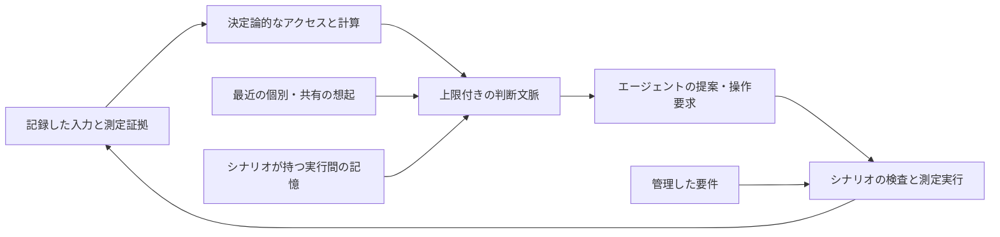

# ツールと記憶

ツールはエージェントの問いを確認可能な証拠に変えます。記憶は選択した過去の証拠を次の判断へ渡します。いずれも要件の権限を変えず、仮説を測定事実に変えません。

## ツールの責務

公開する操作は引数の契約、決定論的な実装、結果の上限、副作用の方針、エラー・証拠の経路を必要とします。カタログだけでは呼ぶ時点を決めません。現在のシナリオはトレース付きラッパーでハンドラを直接呼ぶ場合もあり、追加時はその経路と公開ディスパッチを一致させます。

[SSOS のツール群](scenarios/ssos_eclss_loop/implementation.md#design-toolkit)は 9 操作と固定手順、[キューブのアダプタ・ワークフロー](scenarios/balancing_cube/implementation.md)は別のコンパイル・実行・応答境界を持ちます。`tools/` の分析機能は自動でシナリオのエージェントへ公開されません。[ツール追加](guides/add-tool.md)で変更の範囲を定めます。

## 証拠、想起、権限

| 記憶の境界 | 保存するもの | 許可しないこと |
| --- | --- | --- |
| `AgentMemory` | 上限付きの自分の要約と発行操作 | 要件変更や他者のセッション参照 |
| `DiscourseBuffer` | 上限付きのチーム発言 | 全発言を測定事実とすること |
| `SessionStore` | 個別の記録の永続保存 | アクセス制御や意味の真偽 |
| シナリオの実行間記憶 | 出典付きで選択した過去の測定 | 一方的な採用や検証の書き換え |

元のエージェント設計の説明から、3 つの区別を保持します。トレースは確認用の全履歴、記憶の投影は次の判断へ渡す選択情報、正本の要件は別の担当を持つものです。記憶に保持しても主張の証拠は強まりません。

## 記憶の範囲

- `core/agents/memory.py` はチームの最近の会話と個別要約に上限を設けます。メモリ上の履歴であり、実行をまたぐ永続的な知識基盤ではありません。
- `core/storage/session.py` はエージェント別の JSONL セッションを保存します。API は指定したエージェントを読みますが、相互参照の制限は呼び出し側の規律であり、ファイルシステムのアクセス制御ではありません。
- SSOS の `chain_memory.py` は測定に基づく小さな連鎖履歴と探索の指針を維持します。`iterate.py` はディレクトリを保持する場合でも、新規の呼び出しでは残存する連鎖記憶を消します。
- キューブの `memory.py` は出典と設定ダイジェストを持つエピソードを保存し、上限付きで取り出し、測定値の関連を決定論的に整理します。関連は因果の証明ではなく、保存した仮説も仮説のままです。

検索処理を変える際は、来歴、版、適さない証拠の除外、コンテキスト上限を維持します。`tests/core` の `test_memory.py` と `test_design_storage.py`、`tests/scenario` の SSOS 連鎖記憶、キューブの記憶ループ、独立設計、コンテキスト上限のテストを確認してください。保存と回復の動作は[保存契約](reference/storage.md)にあります。
