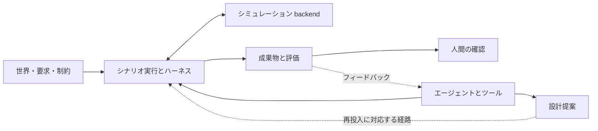

# Engineering Agents

ドメインによらずシステムを設計・検証する技術者集団を、ソフトウェアで育てるプロジェクトです。知見、記憶、ツール、評価、証拠を積み上げ、次の技術的判断へつなげます。

## 機能のつながり

この図は責務の関係を示し、単一の実行 API を表すものではありません。物理モデル、評価契約、次の実行へ提案を適用できるかはシナリオごとに異なります。人間向けの画面は、保存された証拠を読み取ります。

| 行いたいこと | 入口 | 得られるもの |
| --- | --- | --- |
| 既存の実験を設定し、結果を判断する | [ユーザーガイド](users/index.md) | 解決済みの入力、出力記録、証拠の解釈 |
| リポジトリの機能を変更する | [開発者ガイド](developers/index.md) | 実装の責務境界、拡張手順、回帰検査 |

## 設計・検証を実行する

[ユーザーガイド](users/index.md)は、既存機能を使って設計・検証を行う技術者のための文書です。まず[クイックスタート](users/quickstart.md)でローカル実行を試し、[目的別ガイド](users/guides/configure-run.md)で条件を設定し、[結果の確認](users/guides/inspect-results.md)へ進みます。

## 機能を追加・変更する

[開発者ガイド](developers/index.md)は、リポジトリを変更する人のための文書です。[開発環境](developers/setup.md)、[アーキテクチャ](developers/architecture.md)、[拡張ガイド](developers/guides/add-scenario.md)、[次の開発](developers/development/index.md)から、実装と検査の接続を確認できます。

## 現在のシナリオ

- [scrubber_degradation](users/scenarios/scrubber_degradation/index.md)：スクラバーの劣化、電力支援、一時的な回復と設計提案。
- [ssos_eclss_loop](users/scenarios/ssos_eclss_loop/index.md)：生命維持系の運用と処理能力の設計反復。
- [balancing_cube](users/scenarios/balancing_cube/index.md)：One-Piece の要求に基づくキューブの機械・制御設計。

これらは同格の組込みインスタンスです。現在の実装はリポジトリ内のシナリオを登録して実行します。外部シナリオとの接続は[次の開発課題](developers/development/external-scenarios.md)です。

リポジトリの中核は、世界・制約、エージェントの入出力、ツール、ハーネス、評価、成果物を接続する機能です。ダッシュボードとレポートは、記録した証拠を人間が確認するために使います。
