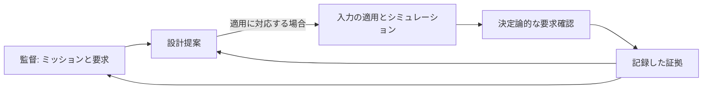

# 設計と検証のループを理解する

本プロジェクトは、複数の分野で設計・検証を行うエンジニアリングチームを開発します。シナリオは、具体的なシステム、観測、利用可能なツール、設計変数、制約、評価手順をチームに与えます。同梱の 3 シナリオは異なる能力を持つ実例であり、単一シミュレータの成熟段階ではありません。

## 役割と権限

**監督**はミッション、設計要求、検証要求を与えます。ミッションが最重要要求です。要求改訂の最終権限は人間が持ちます。

**設計**は将来の製作や実行に向けた恒久変更を提案します。**運用**は現在のシステムを操作します。実行中に酸素生成装置を起動することと、次の設計で装置容量を増やすことは別の行為です。

**検証**は宣言した条件で候補を測定し、要求を決定論的に確認します。エージェントは観測を説明し、要求変更を提案できますが、その説明が合否を決めるわけではありません。要求変更は監督の判断事項であり、比較の途中で採点基準を動かす許可ではありません。

## 証拠から言えること

制約は許容範囲や必要な動作を定めます。最適化指標は宣言した目的に沿って結果を順位付けします。高い点数だけでは制約を満たしたことになりません。終了コードは手順の実行状態を示すもので、工学的な結果の受入判定ではありません。

モデルの検証では、実装したシミュレーションとその不変条件を確認します。数値的一致では、条件を揃えて実装同士を比較します。物理的な妥当性評価には実システムの観測が必要です。同梱シナリオのシミュレーション合格は、その証明にはなりません。

提案と適用済み設計、ビューアのプレビューと再シミュレーションは異なります。改善を主張する前に、消費した入力、適用設定、新しい観測、シナリオの評価記録を確認してください。

## 証拠の契約を選ぶ

[スクラバー](scenarios/scrubber_degradation/index.md)は回復操作と実行後の推奨を扱います。[ECLSS](scenarios/ssos_eclss_loop/index.md)は提案の適用と容量設計の連鎖実行を扱います。[バランシングキューブ](scenarios/balancing_cube/index.md)は凍結した要求のもとで、スクリーニングと独立検証を分けて行います。結果の解釈には各シナリオの「結果」ページを使ってください。

## 主張をレビュー可能にする流れ

概念上の検証経路です。提案の適用はシナリオの対応範囲に従い、スクラバーの再投入は未実装です。監督へ戻る矢印は要求レビューの依頼であり、自動改訂ではありません。設計へ戻る矢印が渡すのは測定結果であり、説明が真であるという宣言ではありません。

| 証拠の段階 | 答えられる問い | まだ言えないこと |
| --- | --- | --- |
| 提案・スキーマ検証 | 許可された形式の入力か | 動作するか |
| モデルの検証 | 実装規則と不変条件を満たすか | ハードウェアを表すか |
| 数値比較 | 条件を揃えた実装同士が一致するか | 実世界で正確か |
| 物理的な妥当性評価 | 観測した実機が要求を満たすか | シミュレーションだけで得られる結果ではない |
