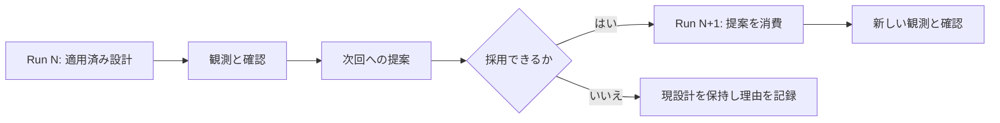

# 設計を反復して引き渡しを検証する

シナリオが対応する反復手順を選びます。[ECLSS](../scenarios/ssos_eclss_loop/running.md)は実行後の提案を次回へ適用し、連鎖実行できます。[キューブ](../scenarios/balancing_cube/running.md)は凍結 SSOT の試験計画に対して、予算を限定した探索を行います。スクラバーは推奨を出力しますが、次回へ再投入しません。

## ECLSS を連鎖実行する

[LLM 接続](llm.md)でサービスを準備してから実行します。

```bash
PYTHONPATH=src python -m tools.cli run ssos_eclss_loop \
  --backend plant_sim --actor-mode labeled_rule_base --design-mode llm \
  --iterate 3 --steps 50 --run-id capacity-review-01 --dry-run --json
```

計画を確認し、dry-run 指定を外します。連鎖実行は番号付き子ディレクトリを使い、既定では `baseline-replay` と `final-replay` も実行します。許可された設計変更を実行間で引き継ぎ、後の部分提案が省略した過去の変更も保持します。検証閾値を設計変更として自動適用することはありません。

監督承認が必要な暫定設計は、`--approve-provisional` がなければ採用しません。先に実現可能性・採用適格性・承認理由を読みます。自動連鎖は `rejected_final` を除外します。一方、手動の `--apply-proposals` と `--approve-provisional` の併用は `rejected_final` も含む状態ゲートを迂回し、すべての設計範囲や安全性・制約適合を保証しません。`--no-approve-provisional` で状態ゲートを戻せます。自動連鎖と `--apply-proposals` は併用できません。特定の提案を渡す場合は[2 回の実行手順](../quickstart.md)を使います。

## 結果を確認する

`chain_summary.json` と `chain_final_answer.json` を読み、選択候補のシミュレーション証拠を確認します。最新の提案が未検証の場合があり、選択された回答が最後の番号の実行とは限りません。

連鎖の `IMPROVED` は対比較リプレイの成功を前提に、番号付き実行で測定した選択設計の生存数を、最初の番号付き実行と比較します。リプレイの生存数は別に記録し、この判定の比較値には使いません。生存数が同じで点数が上がった設計も有用ですが、判定は `NOT_IMPROVED` になり得ます。対比較リプレイを無効化すると `INCONCLUSIVE` です。mock で引き渡しは確認できますが、プラント容量の改善は立証できません。

キューブには別の選択、GPU 比較、昇格条件があります。ECLSS の判定や承認フラグを機械ワークフローに一般化しないでください。

## 最後の案でなく適用した設計を追う



| 記録 | 確認する問い |
| --- | --- |
| 提案 | 何を、なぜ変えようとしているか |
| 消費済み提案・コンパイル済み入力 | 実際に何を適用したか |
| 次回の評価 | 適用後に何が起きたか |
| 連鎖の選択 | どの要求で、どの測定済み設計を選んだか |
| 未検証の最後の提案 | さらに測定が必要なのは何か |

[過去の ECLSS 例](../scenarios/ssos_eclss_loop/results.md#historical-four-chain-record)では、初期の部分提案が成功済み設計を失うことがありました。この失敗記録は、現在の省略容量補完より前のものです。
