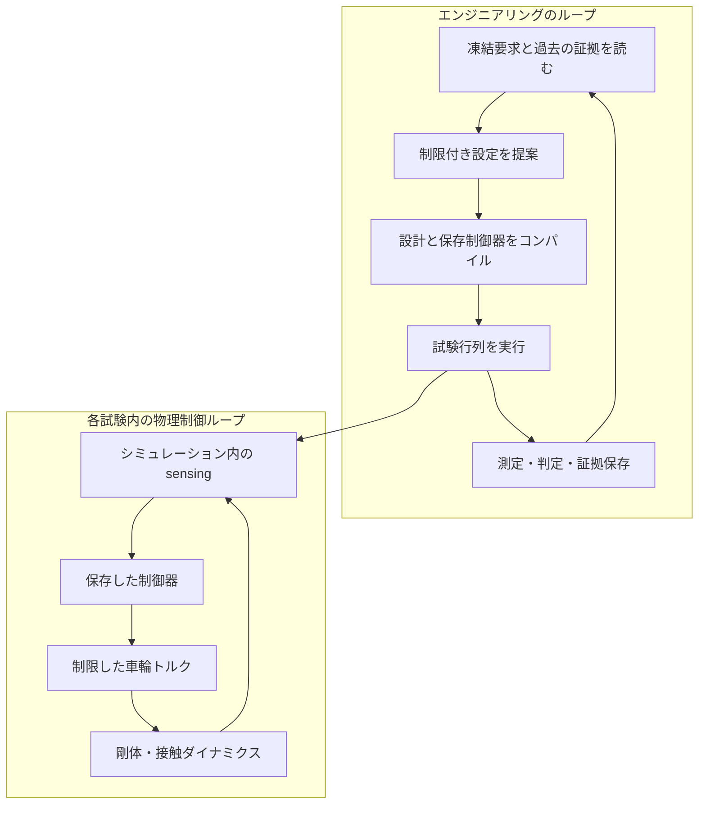

# バランシングキューブ

バランシングキューブの制限付き機械設計変更を調べるシナリオです。要求、基準設計、制御器、試験行列、乱数種、検証基準は、凍結した One Piece の単一正本（SSOT）スナップショットから得ます。モデルの提案が要求や検証器を書き換えることはできません。

通常の実行は native MuJoCo で基準と候補をスクリーニングします。探索で選んだ候補を別の凍結検証行列で評価し、MJX GPU と比較できます。任意の Isaac ワークフローは同じ凍結モデルをエクスポートし、別の接触シミュレーションキャンペーンを行います。これらの証拠の限界は異なります。

[設定](configuration.md)でストアと追加依存を準備し、[実行](running.md)で基準評価・設計探索・Isaac を使います。完了や選択を解釈する前に[結果](results.md)を読んでください。CPU スクリーニング、数値的確認、実機の妥当性評価は異なります。

シミュレーションでバランスできたことから、電力、モータ温度、実機適合を推定しません。実装や凍結契約の変更は[開発者向け説明](../../../developers/scenarios/balancing_cube/implementation.md)を参照します。

## 2 つのループと時間尺度

LLM は外側のエンジニアリングループに参加し、制御周期ごとにモータ指令を出しません。保存した制御器と凍結した sensing・actuation 仮定が内側のループを定めます。

元の解説は、8 頂点の実機ミッションと宣言した数値試験、実行可能なスナップショットと過去の実験を区別します。ビューアが新しい要求モデルを表示しても、保存済みキャンペーンを遡って変えません。
