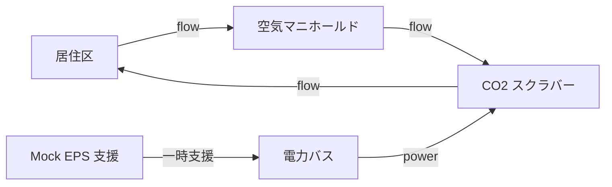

# スクラバー劣化

CO₂ 除去能力が落ち、電力余裕も減る状況で、エンジニアリングチームがどう対応するかを調べるシナリオです。簡易 ECLSS モデルと mock の電力支援モデルを組み合わせます。決定論的なステーション抽象モデルであり、妥当性を実機で確認した宇宙機モデルではありません。

同梱設定ではステップ 20 から異常が始まります。実行中のエージェントはファン速度、バイパス、負荷削減、一時的な EPS 支援を操作できます。実行後の設計担当は恒久変更を推奨しますが、このシナリオは次回シミュレーションへ適用しません。ダッシュボードの Before/After はプレビューです。

[設定](configuration.md)で条件とモードを選び、[実行](running.md)で比較し、[結果](results.md)で回復指標を解釈します。既定はエージェントなしのベースラインです。チームを動かす場合はモードを明示してください。

提案から次回シミュレーションへ進む実装済みループが必要なら [ECLSS](../ssos_eclss_loop/index.md)を使います。このシナリオの変更は[開発者向け実装説明](../../../developers/scenarios/scrubber_degradation/implementation.md)を参照してください。

## モデル内のステーション

元のシナリオは空気の流れと電力支援を分けています。

初期ノードは `cabin`・`manifold`・`scrubber`・`power_bus` です。一時バイパス操作は運用フラグを変え、バイパス辺の提案は恒久設計の推奨です。これを分けることで、実行中にステーションを作り直したと誤認せず回復を調べられます。
