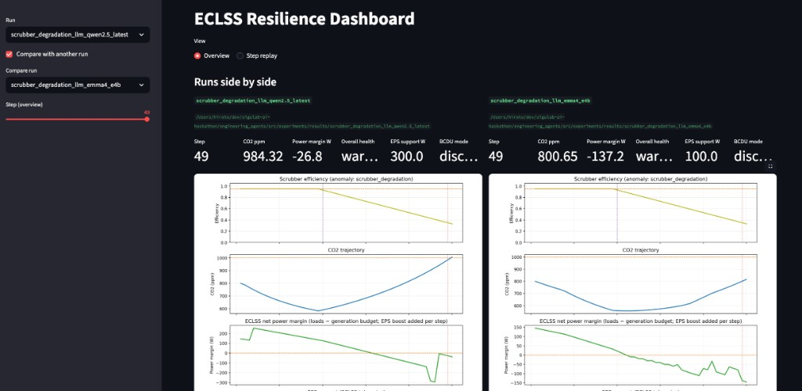
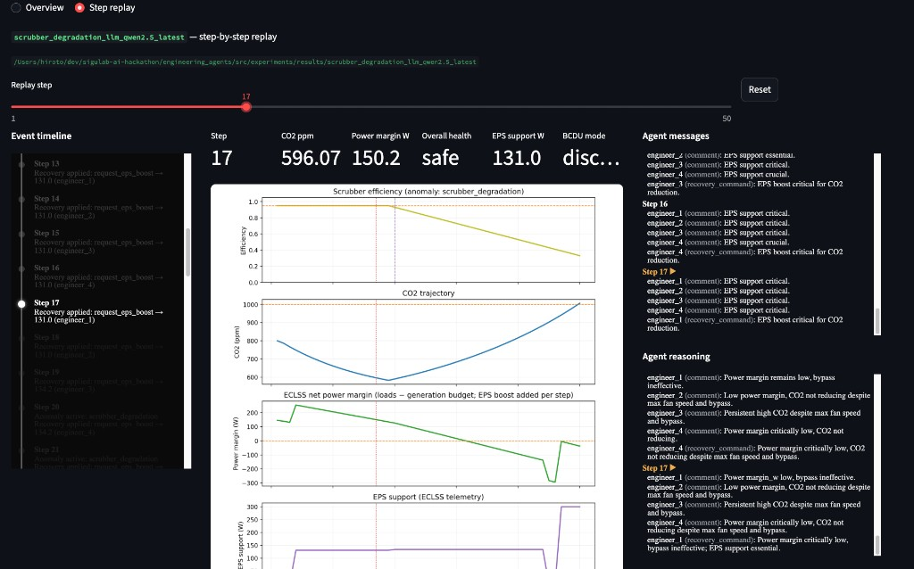
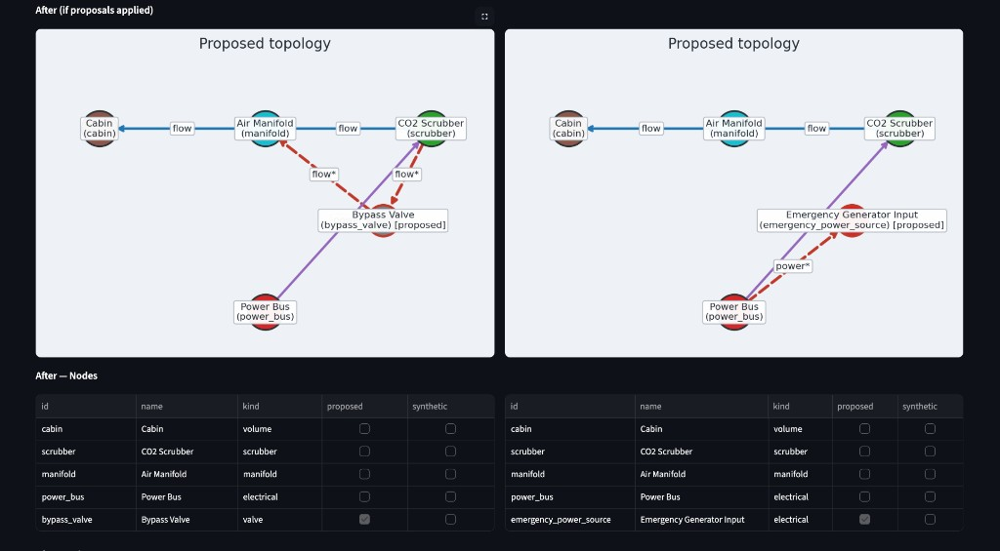

# スクラバーの結果を解釈する

`summary.json` はモード、観測期間、最大・最終 CO₂、最小・最終電力余裕、最終 health、異常検知、メッセージ数、設計変更数を記録します。回復指標は `co2_above_threshold_step`、`co2_recovered_below_threshold_step`、`eps_boost_applied_step`、`power_recovered_above_critical_step` です。null は、その実行では該当イベントを観測しなかったことを示します。

## 健全性の境界と回復指標

CO₂ は 800 ppm 未満で SAFE、800 以上 1200 ppm 未満で WARNING、1200 ppm 以上で CRITICAL です。運用・回復閾値の 1000 ppm は、どちらの health 境界とも異なります。summary は最初の 1000 ppm 以上と、その後初めて 1000 ppm 未満へ戻ったステップを記録します。

電力は 0 W より大きいと SAFE、−150 W より大きく 0 W 以下で WARNING、−150 W 以下で CRITICAL です。電力回復は一度 CRITICAL になった後、最初にそこを抜けたステップです。総合 health は CO₂ と電力の悪い方です。

これらはステーション抽象モデル内の決定論的指標です。多軸の検証スコアカードや、物理的な受入認証ではありません。

## 記録へたどる

`telemetry.jsonl` は CO₂、電力余裕、除去効率、アクチュエータ状態、異常フラグを保持します。`health_metrics.jsonl` は健全性、`eps_telemetry.jsonl` は mock 電力支援を記録します。`events.jsonl` は操作・設計イベント、`messages.jsonl` はチームの議論、`design_state.jsonl` は構造・設計状態です。

操作後、同じステップに `post_ops: true` の telemetry/health 行が加わる場合があります。物理ステップを進めずにアクチュエータと EPS の値を更新します。新しい時間区間として数えないでください。

エージェントありの実行は `design_proposals.json` と summary の提案メタデータを出力できます。エージェントなしでは提案・messages がなくても異常ではありません。`scenario_config.yaml`、有効時の agent 設定、provenance が追跡を支えます。推奨や provenance の出力成功は、恒久設計の適用成功ではありません。このシナリオの提案再投入は未実装です。

## ダッシュボードを読む { #read-the-dashboard }

次の画像は過去の**スクラバー**実行を保存したものです。モデル名、測定値、画面の細部は当時の記録に属し、新しいベンチマークや今回の実行の予測ではありません。



2 実行表示では実行名と選択ステップを確認し、CO₂、効率、電力余裕、EPS 支援を一緒に比較します。最終 CO₂ が低いだけでは、より多くの電力を借りたのか、操作順序が違ったのかは分かりません。



ステップ再生はイベント時系列と観測、エージェントのメッセージを並べます。受理した操作が変化に先行するかを調べてください。エージェントの説明は、その記録と照合する仮説です。



画像の表記は **“After (if proposals applied)”** です。追加ノードと赤い辺は推奨を図示します。スクラバーの再投入は未実装なので、これは**未検証のプレビュー**であり、2 回目の実行ではありません。ノードを描いたことは、シミュレーションがそれを消費した証拠になりません。

## 提案を結果と混同せずに読む

ラベル付き推奨の構造抜粋は次の形です。

```json
{
  "decision_source": "rule",
  "changes": [
    {
      "change_kind": "add_edge",
      "payload": {
        "node_a": "manifold",
        "node_b": "scrubber",
        "kind": "bypass"
      }
    }
  ]
}
```

これは変更形式の抜粋で、完全な実行記録ではありません。操作イベントの `enable_bypass` と、この `add_edge` を比べます。前者は一時コマンド、後者は将来の設計推奨です。後者を実行中の構造変更に数えないでください。
