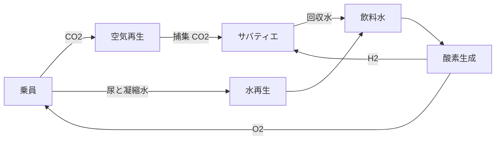

# ECLSS ループ

空気再生（ARS）、酸素生成（OGS）、水再生（WRS）の資源運用と、実行後の装置容量設計を調べるシナリオです。actor は現在のシステムを操作し、実行後の designer は次の設計を提案します。モードは独立して選べます。

小さな引き渡し確認には `mock`、ローカルの資源・生存モデルには `plant_sim`、コンテナ経由の SSOS 操作には `ros2` を選びます。同じコマンド名であっても、物理と評価範囲は同じではありません。

次回実行前に `design_proposals.json` を消費し、設計と検証を連鎖できます。容量提案は `plant_sim` に適用し、グラフ・サービスの変更にはバックエンド別の制限があります。検証閾値は許可する設計変数とは分離しています。

[設定](configuration.md)、[実行](running.md)へ進み、[結果](results.md)で生存、制約、点数、比較証拠を判断してください。[クイックスタート](../../quickstart.md)は小さな mock の引き渡しです。実装変更は[開発者向けシナリオ説明](../../../developers/scenarios/ssos_eclss_loop/implementation.md)を参照します。

## 結合した資源を追う

これは資源フローの説明であり、ROS topic グラフではありません。ローカルプラントは結合した在庫、処理容量、操作時間、生存を扱います。温度・湿度・圧力制御のような広い居住環境機能は、このプラントの実装範囲外です。

| 役割 | シミュレーション中 | シミュレーション後 |
| --- | --- | --- |
| Actor | 在庫・health を観測し許可操作を要求 | イベントが判断の証拠になる |
| Designer | 稼働中の装置容量は変えない | 次の設計を提案。LLM tool-use は候補も測定できる |
| 決定論的評価器 | 観測・イベントを収集 | 適用範囲、整合性、物理、点数を確認 |
