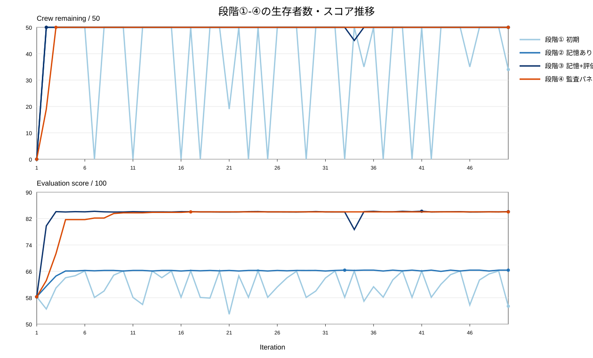
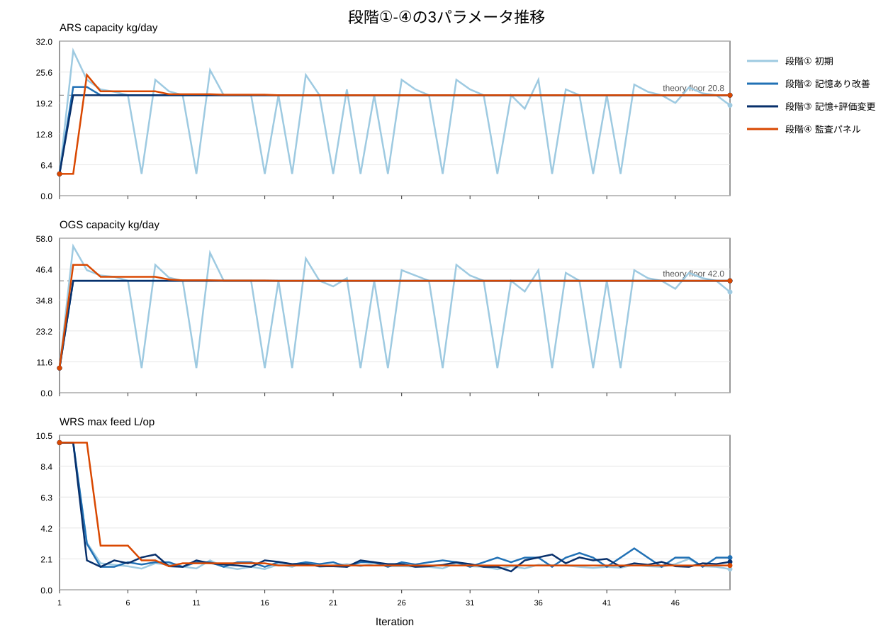
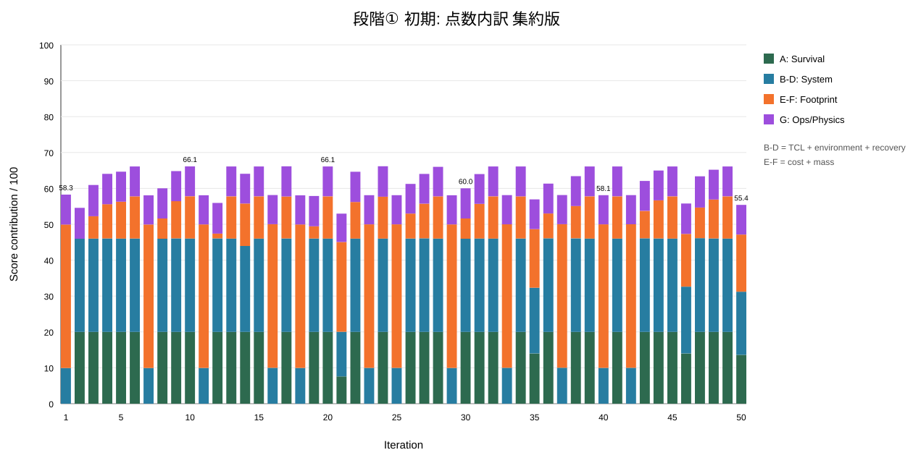
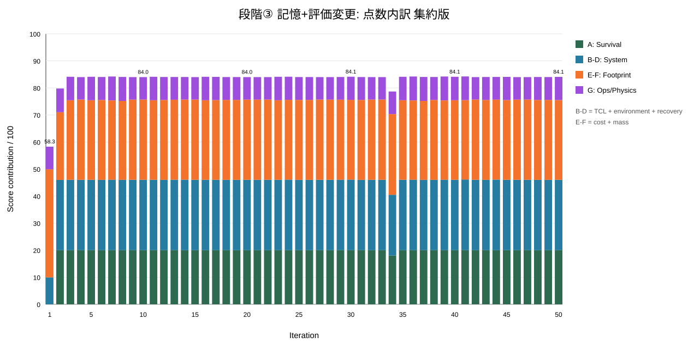

# ECLSS の証拠を解釈する

`summary.json` で backend、actor/design、steps、故障注入、資源の極値・最終値、操作数、提案と評価のパスを確認します。plant_sim は初期・残存・損失乗員数と原因も記録します。保存した実効設定が実際の実験条件です。

## 健全性と正規の観測行

既定の資源境界は、CO₂ の HIGH が 2 kg、CRITICAL が 8 kg、O₂ の LOW が 6 kg、CRITICAL が 1 kg、飲料水の LOW が 50 L、CRITICAL が 25 L です。これはシナリオの要求であり、スクラバーの ppm 境界を変換したものではありません。plant_sim の生存には設定した連続滞在規則と物理的な資源限界を使います。

`telemetry.jsonl` には同一ステップの操作前と `post_ops` が存在する場合があります。評価は `post_ops` があればそれを、なければ同ステップ最後の行を使います。actor 判断の確認には、イベント時点の最初の非 post 行を使います。`events.jsonl` は操作の受理・拒否、busy guard、故障、乗員損失、`messages.jsonl` は議論を記録します。

## 評価の契約

`evaluation.json` が正本の決定論的スコアカードで、現在のスキーマは **2.1** です。`evaluation.html` と `evaluation_browser.html` は表示用です。完全な採点には plant_sim と生存追跡が必要です。mock/ROS2 と評価無効時には適用理由を読みます。物理または証拠整合性の問題は記録を invalid にします。`physics_gate.json` と `run_integrity.json` が補助記録です。

現在の actor ありの満点は 100 点です。

| 軸 | 満点 | 読み方 |
| --- | ---: | --- |
| Actor 生存 | 20 | 残存乗員。実機の認証ではない |
| 最初の乗員損失までの時間（TCL） | 10 | 宣言した観測期間に対する生存 |
| 環境軌跡 | 10 | 実行を通した資源帯の深刻度 |
| 資源回復 | 10 | 最終状態と最悪状態からの回復 |
| 費用 | 20 | 設定した探索用費用モデル |
| 質量 | 20 | 設定した装置質量モデル |
| Actor 判断 | 5 | 応答時間とコマンドの妥当性 |
| 物理応答 | 5 | 妥当な操作に対する観測応答 |

actor なしでは最後の 2 軸を除き 90 点です。未観測の軸があると不完全になる場合があります。比較前に `status`、`scores.complete`、各軸の状態、`scores.applicable_max` を読みます。旧スキーマの点数とは比較できない場合があります。

TCL は観測データを設定された 16 時間の基準で評価し、未来の生存を外挿しません。費用・質量は探索用の容量モデルに基づきます。制約と全員生存の設計目的は合計点と別に確認します。LLM の説明は決定論的合否を決めず、プラントモデル合格も実機での妥当性評価にはなりません。

## 設計と連鎖の記録

`design_proposals.json` は次の設計案、`consumed_proposals.json` は今回の実行前に適用した提案です。`design_history.json`、候補記録、provenance が引き渡しを支えます。`provisional_final` や `requires_supervisor_approval` があれば、理由を読んでから採用します。

連鎖には番号付き実行、`chain_summary.json`、`chain_final_answer.json`、任意のベースライン/最終リプレイが加わります。`IMPROVED` には対比較リプレイの成功が必要ですが、比較値はリプレイの生存数ではなく、番号付き実行で測定した選択設計の生存数と最初の番号付き実行です。同数なら別指標が改善しても `NOT_IMPROVED`、比較証拠が不足すれば `INCONCLUSIVE` です。`unverified_proposals` と選択候補の証拠を確認してください。最後の提案が自動的に検証済みの回答になるわけではありません。[設計の反復](../../guides/design-iterations.md)を参照してください。

## 過去の 4 連鎖記録 — 2026-08-30 { #historical-four-chain-record }

元の実験記録と図を再利用した読解例です。4 つの保存済み chain summary の日付は **2026-08-30 UTC** です。**各段階 1 本の連鎖**で、それぞれ設計 50 ラウンド、各ラウンドは 50 シミュレーションステップです。当時の実行の証拠であり、現在のベンチマーク、制御された因果証明、普遍的なエージェント改善の証明ではありません。

| 保存条件 | 当時の値 |
| --- | --- |
| プラント・乗員 | `plant_sim`、50 人、生存追跡有効 |
| 観測間隔・期間 | 1200 秒、各シミュレーション 50 ステップ |
| 初期 CO₂・O₂・水 | 1.3 kg・8 kg・80 L |
| 運用 | `labeled_rule_base`、サブシステム故障注入なし |
| Designer | vLLM `qwen3.8-27b-uncensored`、生成温度 0.45 |
| 記録した seed | null。独立した複数 seed の研究ではない |
| 評価 schema | **2.0**。段階 3 の前に規模評価の設定を変更 |

元の主要値をそのまま示します。「最終 replay」は記録された最終 replay であり、**選択候補の生存数ではありません**。選択設計、最後の番号付き実行、replay は別の結果を持ちます。

| 記録した指標 | 1: 初期 | 2: + memory | 3: + 採点再調整 | 4: + audit panel |
| --- | ---: | ---: | ---: | ---: |
| 完了ラウンド | 50 | 50 | 50 | 50 |
| 基準 replay 生存数 | 0/50 | 0/50 | 0/50 | 0/50 |
| **最終 replay 生存数** | **34/50** | **50/50** | **50/50** | **50/50** |
| 全員生存ラウンド | 34 | 49 | 48 | 48 |
| 生存 0 人のラウンド | 12 | 1 | 1 | 1 |
| 完全な設計提案 | 38/50 | 50/50 | 50/50 | 50/50 |
| 異なる設計数 | 39 | 11 | 17 | 9 |
| 最高点 | 66.18 | 66.36 | 84.23 | 84.03 |
| 平均点 | 61.71 | 65.94 | 83.34 | 82.59 |
| 最終点 | 55.41 | 66.36 | 84.08 | 84.03 |

!!! warning "過去の採点基準は途中で変わっている"
    保存 schema はすべて 2.0 ですが、段階 1–2 と 3–4 は費用・質量の採点基点が異なります。約 66 点から 84 点への上昇は、同じ物差しで 18 点ハードウェアが改善したことではありません。段階 3 と 4 は同じ採点基準です。現在の schema 2.1 とも、評価器と全設定を確認せずに直接比較しないでください。



上の生存パネルと下の点数パネルを分けて読みます。記録では memory とともに崩壊が減り、audit 段階の異なる設計数は減っています。各段階 1 本で処理の変更も複数あるため、memory や audit の因果効果を単独に特定できません。

### 提案値と適用値を区別する

元の段階 1 の例は状態継承の失敗です。

```text
round 24: ARS=20.8  OGS=42.0  WRS=1.8  → 50/50 alive, 66.18
partial WRS-only proposal
next run: ARS=4.5  OGS=9.25           → 0/50
```

現在の引き渡しは、提案で省略した容量を適用済み設計から補完します。この過去の失敗は今日のマージ動作ではありません。CSV の `config_ars`・`config_ogs`・`config_wrs` は実際に動かした装置、`proposal_ars`・`proposal_ogs`・`proposal_wrs` は渡した案です。提案の空欄は容量 0 の測定値ではありません。



元の記録は計算した下限で探索を導き、段階 4 は項目別 veto の audit panel を使いました。その後の測定下限や監査の変更とは異なります。古い下限や監査挙動を現在の契約にしないでください。

### 採点変更を成分から読む

段階 1–2 は生存できない基準装置に規模評価の満点を置き、段階 3–4 はその基点を移しました。次の元の図は当時の集約ラベルと値を保持しています。





| 規模評価の設定 | 段階 1–2 | 段階 3–4 |
| --- | --- | --- |
| 費用の満点基点 | ベースライン | 500 MUSD |
| 費用の 0 点基点 | 750 MUSD | 900 MUSD |
| 質量の満点基点 | ベースライン | 3400 kg |
| 質量の 0 点基点 | 5000 kg | 6000 kg |

点数は設計の変更でも評価器の変更でも、その両方でも変わります。図からは、単一の点数に加えて物理量と生存数を残す理由が分かります。

### 保存証拠をたどる

完全な説明は[元の実験記録](https://github.com/hirototamura/engineering_agents/blob/648237d8596462362b5772914242a3881f82ad35/docs/ja/results.md)を参照してください。[4 段階の summary JSON](https://raw.githubusercontent.com/hirototamura/engineering_agents/648237d8596462362b5772914242a3881f82ad35/docs/data/ssos_three_way_comparison_summary.json)と[ラウンド別データ](https://github.com/hirototamura/engineering_agents/tree/648237d8596462362b5772914242a3881f82ad35/docs/data/)が値を保持し、各 `phaseN_iteration_metrics.csv` は 50 行・54 列です。[元の実行アーカイブ](https://github.com/hirototamura/engineering_agents/tree/648237d8596462362b5772914242a3881f82ad35/experiments/eclss/runs/)には入力と各回の評価があります。リンクはここで使った元リビジョンを固定しています。この文書のための再実験・図の再生成は行っていません。
